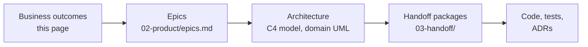
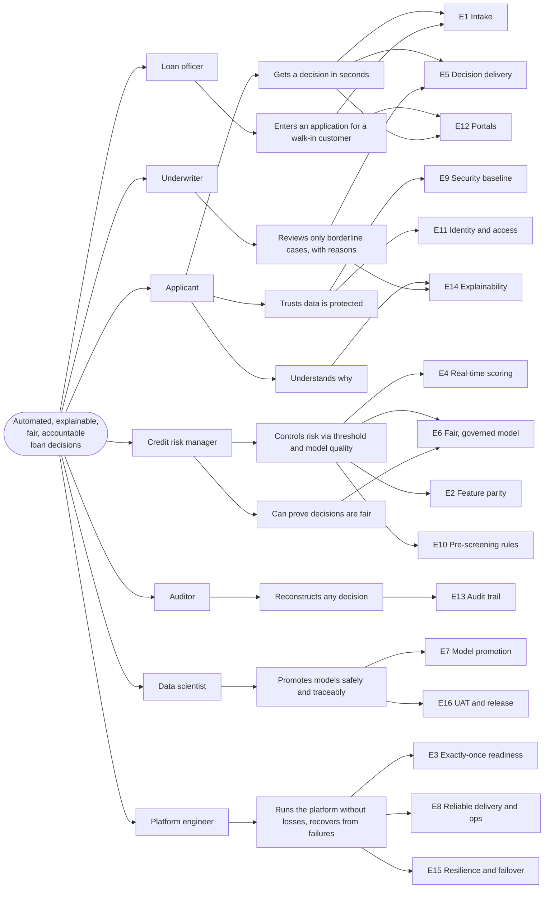

# Business outcomes

This is the top of the documentation chain. Every epic in [`../02-product/epics.md`](../02-product/epics.md) traces back to an outcome on this page, and every handoff package in [`../03-handoff/`](../03-handoff/README.md) traces back to an epic.

## 1. Problem

A consumer lender assesses loan applications manually. Credit analysts read the application, pull the bureau report, look at the customer's history with the lender and decide. This is:

- **slow**: days to weeks per application;
- **inconsistent**: two analysts can decide differently on the same file;
- **hard to scale**: volume growth needs more analysts;
- **hard to audit**: the reasons for a decision live in an analyst's head.

## 2. Goal

> Decide most consumer loan applications automatically, within seconds of submission, with a risk-based, explainable and fair decision. Route only borderline cases to a human.
>
> Applications arrive through two channels: **lender staff** (loan officers at branches and points of sale) enter them for walk-in customers, and **applicants** apply online themselves. Every person signs in, can do only what their role allows, and every decision and every access to personal data can be reconstructed afterwards.

## 3. Outcomes and KPIs

Baselines are what the repository measures **today** (2026-11-21; O5–O8 security, audit and release rows added 2026-11-22). Targets are proposals for the next 6–8 weeks of work and should be confirmed by whoever owns credit policy.

| ID | Outcome | KPI | Baseline today | Target | How it is measured |
|---|---|---|---|---|---|
| **O1** | Applicants get a decision fast | p95 time from submission to a decision the applicant can read | **No decision is ever returned** (no consumer of `hc.scoring`, F-04). Pipeline-only E2E p95 3.4 s at 5 RPS | p95 ≤ 15 s from `POST /applications` to `GET /status` returning a final state | Load test: insert timestamp vs. status-log timestamp |
| **O2** | Decisions are consistent | % of decisions stored with model version, feature version, score and reason code | 0% (decisions are not stored) | 100% | Query `application_status_log` |
| **O2** | | % of applications with a decision or an explicit under-review state | Unknown; silent drops are possible (F-06, F-15) | 100%: every application ends in approve, reject or under-review | Reconciliation job: submitted vs. decided |
| **O3** | Lend to good risks, decline bad ones | Model discrimination (AUC on held-out data) | ≈ 0.77 | ≥ current production − 0.005 (no regression), floor 0.72 | Model gate at registration |
| **O3** | | Threshold chosen from an explicit cost matrix | 0.3 chosen informally | Documented expected-loss rationale | Threshold policy document |
| **O4** | Fair lending | Protected attributes used as model inputs | `CODE_GENDER` is an input | None | Feature catalog check in CI |
| **O4** | | Disparate impact ratio of approval rates (female vs. male) | Not measured | ≥ 0.80 (four-fifths rule), investigated if lower | Offline bias audit per model version |
| **O5** | Scale without losing applications | Sustained submission rate with ≥ 99% decided within the O1 SLO | 29 RPS inserted, only 17.5% scored within a 3-minute window | ≥ 30 RPS sustained for 10 min, ≥ 99% within SLO, 0 silent losses | `run_e2e_load_test.sh` |
| **O6** | Ship model improvements safely | Manual steps between "promote in MLflow" and "serving traffic" | 0 (automated) | 0, plus traceability: model → git commit → data snapshot, and rollback by re-promoting | MLflow tags; serving watcher logs |
| **O5** | | Applications lost or auto-approved when one component fails | Unknown; single replicas, Kafka RF 1, no drills | 0 lost, 0 auto-approved: every affected application ends in `manual_review` or is decided after recovery | Monthly failover drill (E15) |
| **O5** | | Recovery of the operational database | No backups | RPO ≤ 5 min, RTO ≤ 15 min, restore rehearsed | Restore drill (E15) |
| **O6** | | Releases that pass the go/no-go checklist with evidence, including UAT sign-off | No checklist, no UAT | 100% | [`release/checklist.md`](../release/checklist.md) (E16) |
| **O7** | Protect applicant data | People who can call the API without signing in | Anyone on the network (F-17); credentials were committed | Nobody: staff sign in with MFA, applicants with a verified account, services with client credentials | Integration tests; Keycloak realm settings (E11) |
| **O7** | | API actions covered by an allow and a deny test per role | 0% | 100% of the permission matrix, including cross-applicant (IDOR) and separation-of-duties cases | Authorization test suite (E11) |
| **O7** | | Known high-severity findings at release | Not scanned | 0 open: gitleaks, SAST, dependency and image scans, ZAP baseline | Release checklist (E9, E16) |
| **O8** | Decisions are explainable and accountable | Adverse or under-review decisions that carry principal reasons the applicant and the reviewer can read | 0% (no reasons are produced) | 100%, from model attributions (SHAP), never from protected features | Query decisions without reason codes (E14) |
| **O8** | | Time for an auditor to reconstruct one decision: who submitted, data used, model and feature-set version, score, reasons, any override and who made it | Not possible | ≤ 5 min from the audit view | Audit drill (E13) |
| **O8** | | Manual overrides recorded with the reviewer's identity and a reason | Not possible (no review flow) | 100%; audit log append-only and tamper-evident | Daily hash-chain verification (E13) |

## 4. Stakeholders

| Role | Who | Interest | Main outcomes |
|---|---|---|---|
| Applicant | Customer applying online (self-service) | Fast, fair answer with reasons; data protected | O1, O4, O7, O8 |
| Loan officer | Lender staff at a branch or point of sale, entering applications for walk-in customers | Quick entry, immediate decision, only their branch's files | O1, O7 |
| Underwriter | Credit operations staff working the manual-review queue | Clear borderline cases with reasons; cannot review their own submissions | O1, O2, O8 |
| Credit risk manager | Owns credit policy | Loss rate, threshold, model quality; changes approved by a second person | O3, O4, O6 |
| Compliance / auditor | Second and third line of defence | Fairness evidence, explanations, a complete and tamper-evident audit trail | O4, O8 |
| Data scientist | Trains and compares models | Train, compare, promote without platform friction | O3, O6 |
| Platform engineer / IAM admin | Runs the platform and manages identities | Reliable, observable, recoverable; least privilege | O5, O6, O7 |

## 5. Impact map

How each outcome is reached, through which actor, by which epic.

## 6. Constraints and assumptions

- **Data.** The Kaggle *Home Credit Default Risk* dataset stands in for both the lender's history and the credit bureau (307,511 applications, 8.1% default). An applicant's `sk_id_curr` must exist in that data for history and bureau features to be found.
- **Regulation.** Credit decisions must not use protected attributes such as gender, and adverse decisions need a reason. Human review must exist for borderline cases. (NIST AI RMF 1.0, MEASURE 2.11; see ADR log for decisions taken.)
- **Infrastructure.** Single-node Minikube (20 CPU, 24 GB). Today: single Kafka broker with RF 1 and single database instances. E15 adds replicas and failover inside the cluster, but a node failure still takes everything down. This is a portfolio platform, not a production deployment, and the docs say so where it matters.
- **Identity.** Keycloak runs in the cluster with two realms: `staff` (no self-registration, MFA required) and `customers` (self-registration, verified email). Applicant identities and staff identities never share a realm.
- **Explanations.** Reason codes describe how the model weighed the inputs (SHAP attributions). They are not causal claims, and they are never built from protected attributes.
- **Decision semantics.** The model outputs P(default). Higher means riskier.
- **Processing-time assumption.** A decision within one day is already competitive with partly manual processes; the O1 target of seconds is the product differentiator.
- **Pre-screening.** Hard eligibility rules (age, affordability, contactability) are described in [`business-constraints.md`](business-constraints.md) and are not implemented yet (E10).

## 7. Non-goals

- Pricing, limit setting or collections.
- Real credit-bureau integration (simulated by ClickHouse tables).
- OCR or document content analysis (documents are stored but not read).
- Multi-region deployment and node-level high availability.
- Per-user OAuth for third parties, or federation with a corporate directory (the `staff` realm stands in for it).

## Related

- [`business-constraints.md`](business-constraints.md): proposed pre-screening rules (E10)
- [`data-definition.md`](data-definition.md): which features come from the applicant and which are derived
- [`../02-product/epics.md`](../02-product/epics.md): epics, user stories, acceptance criteria
