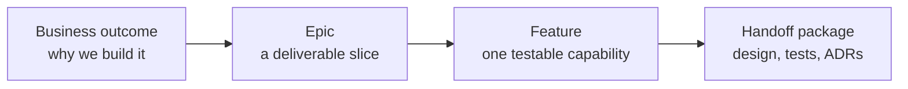
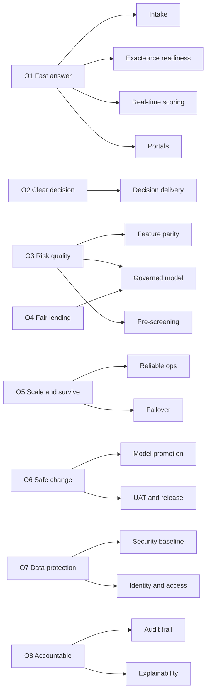

# Business outcomes

This is the top of the documentation chain, and it describes the **target state**: what the platform delivers when it is finished. It does not describe what is built today. Progress is tracked in the [handoff packages](../03-handoff/README.md) and the [findings log](../architecture/c4/docs/07-findings.md).

Read it as three questions. **Why** (outcome), **what** (epic), **how we know it works** (feature with acceptance criteria).

## 1. The goal in one sentence

> A person applies for a consumer loan and gets a fair, explainable decision in seconds. Only borderline cases go to a human, and every decision can be traced afterwards.

Applications arrive through two channels: **loan officers** enter them for walk-in customers, and **applicants** apply online. Everyone signs in, and everyone can do only what their role allows.

## 2. Why: the problem today's lenders have

A manual process is **slow** (days), **inconsistent** (two analysts decide differently), **hard to scale** (volume needs headcount) and **hard to audit** (reasons live in a person's head).

## 3. The eight outcomes

Each outcome has a code ([O1 Fast answer](#o1-applicants-get-an-answer-fast) to [O8](#o8-decisions-are-explainable-and-accountable)). The [epics](../02-product/epics.md) say how it is reached, and each epic's features say how we know it works. Targets are proposals; the owner of credit policy confirms them.

### O1. Applicants get an answer fast

An applicant, or a loan officer with a customer at the desk, should not wait days. A decision that arrives in seconds is the product's main advantage over a manual process.

- **How we know:** 95% of applications show a final status within 15 seconds.
- **Reached by:** [E1 Intake](../02-product/epics.md#e1-application-intake-and-document-capture), [E3 Exactly-once readiness](../02-product/epics.md#e3-exactly-once-application-readiness), [E4 Real-time scoring](../02-product/epics.md#e4-real-time-scoring), [E12 Portals](../02-product/epics.md#e12-staff-and-applicant-portals)

### O2. Every application ends in a clear decision

No application may stall or disappear. Each one ends as approved, rejected or under review, and the decision is stored with what produced it.

- **How we know:** 100% end in one of those three states, each stored with model version, score and reason.
- **Reached by:** [E5 Decision delivery](../02-product/epics.md#e5-decision-delivery-and-status-tracking)

### O3. We lend to good risks and decline bad ones

The model has to separate people who will repay from those who will not, and the cut-off between approve and decline needs a reason someone can read.

- **How we know:** Model quality (AUC) never drops below the current production model, and the cut-off has a written expected-loss rationale.
- **Reached by:** [E2 Feature parity](../02-product/epics.md#e2-feature-engineering-with-trainingserving-parity), [E6 Governed model](../02-product/epics.md#e6-fair-governed-credit-model), [E10 Pre-screening](../02-product/epics.md#e10-pre-screening-business-rules)

### O4. Lending is fair

A credit decision must not depend on a protected attribute such as gender, and the platform should show evidence that groups are treated alike.

- **How we know:** No protected attribute is a model input, and the approval-rate ratio between groups is at least 0.80 or is investigated.
- **Reached by:** [E6 Governed model](../02-product/epics.md#e6-fair-governed-credit-model)

### O5. The platform scales and survives failures

Volume grows and components fail. Neither may lose an application or approve one by default.

- **How we know:** 30 applications per second for 10 minutes with at least 99% decided in time; a failed component loses nothing and approves nothing; restore within 15 minutes.
- **Reached by:** [E8 Reliable ops](../02-product/epics.md#e8-reliable-delivery-and-operations), [E15 Resilience and failover](../02-product/epics.md#e15-resilience-and-failover)

### O6. Model and platform changes ship safely

A new model or release should be traceable, reviewed and reversible, not a surprise.

- **How we know:** Every serving model traces to its code and data, and every release passes a go/no-go checklist with evidence.
- **Reached by:** [E7 Model promotion](../02-product/epics.md#e7-automated-traceable-model-promotion), [E16 UAT and release](../02-product/epics.md#e16-uat-and-release-readiness)

### O7. Applicant data is protected

People hand over their identity and income. Only people with a reason may see it, and only after signing in.

- **How we know:** Nobody uses the API without signing in, staff use MFA, and no high-severity finding is open at release.
- **Reached by:** [E9 Security baseline](../02-product/epics.md#e9-security-baseline), [E11 Identity and access](../02-product/epics.md#e11-identity-and-access)

### O8. Decisions are explainable and accountable

An applicant is owed the main reasons, and an auditor must be able to rebuild any decision and see who changed it.

- **How we know:** Every non-approval carries readable reasons, an auditor rebuilds any decision in five minutes, and every override records who and why.
- **Reached by:** [E13 Audit trail](../02-product/epics.md#e13-audit-trail), [E14 Explainability](../02-product/epics.md#e14-explainability)

## 4. Who benefits

| Role | What they get | Outcomes |
|---|---|---|
| Applicant | A quick, fair answer with reasons, and protected data | [O1 Fast answer](#o1-applicants-get-an-answer-fast), [O4](#o4-lending-is-fair), [O7](#o7-applicant-data-is-protected), [O8](#o8-decisions-are-explainable-and-accountable) |
| Loan officer | Fast entry for walk-in customers, only their branch's files | [O1 Fast answer](#o1-applicants-get-an-answer-fast), [O7](#o7-applicant-data-is-protected) |
| Underwriter | A clear queue of borderline cases; cannot review their own work | [O1 Fast answer](#o1-applicants-get-an-answer-fast), [O2](#o2-every-application-ends-in-a-clear-decision), [O8](#o8-decisions-are-explainable-and-accountable) |
| Credit risk manager | Control of the threshold and model quality; changes need a second approver | [O3 Risk quality](#o3-we-lend-to-good-risks-and-decline-bad-ones), [O4](#o4-lending-is-fair), [O6](#o6-model-and-platform-changes-ship-safely) |
| Compliance and auditor | Fairness evidence and a tamper-evident trail | [O4 Fair lending](#o4-lending-is-fair), [O8](#o8-decisions-are-explainable-and-accountable) |
| Data scientist | Train, compare and promote models without friction | [O3 Risk quality](#o3-we-lend-to-good-risks-and-decline-bad-ones), [O6](#o6-model-and-platform-changes-ship-safely) |
| Platform engineer | A reliable, observable, recoverable platform with least privilege | [O5 Scale and survive](#o5-the-platform-scales-and-survives-failures), [O6](#o6-model-and-platform-changes-ship-safely), [O7](#o7-applicant-data-is-protected) |

## 5. From outcome to epic

Each outcome is reached by a few epics. The full list of features sits in [`epics.md`](../02-product/epics.md).

## 6. Boundaries

- **Data.** The Kaggle *Home Credit Default Risk* data stands in for the lender's history and the credit bureau.
- **Rules.** Decisions must not use protected attributes, adverse decisions need a reason, and borderline cases get human review (NIST AI RMF 1.0, MEASURE 2.11).
- **Scope of the platform.** A portfolio-grade platform on one machine. High availability covers a failing component, not a failing node.
- **Explanations** describe how the model weighed its inputs. They are not causal claims.
- **Eligibility rules** (age, affordability) are described in [`business-constraints.md`](business-constraints.md).

## 7. Out of scope

Pricing and limits, collections, a real credit bureau, reading document contents, multi-region deployment, and third-party OAuth.

## Related

- [`business-constraints.md`](business-constraints.md): eligibility rules
- [`data-definition.md`](data-definition.md): which features come from the applicant and which are derived
- [`../02-product/epics.md`](../02-product/epics.md): epics and features
