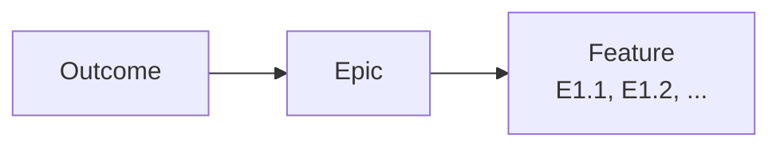

# Epics and features

An **epic** is a deliverable slice that serves one or more [business outcomes](../01-business/business-outcomes.md). A **feature** is one testable capability inside an epic, written with its acceptance criteria. This page describes the **target state**. What is built today is tracked in the [handoff packages](../03-handoff/README.md) and the [findings log](../architecture/c4/docs/07-findings.md).

## 1. Outcomes, epics and what each delivers

| Outcome | Epic | In one line | Handoff |
|---|---|---|---|
| [O1 Fast answer](../01-business/business-outcomes.md#o1-applicants-get-an-answer-fast) | [E1 Intake](#e1-application-intake-and-document-capture) | An application and its documents are captured once, by staff or by the applicant | |
| | [E3 Exactly-once readiness](#e3-exactly-once-application-readiness) | Each application is scored once, after all its data has arrived | [E3](../03-handoff/E3-exactly-once-readiness.md) |
| | [E4 Real-time scoring](#e4-real-time-scoring) | A ready application is scored within seconds under load | |
| | [E12 Portals](#e12-staff-and-applicant-portals) | Staff and applicants use two web apps | [E12](../03-handoff/E12-portals.md) |
| [O2 Clear decision](../01-business/business-outcomes.md#o2-every-application-ends-in-a-clear-decision) | [E5 Decision delivery](#e5-decision-delivery-and-status-tracking) | Every decision is stored and visible to the applicant and reviewers | [E5](../03-handoff/E5-decision-delivery.md) |
| [O3 Risk quality](../01-business/business-outcomes.md#o3-we-lend-to-good-risks-and-decline-bad-ones) | [E2 Feature parity](#e2-feature-engineering-with-trainingserving-parity) | The model sees the same features in training and serving | [E2](../03-handoff/E2-feature-catalog-and-parity.md) |
| | [E6 Governed model](#e6-fair-governed-credit-model) | The model is reproducible, documented and checked before it can serve | [E6](../03-handoff/E6-fair-governed-model.md) |
| | [E10 Pre-screening](#e10-pre-screening-business-rules) | Clearly ineligible applications are declined early, with a reason | |
| [O4 Fair lending](../01-business/business-outcomes.md#o4-lending-is-fair) | [E6 Governed model](#e6-fair-governed-credit-model) | No protected input; fairness evidence per version | [E6](../03-handoff/E6-fair-governed-model.md) |
| [O5 Scale and survive](../01-business/business-outcomes.md#o5-the-platform-scales-and-survives-failures) | [E8 Reliable ops](#e8-reliable-delivery-and-operations) | Nothing is lost silently, and telemetry proves it | |
| | [E15 Resilience and failover](#e15-resilience-and-failover) | One failing component loses nothing and approves nothing | [E15](../03-handoff/E15-resilience-failover.md) |
| [O6 Safe change](../01-business/business-outcomes.md#o6-model-and-platform-changes-ship-safely) | [E7 Model promotion](#e7-automated-traceable-model-promotion) | Promotion is automatic and traceable to code and data | |
| | [E16 UAT and release](#e16-uat-and-release-readiness) | A release ships only with sign-off and evidence | [E16](../03-handoff/E16-uat-release.md) |
| [O7 Data protection](../01-business/business-outcomes.md#o7-applicant-data-is-protected) | [E9 Security baseline](#e9-security-baseline) | Secrets stay out of git; the edges are protected | [E9](../03-handoff/E9-security-baseline.md) |
| | [E11 Identity and access](#e11-identity-and-access) | Every caller is identified, and the API decides what they may do | [E11](../03-handoff/E11-identity-access.md) |
| [O8 Accountable](../01-business/business-outcomes.md#o8-decisions-are-explainable-and-accountable) | [E13 Audit trail](#e13-audit-trail) | Who did what, when, can be rebuilt and cannot be altered | [E13](../03-handoff/E13-audit-trail.md) |
| | [E14 Explainability](#e14-explainability) | Each decision carries readable reasons | [E14](../03-handoff/E14-explainability.md) |

## 2. Delivery order

Dependencies decide the order. A feature that needs another is built after it.

- [E6 Governed model](#e6-fair-governed-credit-model) needs [E2](#e2-feature-engineering-with-trainingserving-parity)'s catalog to remove protected inputs consistently.
- [E5 Decision delivery](#e5-decision-delivery-and-status-tracking) needs [E3](#e3-exactly-once-application-readiness), otherwise duplicate scoring creates duplicate decisions.
- [E14 Explainability](#e14-explainability) needs [E6](#e6-fair-governed-credit-model), so no reason is ever built from a protected attribute.
- [E13 Audit trail](#e13-audit-trail) needs [E11](#e11-identity-and-access), because an audit event without a verified actor is worthless.
- [E12 Portals](#e12-staff-and-applicant-portals) needs [E11](#e11-identity-and-access), [E5](#e5-decision-delivery-and-status-tracking) and [E14](#e14-explainability): the portals show who you are, the decision and its reasons.
- [E16 UAT and release](#e16-uat-and-release-readiness) goes last, because UAT and the go/no-go checklist exercise everything else.

| Wave | Epics | Done when |
|---|---|---|
| 1 | [E9 Security baseline](#e9-security-baseline), [E2](#e2-feature-engineering-with-trainingserving-parity), [E3](#e3-exactly-once-application-readiness) | Catalog and parity tests pass; no tracked secrets |
| 2 | [E6 Governed model](#e6-fair-governed-credit-model), [E5](#e5-decision-delivery-and-status-tracking), [E11](#e11-identity-and-access) | A model without protected inputs is registered; decisions are recorded; every API call is authenticated and authorised |
| 3 | [E13 Audit trail](#e13-audit-trail), [E14](#e14-explainability), [E7](#e7-automated-traceable-model-promotion) | Audit trail and reasons on every decision |
| 4 | [E12 Portals](#e12-staff-and-applicant-portals), [E4](#e4-real-time-scoring), [E8](#e8-reliable-delivery-and-operations), [E15](#e15-resilience-and-failover) | Both portals work; the failover drill passes |
| 5 | [E16 UAT and release](#e16-uat-and-release-readiness) | UAT is signed off; the go/no-go checklist is complete |

[E10 Pre-screening](#e10-pre-screening-business-rules) follows once credit policy confirms the rules.

---

## E1. Application intake and document capture

**Goal.** An application and its documents are captured once, either by a loan officer for a walk-in customer or by the applicant online, and the platform has everything it needs to decide.

| Feature | Acceptance criteria |
|---|---|
| **E1.1** As an applicant I submit my application so that it can be assessed | **Given** a valid payload **when** I POST it **then** I get `201` with `status=submitted`, and exactly one change event appears on `hc.applications.public.loan_applications` |
| **E1.2** As an applicant I upload my ID and payslip | **Given** a supported file type **when** I request a presigned URL and upload **then** the object exists under `{sk_id_curr}/{folder}/` and its `document_id_N` is stored on the application |
| **E1.3** As a loan officer I enter an application for a walk-in customer | **Given** I am signed in to the staff portal **when** I submit **then** the application stores `channel=staff`, my user id as `created_by_sub` and my `branch_id` |
| **E1.4** As the platform I publish each application exactly once | **Given** an application is committed **then** only Debezium publishes it; the API has no Kafka producer |

## E2. Feature engineering with training–serving parity

**Goal.** The model sees the same features, computed the same way, in training and in serving.

| Feature | Acceptance criteria |
|---|---|
| **E2.1** As a data scientist I declare each feature once | **Given** the feature definitions and a versioned feature set **then** Feast views and the Flink sink column list are generated from the definitions, training inputs come from the set (built: `legacy-v1`), and CI fails if any of them disagree |
| **E2.2** As a risk owner I trust serving values match training values | **Given** a golden set of 50 applicants **when** features are computed by the training path and the serving path **then** every feature matches within 1e-6, and `DAYS_EMPLOYED ≤ 0` or `= 365243` |
| **E2.3** As a platform engineer I get bureau features in bounded time | **Given** 30 RPS **then** the ClickHouse bureau lookup p95 stays under 50 ms (tables ordered by `SK_ID_CURR`) |

## E3. Exactly-once application readiness

**Goal.** Each application is scored exactly once, after all three feature groups are in the online store, or is explicitly flagged when they never arrive.

| Feature | Acceptance criteria |
|---|---|
| **E3.1** As the scoring pipeline I receive one readiness event per application | **Given** the three groups arrive in any order, any of them duplicated **then** exactly one `feature_ready` event is published |
| **E3.2** As a reviewer I see applications whose data never completed | **Given** a group is missing 300 s after the first one **then** a `feature_timeout` event is published and the application ends in `under_review` with reason `features_incomplete` |

## E4. Real-time scoring

**Goal.** Score a ready application within the [O1](../01-business/business-outcomes.md#o1-applicants-get-an-answer-fast) budget under [O5](../01-business/business-outcomes.md#o5-the-platform-scales-and-survives-failures) load.

| Feature | Acceptance criteria |
|---|---|
| **E4.1** As the platform I score at the target rate | **Given** 30 RPS for 10 minutes **then** ≥ 99% of applications get a decision event within 15 s, and `hc.scoring.dlq` stays empty |

## E5. Decision delivery and status tracking

**Goal.** Close the loop: every decision is stored, auditable and visible to the applicant and to reviewers.

| Feature | Acceptance criteria |
|---|---|
| **E5.1** As an applicant I check my application status | **Given** my application was scored **when** I call `GET /api/v1/applications/{id}/status` **then** I see `approved`, `rejected` or `under_review`, the decision time and a reason code |
| **E5.2** As a reviewer I work a queue of borderline cases | **Given** a score in the review band (0.25 ≤ p ≤ 0.35) or incomplete features **then** the application appears in the review queue with score, top reasons and model version |
| **E5.3** As compliance I audit any decision | **Given** a decision **then** the stored record holds score, threshold band, model name and version, feature catalog version and event id; re-delivering the same event does not create a second record |

## E6. Fair, governed credit model

**Goal.** A model that is reproducible, documented, free of protected inputs and checked for disparate impact before it can serve.

| Feature | Acceptance criteria |
|---|---|
| **E6.1** As compliance I know no protected attribute is used | **Given** a candidate model **then** registration fails if any catalog feature tagged `protected` is in its inputs |
| **E6.2** As a risk owner I see fairness evidence per version | **Given** a candidate model **then** its MLflow run has `dir_gender` logged; the run is tagged `fairness_review_required` if it is below 0.80 |
| **E6.3** As a data scientist I get the same model from any training entry point | **Given** the same dataset and config **then** CLI, notebook and Kubeflow produce the same feature list and metrics |
| **E6.4** As a reviewer I read a model card | **Given** a registered version **then** `model_card.md` is logged with data window, metrics by slice, threshold rationale and limitations |

## E7. Automated, traceable model promotion

**Goal.** Promotion is automatic and every serving version is traceable to code and data.

| Feature | Acceptance criteria |
|---|---|
| **E7.1** As compliance I trace a serving model to its source | **Given** a serving version **then** its MLflow tags give `git_commit` and `data_snapshot_id`, and the Bento was built from that commit |
| **E7.2** As an engineer I never route to an unready or older version | **Given** a promotion **then** the Sequence is patched only after the new InferenceService is `Ready`, and always to the highest version |

## E8. Reliable delivery and operations

**Goal.** No silent loss anywhere and enough telemetry to prove it.

| Feature | Acceptance criteria |
|---|---|
| **E8.1** As an engineer I never lose an application silently | **Given** a ClickHouse outage **then** messages are retried, then land on a per-stage DLQ with an alert; offsets are committed only after successful produce |
| **E8.2** As an engineer I see end-to-end latency per application | **Given** a submission **then** one trace spans API → consumers → Feast → scoring → decision recorder |

## E9. Security baseline

**Goal.** Applicant data is protected at the edges, and no secrets live in git.

| Feature | Acceptance criteria |
|---|---|
| **E9.1** As the platform I only accept authenticated calls | **Given** no valid credential **when** calling any `/api/v1/*` route **then** `401`; `/health` stays open. People authenticate with Keycloak tokens ([E11 Identity and access](#e11-identity-and-access)); the static API key is kept only for the load-test client |
| **E9.2** As the platform I only allow my own UI cross-origin | **Given** an origin not in `cors_origins` **then** no CORS headers are returned; wildcard origins are rejected at startup |
| **E9.3** As a developer I cannot commit a secret | **Given** a staged file with a credential **then** the gitleaks pre-commit hook blocks the commit |
| **E9.4** As compliance I store no applicant rows in model artifacts | **Given** a registered model **then** its `input_example` is synthetic |

## E10. Pre-screening business rules

**Goal.** Decline clearly ineligible applications before scoring, with an explicit rule reason. Rules and thresholds are in [`business-constraints.md`](../01-business/business-constraints.md); they need confirmation from credit policy before any handoff.

## E11. Identity and access

| | |
|---|---|
| **Serves** | [O7 Data protection](../01-business/business-outcomes.md#o7-applicant-data-is-protected), [O8 Accountable](../01-business/business-outcomes.md#o8-decisions-are-explainable-and-accountable) |
| **Type** | Foundation. [E12 Portals](#e12-staff-and-applicant-portals) and [E13 Audit trail](#e13-audit-trail) cannot work until a verified person is behind every request |
| **Decisions** | [ADR-0012](../adr/0012-keycloak-realms-and-bff-portals.md) Keycloak, two realms, portals as backends-for-frontend · [ADR-0013](../adr/0013-role-based-data-and-explanation-visibility.md) who sees which data · [ADR-0014](../adr/0014-applicant-personal-data-and-opaque-ids.md) personal data and opaque ids (also serves [E1 Intake](#e1-application-intake-and-document-capture) and [E12](#e12-staff-and-applicant-portals)) |
| **Design** | [Handoff package](../03-handoff/E11-identity-access.md) · [How sign-in and permissions work](../architecture/authn-authz.md) |

**Goal.** Every caller is identified, and the API alone decides what they may do.

**How.** Keycloak in the cluster with realms `staff` (MFA, no self-registration, `branch_id` attribute) and `customers` (self-registration, verified email). The API verifies JWTs and asks one policy module, deny by default.

### E11-F1. Sign-in for two kinds of people

Staff sign in with a second factor and cannot register themselves. Applicants register and verify their email. Decision: [ADR-0012](../adr/0012-keycloak-realms-and-bff-portals.md).

| Story | Acceptance criteria | Verified by |
|---|---|---|
| **E11.1** As a loan officer I sign in with MFA | **Given** a staff account without a configured second factor **when** I sign in **then** Keycloak requires TOTP setup before issuing a token | Manual, in UAT ([AC9](../03-handoff/E11-identity-access.md#7-acceptance-criteria--tests)). The API side is automated: [`test_rejected_tokens`](../../tests/unit/api/test_token_verifier.py) has a "staff without mfa" case |
| **E11.2** As an applicant I create my own account | **Given** a new email **when** I register **then** I can apply only after verifying the email | Manual, in UAT. The realm sets `verifyEmail`; no automated test |

### E11-F2. The API trusts only tokens it can verify

Decision: [ADR-0012](../adr/0012-keycloak-realms-and-bff-portals.md).

| Story | Acceptance criteria | Verified by |
|---|---|---|
| **E11.3** As the platform I reject tokens I did not issue | **Given** a token with an unknown issuer, wrong audience, expired, or `alg=none` **then** `401` | [`test_rejected_tokens`](../../tests/unit/api/test_token_verifier.py) (ten cases: wrong key, expired, wrong audience, foreign issuer, no MFA, no role, staff role in the customer realm, `alg=none`, HS256, garbage) and [`test_missing_token_is_401`](../../tests/integration/api/test_access_control.py) |

### E11-F3. Each person can do only what their role allows

One pure function decides, with a rule that names why. Decision: [ADR-0013](../adr/0013-role-based-data-and-explanation-visibility.md).

| Story | Acceptance criteria | Verified by |
|---|---|---|
| **E11.4** As an applicant I see only my own applications | **Given** applicant A's token **when** reading applicant B's application **then** `403`, and the denial is audited | [`test_applicant_reads_own_but_not_others`](../../tests/integration/api/test_access_control.py) and every cell of [`test_matrix`](../../tests/unit/authz/test_permission_matrix.py) |
| **E11.5** As a loan officer I see only my branch | **Given** `branch_id=HN01` **when** reading an application from `HCM02` **then** `403` | [`test_loan_officer_is_limited_to_their_branch`](../../tests/integration/api/test_access_control.py) |
| **E11.6** As an underwriter I cannot review my own work | **Given** I submitted the application (for example while covering a branch) **when** I record a review decision **then** `403 separation_of_duties` | [`test_underwriter_cannot_review_own_submission`](../../tests/integration/api/test_access_control.py) |
| **E11.7** As a risk manager my threshold change needs a second approver | **Given** I propose a new review band **then** it takes effect only after a different risk manager approves it | [`test_policy_change_needs_a_second_risk_manager`](../../tests/integration/api/test_access_control.py) |

## E12. Staff and applicant portals

**Goal.** Two TypeScript web apps replace the Streamlit form: an internal staff portal and a public applicant portal.

**How.** Next.js as a backend-for-frontend: tokens stay on the server, the browser holds only an httpOnly session cookie; CSRF protection on every mutation; CSP and security headers.

| Feature | Acceptance criteria |
|---|---|
| **E12.1** As a loan officer I enter an application and see the decision | **Given** I submit **then** the portal shows `submitted`, then the final state, without a page reload, within the [O1](../01-business/business-outcomes.md#o1-applicants-get-an-answer-fast) SLO |
| **E12.2** As an underwriter I work a queue | **Given** applications in `manual_review` **then** I see them oldest first with score, band and reasons; recording approve or reject requires a reason |
| **E12.3** As an applicant I follow my application | **Given** I applied **then** I see its status and, if rejected or under review, the principal reasons in plain language |
| **E12.4** As an auditor I trace a decision | **Given** an application id **then** I see its full timeline: submission, features version, score, reasons, reviews and who acted |
| **E12.5** As a security reviewer I find no token in the browser | **Given** any portal page **then** no access or refresh token is present in `localStorage`, `sessionStorage` or JavaScript-readable cookies |

## E13. Audit trail

**Goal.** Who did what, to which application, when, and with what result can be reconstructed and cannot be silently altered.

| Feature | Acceptance criteria |
|---|---|
| **E13.1** As an auditor I see every access to personal data | **Given** any read of an application **then** one `audit_event` with actor, action, resource, outcome and trace id exists |
| **E13.2** As an auditor I trust the log was not edited | **Given** the application database role **when** it tries `UPDATE` or `DELETE` on `audit_event` **then** it is refused; the daily hash-chain check passes |
| **E13.3** As an auditor I see why the system decided | **Given** an automated decision **then** its audit event holds model version, feature-set digest, score, band and reason codes |
| **E13.4** As an auditor I see overrides | **Given** an underwriter overrides a band **then** the event records the reviewer, the previous and new state and the mandatory reason |

## E14. Explainability

**Goal.** Each decision carries the principal reasons behind its score, readable by the applicant and the underwriter.

| Feature | Acceptance criteria |
|---|---|
| **E14.1** As an applicant I learn why I was declined | **Given** a reject or under-review decision **then** up to four reason codes from the catalog are shown, ordered by contribution |
| **E14.2** As a risk manager I trust the attributions | **Given** any scored application **then** the sum of SHAP values plus the base value equals the model's log-odds within 1e-4 |
| **E14.3** As compliance I never see a protected attribute as a reason | **Given** any decision **then** no reason code maps to a `protected` definition or a listed proxy |
| **E14.4** As an engineer I keep scoring fast | **Given** 30 RPS **then** scoring p95 with explanations stays within the [O1](../01-business/business-outcomes.md#o1-applicants-get-an-answer-fast) budget |

## E15. Resilience and failover

**Goal.** A single failing component neither loses an application nor approves one by default.

| Feature | Acceptance criteria |
|---|---|
| **E15.1** As a risk manager I never get an automatic approval during an outage | **Given** scoring or the online store is unavailable past the readiness timeout **then** the application goes to `manual_review` |
| **E15.2** As an engineer I survive a broker loss | **Given** 3 Kafka brokers with RF 3 and `min.insync.replicas=2` **when** one broker pod is deleted under load **then** no application is lost |
| **E15.3** As an engineer I survive a database failover | **Given** CloudNativePG with a replica **when** the primary pod is deleted **then** the API recovers within 60 s and no committed application is lost |
| **E15.4** As an engineer I can restore | **Given** a backup **when** restoring to a new cluster **then** data is complete to within 5 minutes (RPO) and the restore takes under 15 minutes (RTO) |
| **E15.5** As an engineer I rehearse | **Given** the chaos drill script **then** it runs monthly in UAT and its report is linked from the release checklist |

## E16. UAT and release readiness

**Goal.** A release ships only after the people who will use it accept it and every go/no-go gate has evidence.

| Feature | Acceptance criteria |
|---|---|
| **E16.1** As a product owner I run UAT with real roles | **Given** the UAT namespace and one test user per role **then** each role's scripted scenarios pass and are signed off in the UAT record |
| **E16.2** As a risk manager I review decisions as an expert | **Given** 50 synthetic applications **then** an SME reviews decisions and reasons, and disagreements are logged and triaged |
| **E16.3** As a release manager I decide go or no-go on evidence | **Given** the [release checklist](../release/checklist.md) **then** every gate links to its evidence (test run, scan report, drill report, sign-off) |

