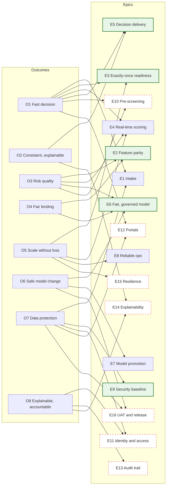
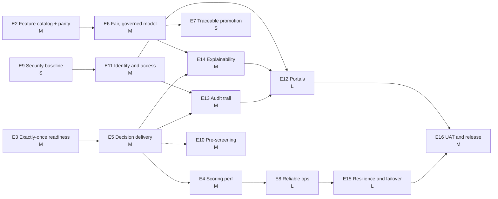

# Epics

Epics break the [business outcomes](../01-business/business-outcomes.md) into deliverable slices. Each epic lists the outcomes it serves, what already exists in the code, the gaps (with finding IDs from [`architecture/c4/docs/07-findings.md`](../architecture/c4/docs/07-findings.md)), user stories and acceptance criteria. Epics marked **Next** have a full handoff package in [`../03-handoff/`](../03-handoff/README.md).

Status: **Built** = works end to end; **Built, defects** = works but a finding breaks an outcome; **Partial** = some stories built; **Not built**.

## 1. Catalogue

| ID | Epic | Outcomes | Status | Findings | Size | Handoff |
|---|---|---|---|---|---|---|
| E1 | Application intake and document capture (staff and self-service) | O1, O7 | Built, defects | F-03, F-05 | S | (part of E5, E11, E12) |
| E2 | Feature engineering with training–serving parity | O3, O4 | Built, defects | F-01, F-02, F-07, F-09, F-13 | M | **Next**: [E2](../03-handoff/E2-feature-catalog-and-parity.md) |
| E3 | Exactly-once application readiness | O1, O5 | Built, defects | F-03, F-06, F-15 | M | **Next**: [E3](../03-handoff/E3-exactly-once-readiness.md) |
| E4 | Real-time scoring | O1, O3, O5 | Built, defects | F-10, F-11 | M | (after E5) |
| E5 | Decision delivery and status tracking | O1, O2 | **Not built** | F-04 | M | **Next**: [E5](../03-handoff/E5-decision-delivery.md) |
| E6 | Fair, governed credit model | O3, O4, O6 | Partial | F-07, F-08 | M | **Next**: [E6](../03-handoff/E6-fair-governed-model.md) |
| E7 | Automated, traceable model promotion | O6 | Built, defects | F-12, F-16 | S | (after E6) |
| E8 | Reliable delivery and operations | O5 | Partial | F-06, F-11, F-13, F-14 | L | (after E3) |
| E9 | Security baseline | O7 | Partial | F-17 | S | **Next**: [E9](../03-handoff/E9-security-baseline.md) |
| E10 | Pre-screening business rules | O3, O1 | Not built | n/a | M | (backlog) |
| E11 | Identity and access | O7, O8 | **Not built** | F-17 | M | [E11](../03-handoff/E11-identity-access.md) |
| E12 | Staff and applicant portals | O1, O7, O8 | Streamlit form only | n/a | L | [E12](../03-handoff/E12-portals.md) |
| E13 | Audit trail | O8 | **Not built** | n/a | M | [E13](../03-handoff/E13-audit-trail.md) |
| E14 | Explainability | O2, O8 | **Not built** | n/a | M | [E14](../03-handoff/E14-explainability.md) |
| E15 | Resilience and failover | O5 | **Not built** | F-06, F-14 | L | [E15](../03-handoff/E15-resilience-failover.md) |
| E16 | UAT and release readiness | O6, O7 | **Not built** | n/a | M | [E16](../03-handoff/E16-uat-release.md) |

## 2. Traceability: outcomes → epics

## 3. Delivery order

Dependencies decide the order:
- E6 needs E2's catalog to remove `CODE_GENDER` consistently.
- E5 needs E3, otherwise duplicate scoring produces duplicate decisions.
- E14 needs E6, so that no reason code is ever built from a protected attribute.
- E13 needs E11, because an audit event without a verified actor is worthless.
- E12 needs E11, E5 and E14: the portals show who you are, the decision and its reasons.
- E16 goes last: UAT and the go/no-go checklist exercise everything else.

| Wave | Epics | Exit |
|---|---|---|
| 1 | E9, E2, E3 | Catalog and parity tests green; no tracked secrets |
| 2 | E6, E5, E11 | Gender-free model registered; decisions recorded; every API call authenticated and authorized |
| 3 | E13, E14, E7 | Audit trail and reason codes on every decision |
| 4 | E12, E4, E8, E15 | Both portals live; failover drill passes |
| 5 | E16 | UAT signed off; go/no-go checklist complete |

E10 follows once credit policy confirms the rules.

---

## E1. Application intake and document capture

**Goal.** An application and its documents are captured once, either by a loan officer for a walk-in customer or by the applicant online, and the platform has everything it needs to decide.

**Built.** Streamlit form, `POST /api/v1/applications`, presigned upload to MinIO, PostgreSQL storage, CDC to Kafka.

**Gaps.** The API also publishes onto the CDC topic (dual write, F-03), with a new producer per request (F-05). No authentication (E11). The application does not record its channel, who entered it, or which branch it belongs to.

| Story | Acceptance criteria |
|---|---|
| As an applicant I submit my application so that it can be assessed | **Given** a valid payload **when** I POST it **then** I get `201` with `status=submitted`, and exactly one change event appears on `hc.applications.public.loan_applications` |
| As an applicant I upload my ID and payslip | **Given** a supported file type **when** I request a presigned URL and upload **then** the object exists under `{sk_id_curr}/{folder}/` and its `document_id_N` is stored on the application |
| As a loan officer I enter an application for a walk-in customer | **Given** I am signed in to the staff portal **when** I submit **then** the application stores `channel=staff`, my user id as `created_by_sub` and my `branch_id` |
| As the platform I publish each application exactly once | **Given** an application is committed **then** only Debezium publishes it; the API has no Kafka producer |

## E2. Feature engineering with training–serving parity

**Goal.** The model sees the same features, computed the same way, in training and in serving.

**Built.** Flink CDC job (applicant features), bureau service + Flink aggregation, DWH service over dbt marts, Feast materialisation.

**Gaps.** `DAYS_EMPLOYED` has the wrong sign at serving (F-01); bureau aggregates are implemented twice (F-02); the model's feature list and the Feast schemas drift apart (F-07); per-applicant ClickHouse lookups are full scans (F-09); Flink has no checkpoints (F-13).

| Story | Acceptance criteria |
|---|---|
| As a data scientist I declare each feature once | **Given** the feature definitions and a versioned feature set **then** Feast views and the Flink sink column list are generated from the definitions, training inputs come from the set (built: `legacy-v1`), and CI fails if any of them disagree |
| As a risk owner I trust serving values match training values | **Given** a golden set of 50 applicants **when** features are computed by the training path and the serving path **then** every feature matches within 1e-6, and `DAYS_EMPLOYED ≤ 0` or `= 365243` |
| As a platform engineer I get bureau features in bounded time | **Given** 30 RPS **then** the ClickHouse bureau lookup p95 stays under 50 ms (tables ordered by `SK_ID_CURR`) |

## E3. Exactly-once application readiness

**Goal.** Each application is scored exactly once, after all three feature groups are in the online store, or is explicitly flagged when they never arrive.

**Built.** Redis Lua completeness set; `hc.feature_ready` event.

**Gaps.** Readiness fires again on every later write (F-03); an application whose group never arrives disappears silently (F-15); the materialiser loses buffered rows on crash (F-06).

| Story | Acceptance criteria |
|---|---|
| As the scoring pipeline I receive one readiness event per application | **Given** the three groups arrive in any order, any of them duplicated **then** exactly one `feature_ready` event is published |
| As a reviewer I see applications whose data never completed | **Given** a group is missing 300 s after the first one **then** a `feature_timeout` event is published and the application ends in `under_review` with reason `features_incomplete` |

## E4. Real-time scoring

**Goal.** Score a ready application within the O1 budget under O5 load.

**Built.** BentoML service on KServe (serverless), Knative KafkaSource → Sequence → KafkaSink.

**Gaps.** A `FeatureStore` is built per request (F-10); `containerConcurrency: 1` and the KafkaChannel limit throughput (F-11).

| Story | Acceptance criteria |
|---|---|
| As the platform I score at the target rate | **Given** 30 RPS for 10 minutes **then** ≥ 99% of applications get a decision event within 15 s, and `hc.scoring.dlq` stays empty |

## E5. Decision delivery and status tracking

**Goal.** Close the loop: every decision is stored, auditable and visible to the applicant and to reviewers.

**Built.** Nothing past `hc.scoring`. The `application_status_log` table exists but nothing writes to it.

| Story | Acceptance criteria |
|---|---|
| As an applicant I check my application status | **Given** my application was scored **when** I call `GET /api/v1/applications/{id}/status` **then** I see `approved`, `rejected` or `under_review`, the decision time and a reason code |
| As a reviewer I work a queue of borderline cases | **Given** a score in the review band (0.25 ≤ p ≤ 0.35) or incomplete features **then** the application appears in the review queue with score, top reasons and model version |
| As compliance I audit any decision | **Given** a decision **then** the stored record holds score, threshold band, model name and version, feature catalog version and event id; re-delivering the same event does not create a second record |

## E6. Fair, governed credit model

**Goal.** A model that is reproducible, documented, free of protected inputs and checked for disparate impact before it can serve.

**Built.** Three training paths (CLI, notebook, Kubeflow), MLflow registry, calibration metrics.

**Gaps.** `CODE_GENDER` is an input (F-07); the Kubeflow path trains on a different feature set, including the ID (F-08); no model card, threshold rationale or bias audit.

| Story | Acceptance criteria |
|---|---|
| As compliance I know no protected attribute is used | **Given** a candidate model **then** registration fails if any catalog feature tagged `protected` is in its inputs |
| As a risk owner I see fairness evidence per version | **Given** a candidate model **then** its MLflow run has `dir_gender` logged; the run is tagged `fairness_review_required` if it is below 0.80 |
| As a data scientist I get the same model from any training entry point | **Given** the same dataset and config **then** CLI, notebook and Kubeflow produce the same feature list and metrics |
| As a reviewer I read a model card | **Given** a registered version **then** `model_card.md` is logged with data window, metrics by slice, threshold rationale and limitations |

## E7. Automated, traceable model promotion

**Goal.** Promotion is automatic and every serving version is traceable to code and data.

**Gaps.** The build uses a feature branch instead of the training commit (F-16); routing can pick the wrong version and there is no readiness gate (F-12).

| Story | Acceptance criteria |
|---|---|
| As compliance I trace a serving model to its source | **Given** a serving version **then** its MLflow tags give `git_commit` and `data_snapshot_id`, and the Bento was built from that commit |
| As an engineer I never route to an unready or older version | **Given** a promotion **then** the Sequence is patched only after the new InferenceService is `Ready`, and always to the highest version |

## E8. Reliable delivery and operations

**Goal.** No silent loss anywhere and enough telemetry to prove it.

**Gaps.** At-most-once consumers (F-06), single points of failure (F-14), tracing collector not deployed.

| Story | Acceptance criteria |
|---|---|
| As an engineer I never lose an application silently | **Given** a ClickHouse outage **then** messages are retried, then land on a per-stage DLQ with an alert; offsets are committed only after successful produce |
| As an engineer I see end-to-end latency per application | **Given** a submission **then** one trace spans API → consumers → Feast → scoring → decision recorder |

## E9. Security baseline

**Goal.** Applicant data is protected at the edges, and no secrets live in git.

**Built (2026-11-21).** Credential files untracked; Compose-era secrets removed from the tree.

| Story | Acceptance criteria |
|---|---|
| As the platform I only accept authenticated calls | **Given** no valid credential **when** calling any `/api/v1/*` route **then** `401`; `/health` stays open. People authenticate with Keycloak tokens (E11); the static API key is kept only for the load-test client |
| As the platform I only allow my own UI cross-origin | **Given** an origin not in `cors_origins` **then** no CORS headers are returned; wildcard origins are rejected at startup |
| As a developer I cannot commit a secret | **Given** a staged file with a credential **then** the gitleaks pre-commit hook blocks the commit |
| As compliance I store no applicant rows in model artifacts | **Given** a registered model **then** its `input_example` is synthetic |

## E10. Pre-screening business rules

**Goal.** Decline clearly ineligible applications before scoring, with an explicit rule reason. Rules and thresholds are in [`business-constraints.md`](../01-business/business-constraints.md); they need confirmation from credit policy before any handoff.

## E11. Identity and access

**Goal.** Every caller is identified, and the API alone decides what they may do.

**Design.** Keycloak in the cluster with realms `staff` (MFA, no self-registration, `branch_id` attribute) and `customers` (self-registration, verified email). The API verifies JWTs and asks one policy module, deny by default.

| Story | Acceptance criteria |
|---|---|
| As a loan officer I sign in with MFA | **Given** a staff account without a configured second factor **when** I sign in **then** Keycloak requires TOTP setup before issuing a token |
| As an applicant I create my own account | **Given** a new email **when** I register **then** I can apply only after verifying the email |
| As the platform I reject tokens I did not issue | **Given** a token with an unknown issuer, wrong audience, expired, or `alg=none` **then** `401` |
| As an applicant I see only my own applications | **Given** applicant A's token **when** reading applicant B's application **then** `403`, and the denial is audited |
| As a loan officer I see only my branch | **Given** `branch_id=HN01` **when** reading an application from `HCM02` **then** `403` |
| As an underwriter I cannot review my own work | **Given** I submitted the application (for example while covering a branch) **when** I record a review decision **then** `403 separation_of_duties` |
| As a risk manager my threshold change needs a second approver | **Given** I propose a new review band **then** it takes effect only after a different risk manager approves it |

## E12. Staff and applicant portals

**Goal.** Two TypeScript web apps replace the Streamlit form: an internal staff portal and a public applicant portal.

**Design.** Next.js as a backend-for-frontend: tokens stay on the server, the browser holds only an httpOnly session cookie; CSRF protection on every mutation; CSP and security headers.

| Story | Acceptance criteria |
|---|---|
| As a loan officer I enter an application and see the decision | **Given** I submit **then** the portal shows `submitted`, then the final state, without a page reload, within the O1 SLO |
| As an underwriter I work a queue | **Given** applications in `manual_review` **then** I see them oldest first with score, band and reasons; recording approve or reject requires a reason |
| As an applicant I follow my application | **Given** I applied **then** I see its status and, if rejected or under review, the principal reasons in plain language |
| As an auditor I trace a decision | **Given** an application id **then** I see its full timeline: submission, features version, score, reasons, reviews and who acted |
| As a security reviewer I find no token in the browser | **Given** any portal page **then** no access or refresh token is present in `localStorage`, `sessionStorage` or JavaScript-readable cookies |

## E13. Audit trail

**Goal.** Who did what, to which application, when, and with what result can be reconstructed and cannot be silently altered.

| Story | Acceptance criteria |
|---|---|
| As an auditor I see every access to personal data | **Given** any read of an application **then** one `audit_event` with actor, action, resource, outcome and trace id exists |
| As an auditor I trust the log was not edited | **Given** the application database role **when** it tries `UPDATE` or `DELETE` on `audit_event` **then** it is refused; the daily hash-chain check passes |
| As an auditor I see why the system decided | **Given** an automated decision **then** its audit event holds model version, feature-set digest, score, band and reason codes |
| As an auditor I see overrides | **Given** an underwriter overrides a band **then** the event records the reviewer, the previous and new state and the mandatory reason |

## E14. Explainability

**Goal.** Each decision carries the principal reasons behind its score, readable by the applicant and the underwriter.

| Story | Acceptance criteria |
|---|---|
| As an applicant I learn why I was declined | **Given** a reject or under-review decision **then** up to four reason codes from the catalog are shown, ordered by contribution |
| As a risk manager I trust the attributions | **Given** any scored application **then** the sum of SHAP values plus the base value equals the model's log-odds within 1e-4 |
| As compliance I never see a protected attribute as a reason | **Given** any decision **then** no reason code maps to a `protected` definition or a listed proxy |
| As an engineer I keep scoring fast | **Given** 30 RPS **then** scoring p95 with explanations stays within the O1 budget |

## E15. Resilience and failover

**Goal.** A single failing component neither loses an application nor approves one by default.

| Story | Acceptance criteria |
|---|---|
| As a risk manager I never get an automatic approval during an outage | **Given** scoring or the online store is unavailable past the readiness timeout **then** the application goes to `manual_review` |
| As an engineer I survive a broker loss | **Given** 3 Kafka brokers with RF 3 and `min.insync.replicas=2` **when** one broker pod is deleted under load **then** no application is lost |
| As an engineer I survive a database failover | **Given** CloudNativePG with a replica **when** the primary pod is deleted **then** the API recovers within 60 s and no committed application is lost |
| As an engineer I can restore | **Given** a backup **when** restoring to a new cluster **then** data is complete to within 5 minutes (RPO) and the restore takes under 15 minutes (RTO) |
| As an engineer I rehearse | **Given** the chaos drill script **then** it runs monthly in UAT and its report is linked from the release checklist |

## E16. UAT and release readiness

**Goal.** A release ships only after the people who will use it accept it and every go/no-go gate has evidence.

| Story | Acceptance criteria |
|---|---|
| As a product owner I run UAT with real roles | **Given** the UAT namespace and one test user per role **then** each role's scripted scenarios pass and are signed off in the UAT record |
| As a risk manager I review decisions as an expert | **Given** 50 synthetic applications **then** an SME reviews decisions and reasons, and disagreements are logged and triaged |
| As a release manager I decide go or no-go on evidence | **Given** the [release checklist](../release/checklist.md) **then** every gate links to its evidence (test run, scan report, drill report, sign-off) |

