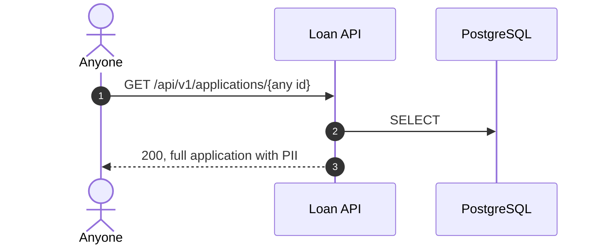
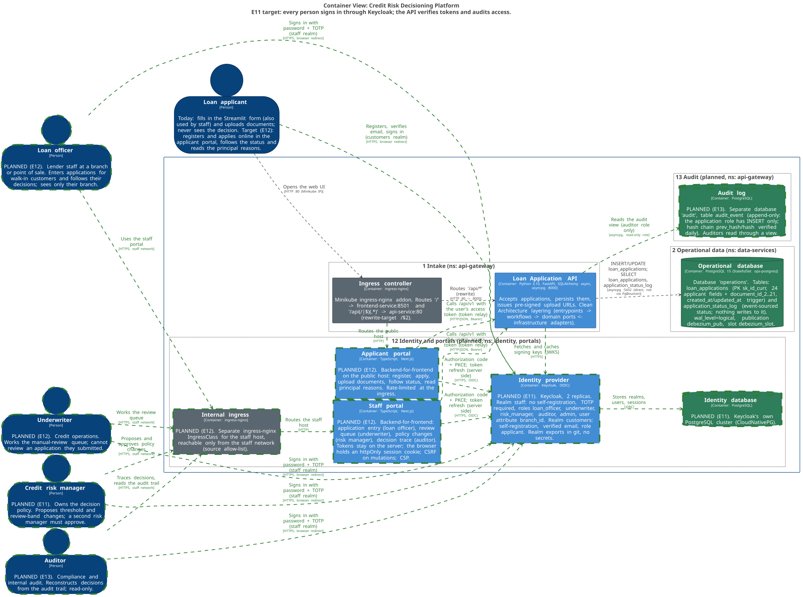
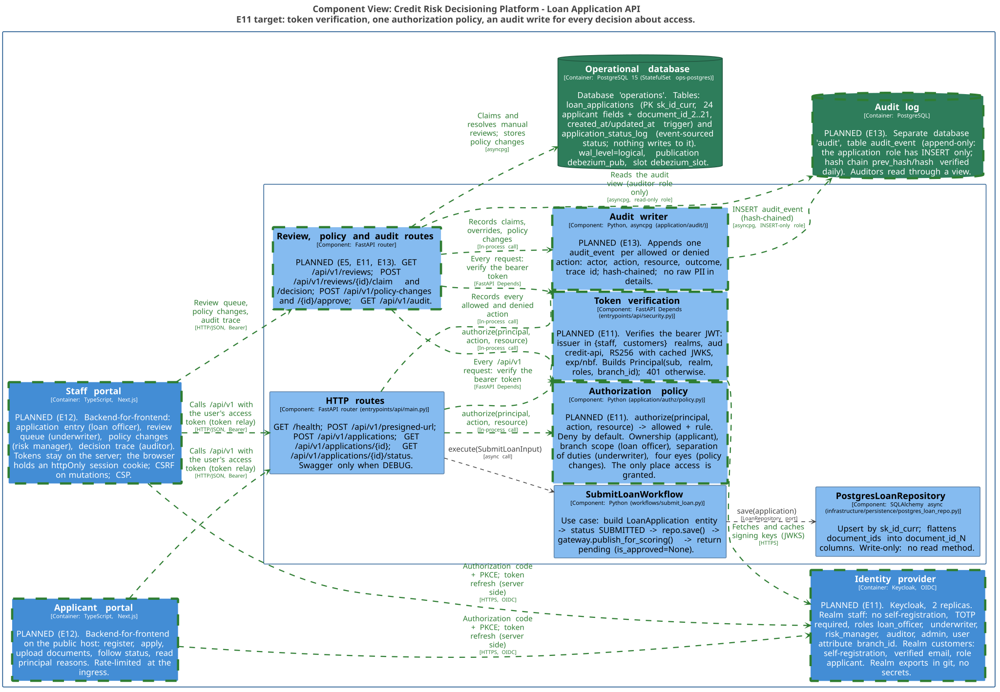
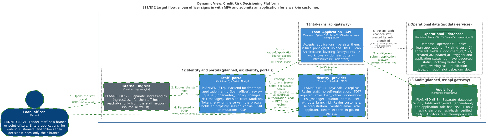
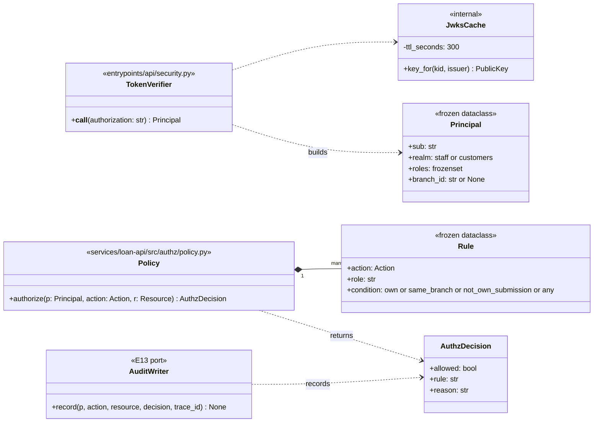
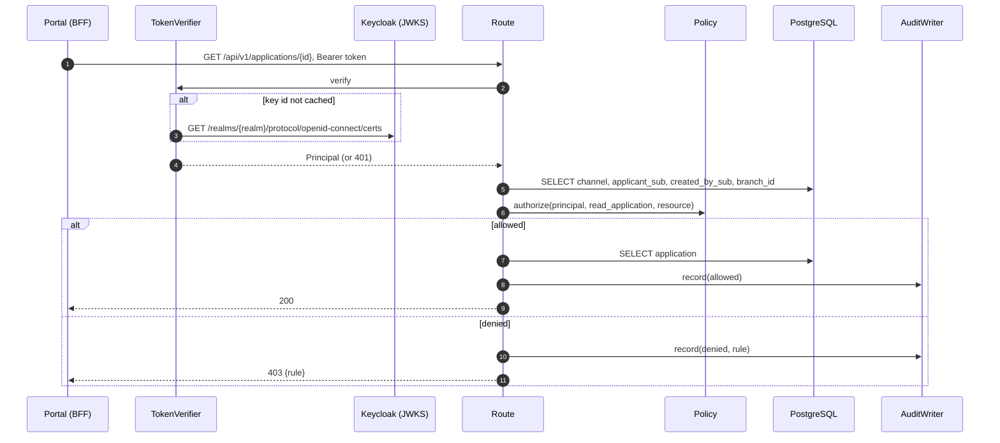

# E11: Identity and access

| Epic | Outcome / KPI | Baseline → target | Size | Depends on |
|---|---|---|---|---|
| [E11](../02-product/epics.md#e11-identity-and-access) | O7 protect applicant data; O8 accountable decisions | Anyone on the network can call every route (F-17) → every call carries a verified identity; 100% of the permission matrix covered by allow and deny tests | M | E9 (secrets hygiene); E5 for the review routes |

## 1. Why

- **No identity.** The API cannot tell who is calling. An applicant can read any other applicant's file by guessing an id. Staff and applicants use the same unauthenticated form.
- **No accountability.** Without a verified actor there is nothing to audit (E13), no separation of duties for manual review, and no way to require a second approver for policy changes.
- **Two populations.** Lender staff and applicants need different sign-in rules (MFA and no self-registration for staff; self-registration with a verified email for applicants). Mixing them in one identity store is how privilege escalation starts.

## 2. Scope

**In**
- **Keycloak** in namespace `identity`, 2 replicas, own PostgreSQL. Realm exports committed under `platform/core/k8s/identity/realms/` with no secrets.
- **Realm `staff`.**
  - No self-registration; TOTP required.
  - Roles `loan_officer`, `underwriter`, `risk_manager`, `auditor`, `admin`; user attribute `branch_id`.
  - Client `staff-portal` (confidential, authorization code + PKCE).
- **Realm `customers`.**
  - Self-registration with a verified email; role `applicant`.
  - Client `applicant-portal` (confidential, authorization code + PKCE).
- **Shared token rules.** Both realms put audience `credit-api` in access tokens and use 5-minute access tokens.
- **API: token verification** (`entrypoints/api/security.py`) builds a `Principal`.
- **API: one policy module** (`services/loan-api/src/authz/policy.py`) used by every route. Deny by default.
- **Migration 004:** ownership columns on `loan_applications`, and the `policy_change` table.
- **Service identities.** Keycloak client credentials for the decision recorder, which calls no API today but is ready for it. The E9 API key stays only for the load-test client.

**Out**
- **Portals:** E12.
- **Audit log storage:** E13. E11 calls the audit writer; until E13 lands, the writer logs to stdout.
- **Federation** with a corporate directory (LDAP/AD); the `staff` realm stands in for it.
- **Fine-grained consent and data-subject requests.**

## 3. Today

As-built view: [`L3-API`](../architecture/c4/docs/images/L3-API.svg). The routes call the workflow and the ORM directly.



## 4. Target design

### 4.1 C4

Container view [`T-E11-Identity-Access`](../architecture/c4/docs/images/T-E11-Identity-Access.svg):



Component view [`T-E11-API-Authz`](../architecture/c4/docs/images/T-E11-API-Authz.svg):



Flow [`T-D11-Staff-Submit`](../architecture/c4/docs/images/T-D11-Staff-Submit.svg):



### 4.2 Module interface (UML)



The policy is pure: no I/O, no framework imports. Routes load the resource (only the fields the policy needs: `channel`, `applicant_sub`, `created_by_sub`, `branch_id`), then call `authorize` before reading anything else. A denied call returns `403` with `{"error": "forbidden", "rule": "<rule id>"}`, and the denial is audited.

### 4.3 Behaviour

See the [portal authentication and API authorization sequence](../../platform/core/k8s/identity/README.md#portal-authentication-and-api-authorization) for browser sign-in, callback, and session handling.

Every protected request goes through the same steps:



The four-eyes rule for policy changes is a state machine: see [domain model §9](../architecture/domain-model.md#9-state-machine-decision-policy-change-four-eyes).

## 5. Data contracts

**Permission matrix.** This is the policy table. Each cell becomes one allow test and at least one deny test. The visibility rules for internal factors and explanations, and the reason loan officers never decide, are in [ADR-0013](../adr/0013-role-based-data-and-explanation-visibility.md).

| Action | applicant | loan_officer | underwriter | risk_manager | auditor | admin |
|---|---|---|---|---|---|---|
| `submit_application` | own (`channel=self`) | own branch (`channel=staff`) | – | – | – | – |
| `read_application` (PII) | own | own branch | applications in `manual_review` | – | via audit trace only | – |
| `read_customer_profile` (internal factors: contracts with us, exposure, repayment, bureau summary) | – | only for an application they handle, after consent is recorded | applications in `manual_review` | – | via audit trace only | – |
| `reveal_identity` (full citizen ID and phone, with an audited reason; [ADR-0014](../adr/0014-applicant-personal-data-and-opaque-ids.md)) | – | only for an application they entered | applications in `manual_review` | – | sees the audited reveal, never the values | – |
| `attach_document` (e.g. payslips during review) | own, while `submitted` or `manual_review` | own branch | – | – | – | – |
| `lookup_customer` (`POST /customers:lookup`, exact citizen ID in the body + purpose) | – | yes; other branches return contract count and status only | – | – | – | – |
| `add_case_note`, `flag_concern` | – | own branch | yes | – | – | – |
| `read_decision` (band, plain-language reasons) | own | own branch | any | any | any | – |
| `read_explanation` (score, contributions, versions) | – | – | applications in `manual_review` | aggregate views only | as recorded | – |
| `claim_review`, `review_decision` | – | – | any **except** `created_by_sub == sub` | – | – | – |
| `propose_policy_change` | – | – | – | yes | – | – |
| `approve_policy_change` | – | – | – | yes, **not** the proposer | – | – |
| `read_audit` | – | – | – | – | yes | – |
| manage users and roles | – | – | – | – | – | in Keycloak only; no API route |

**Access token claims** (both realms)

```jsonc
{
  "iss": "https://auth.credit.local/realms/staff",   // or /realms/customers
  "aud": ["credit-api"],
  "sub": "8f3c…",                                     // stable user id
  "exp": 1795280000,
  "realm_access": {"roles": ["loan_officer"]},
  "branch_id": "HN01",                                // staff only, from a user-attribute mapper
  "acr": "mfa"                                        // staff only; the API rejects staff tokens without it
}
```

**Settings** (`core/config.py`)

| Setting | Example | Note |
|---|---|---|
| `APP_OIDC_ISSUERS` | `https://auth.credit.local/realms/staff,https://auth.credit.local/realms/customers` | allow-list; any other `iss` gets 401 |
| `APP_OIDC_AUDIENCE` | `credit-api` | |
| `APP_OIDC_JWKS_TTL_SECONDS` | `300` | |
| `APP_API_KEYS` | (secret) | load-test client only (E9) |

**Migration `004_ownership_and_policy.sql`**

```sql
ALTER TABLE loan_applications
  ADD COLUMN channel        VARCHAR(10)  NOT NULL DEFAULT 'staff' CHECK (channel IN ('staff','self')),
  ADD COLUMN created_by_sub VARCHAR(64),
  ADD COLUMN applicant_sub  VARCHAR(64),
  ADD COLUMN branch_id      VARCHAR(16);
CREATE INDEX idx_loan_applications_applicant_sub ON loan_applications(applicant_sub);
CREATE INDEX idx_loan_applications_branch ON loan_applications(branch_id, created_at DESC);

CREATE TABLE policy_change (
  id           BIGSERIAL PRIMARY KEY,
  proposed_by  VARCHAR(64) NOT NULL,
  approved_by  VARCHAR(64),
  payload      JSONB NOT NULL,          -- {"approve_below":0.25,"reject_above":0.35}
  state        VARCHAR(12) NOT NULL CHECK (state IN ('proposed','active','rejected','expired','superseded')),
  created_at   TIMESTAMPTZ NOT NULL DEFAULT now(),
  decided_at   TIMESTAMPTZ,
  CHECK (approved_by IS NULL OR approved_by <> proposed_by)
);
```

Existing rows keep `channel='staff'` and null owners. They are readable only by `auditor` until backfilled.

**Migration `006_public_ids_and_identity.sql`** ([ADR-0014](../adr/0014-applicant-personal-data-and-opaque-ids.md))
- `loan_applications.public_id UUID` (unique, random) is the only id in routes, responses, audit entries and portal URLs; `sk_id_curr` stays inside the API.
- `applicant_identity` (outside the CDC publication) holds the name, citizen ID and phone, each AES-256-GCM-encrypted with a wrapped data key, plus `citizen_id_hmac` for lookup and the last three digits for masking.
- Settings `APP_PII_KEKS` (keyring, first key active) and `APP_PII_HMAC_KEY`; the API refuses to start without them outside debug mode.

## 6. Change list

| File | Change |
|---|---|
| `platform/core/k8s/identity/` | **new**: Keycloak StatefulSet (2 replicas), CloudNativePG cluster, Service, Ingress host `auth.credit.local`, realm exports `staff.json`, `customers.json` |
| `Makefile` | `k8s-identity` target; `k8s-secrets` creates client secrets from env, never from files in git |
| `services/loan-api/src/entrypoints/api/security.py` | **new**: `TokenVerifier`, `JwksCache`, `Principal` |
| `services/loan-api/src/authz/{__init__,policy,rules}.py` | **new**: `authorize`, rule table from §5 |
| `services/loan-api/src/entrypoints/api/main.py` | every `/api/v1` route: `Depends(TokenVerifier)` and an `authorize` call; submit sets `channel`, `created_by_sub`/`applicant_sub`, `branch_id` from the principal, never from the body |
| `services/loan-api/src/entrypoints/api/review_routes.py` | **new** (with E5): reviews and policy-change routes |
| `services/loan-api/src/core/config.py` | settings above; startup fails when `APP_OIDC_ISSUERS` is empty and `debug` is false |
| `platform/core/schemas/004_ownership_and_policy.sql` | **new** |
| `tests/test_load/locustfile.py` | keeps `X-API-Key` (load-test client) |

## 7. Acceptance criteria → tests

| # | Given / When / Then | Test |
|---|---|---|
| AC1 | Given a token signed by an unknown key, expired, with `alg=none`, a foreign issuer or a wrong audience, when calling any `/api/v1` route, then `401` | `tests/unit/api/test_token_verifier.py` (keys generated in the test) |
| AC2 | For every cell of the permission matrix, an allowed principal gets `2xx` and every other role gets `403` | `tests/unit/authz/test_policy_matrix.py` (table-driven from §5) |
| AC3 | Given applicant A's token, when reading applicant B's application, then `403` with rule `own` and one denied audit record | `tests/integration/api/test_idor.py` |
| AC4 | Given a loan officer in `HN01`, when reading an `HCM02` application, then `403` | same |
| AC5 | Given an underwriter who created the application, when claiming it, then `403` with rule `separation_of_duties` | `tests/integration/api/test_reviews.py` |
| AC6 | Given a proposed policy change, when the proposer approves it, then `403`; when a second risk manager approves it, then it becomes `active` | `tests/integration/api/test_policy_change.py` |
| AC7 | Given a staff token without `acr=mfa`, then `401` | `test_token_verifier.py` |
| AC8 | Given a submit body containing `branch_id` or `created_by_sub`, then the values from the token win | `tests/integration/api/test_submit_ownership.py` |
| AC9 | Given the running cluster, when signing in as a new staff user, then Keycloak forces TOTP enrolment | manual, recorded in UAT (E16) |
| AC10 | Given a loan officer and an application they did not enter, when reading the customer profile, then `403` with rule `handling_application` | `tests/integration/api/test_customer_profile.py` |
| AC11 | Given a lookup without a purpose, or by name instead of ID, then `422`; given a valid lookup in another branch, then only contract count and status are returned, and the lookup is audited with its purpose | `tests/integration/api/test_customer_lookup.py` |
| AC12 | Given a loan officer token, when calling the explanation route, then `403`; the decision route returns reasons without score or contributions | `tests/integration/api/test_explanation_visibility.py` |
| AC13 | Given a stored identity, then the database holds no citizen ID, phone or name in clear, and a response shows the name with masked numbers | `tests/integration/api/test_personal_data.py` |
| AC14 | Given a reveal with a reason by the handling officer, then the numbers are returned with `no-store` and the audit holds the reason but neither number; auditors, other officers and risk managers get `403` | same, and `staff.spec.ts` (E2E) |
| AC15 | Given a malformed, unknown, numeric or other person's id, then the same `404`/`403`; no route accepts `sk_id_curr` | same; `applicant.spec.ts` (E2E) |
| AC16 | Given a submission or reveal, then no citizen ID, phone or name appears in the API log or audit details | same (captured logs); checked again on the local stack |

## 8. Test plan by layer

| Layer | What |
|---|---|
| Pure logic | the policy matrix; token claims → `Principal` |
| Module interface | `TokenVerifier` against a locally generated RSA key and an in-test JWKS server |
| Integration | FastAPI `TestClient` with tokens minted by a test fixture; PostgreSQL via the existing integration setup |
| Manual / UAT | real Keycloak sign-in, MFA enrolment, logout |
| Existing tests | integration fixtures get a token factory; tests that call routes without a token now expect `401` |

## 9. Rollout, rollback, observability

1. Deploy Keycloak and import the realms.
2. Run migration 004.
3. Deploy the API with `APP_OIDC_ISSUERS` set and E12's portals together. The Streamlit form stops working at this point, which is intended.
4. Create staff users per branch. Hand out TOTP enrolment through the first sign-in.

**Rollback:** redeploy the previous API image. Migration 004 only adds columns and a table, so it is backward compatible.

**Signals:**
- Rate of 401 and 403 by rule (Prometheus counter `authz_decisions_total{outcome,rule}`).
- Keycloak login failures (event log in ECK).

## 10. Risks and open questions

| Item | Owner | Note |
|---|---|---|
| Keycloak is a new single point for sign-in | platform | 2 replicas; existing sessions keep working during an outage until the access token expires (5 min) and the BFF cannot refresh; documented in E15 |
| Role explosion as the business adds functions | architect | Keep roles coarse; conditions (own, branch, SoD) live in the policy, not in new roles |
| Backfilling ownership for existing rows | dev | Not needed for the portfolio data; documented as a migration step for real data |
| Token lifetime vs. revocation | security | 5-minute access tokens; disabling a user takes effect within 5 minutes; no token introspection on the hot path |
