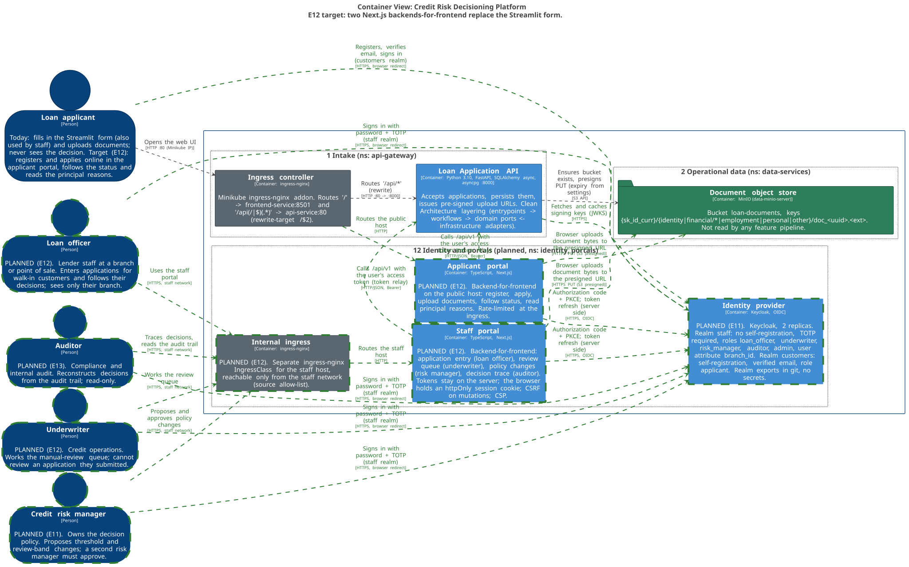
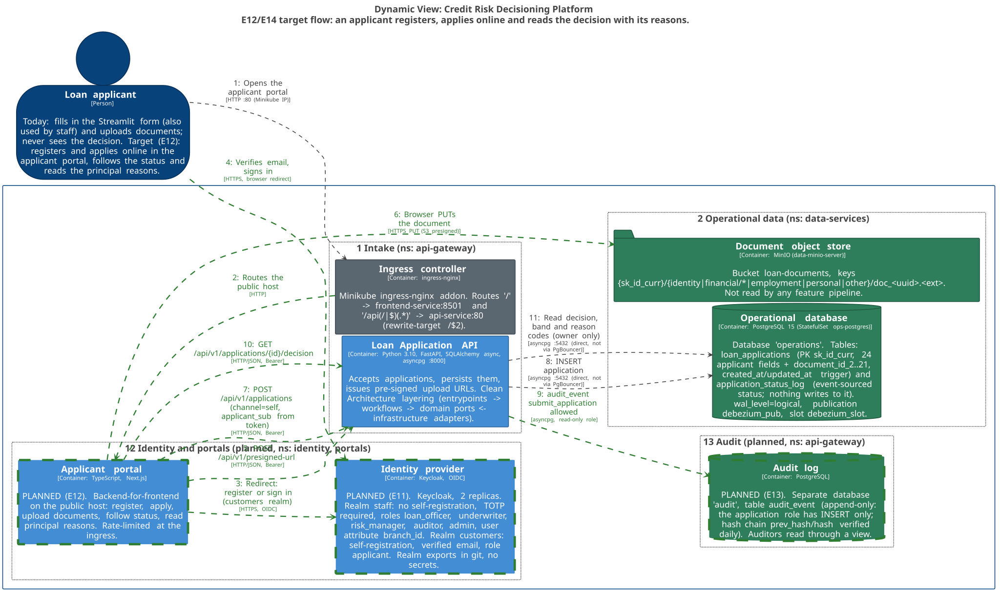
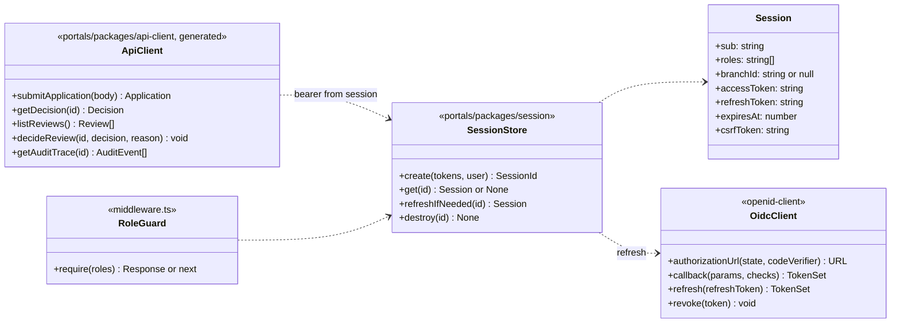
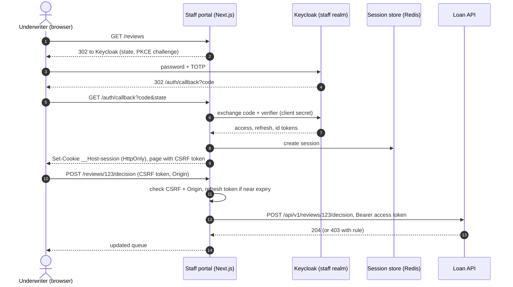

# E12: Staff and applicant portals

| Epic | Outcome / KPI | Baseline → target | Size | Depends on |
|---|---|---|---|---|
| [E12](../02-product/epics.md#e12-staff-and-applicant-portals) | O1 fast decision; O7 data protection; O8 explainable decisions | One unauthenticated Streamlit form, no decision shown → two signed-in portals; every role sees its decision, queue or trace; no token reachable from browser JavaScript | L | E11 (identity), E5 (decisions), E14 (reasons), E13 (audit trace) |

## 1. Why

- **Nothing to read back.** The Streamlit form submits and stops. Nobody sees the decision.
- **One screen for everyone.** Staff and applicants share it, so the UI cannot show different data or actions per role.
- **Unfit for hardening.** A Python server-rendered app cannot easily carry a BFF session model, CSP and per-role routing.

## 2. Scope

**In**
- **Two Next.js (App Router, TypeScript) apps in one workspace** under `portals/`:
  - `staff-portal` on host `staff.credit.local`, behind the internal ingress.
  - `applicant-portal` on host `apply.credit.local`, behind the public ingress with rate limits.
  - Shared package `portals/packages/api-client`, generated from the API's OpenAPI schema, with shared UI primitives.
- **BFF session.** Sign-in with the authorization code flow + PKCE. Tokens are stored server side, keyed by an opaque session id. The browser holds one cookie: `__Host-session`, `HttpOnly`, `Secure`, `SameSite=Lax`.
  - Refresh happens server side.
  - Logout revokes the refresh token and clears the session.
- **Mutation protection.** Server actions or route handlers only. Every mutation checks a CSRF token bound to the session, plus the `Origin` header.
- **Security headers:** strict CSP (no inline script without a nonce), `frame-ancestors 'none'`, HSTS, `Referrer-Policy: no-referrer`, `Permissions-Policy`.
- **Screens.**

| Portal | Role | Screens |
|---|---|---|
| applicant | applicant | Register / sign in (Keycloak pages), Apply (multi-step form with document upload), My applications, Application detail (status timeline, decision, principal reasons) |
| staff | loan_officer | New application (for a walk-in customer), Branch applications, Case view: internal factors for the customer they serve, reasons the customer sees, documents to collect, note and flag actions, customer lookup by ID with purpose. No approve or reject, no score ([ADR-0013](../adr/0013-role-based-data-and-explanation-visibility.md)) |
| staff | underwriter | Review queue (oldest first), Claim, Case in three steps: evidence, then model explanation, then decision (approve or reject with reason code and mandatory text) |
| staff | risk_manager | Policy (current bands), Propose change, Pending approvals |
| staff | auditor | Decision trace (by application id): timeline of audit events with hash-chain status |

- **Layouts and look:** every applicant screen exists at phone width (390 px, the primary channel) and desktop width (≥1280 px); staff screens are desktop-first and still usable on a tablet. Palette: red `#C8102E` for primary actions and risk-raising contributions, black `#111111` text, greys `#3F3F46`/`#52525B` for secondary text, `#E4E4E7`/`#F4F4F5` for borders and grounds, white surfaces. All text pairs meet 4.5:1. Fonts: Be Vietnam Pro (applicant, Vietnamese copy), Inter (staff, English).
- **Removal:** `application/frontend` (Streamlit), its Deployment, Service and Ingress, once both portals pass UAT.

**Out**
- Native mobile apps, notifications (email or SMS), internationalisation beyond English and Vietnamese labels.

## 3. Today

As-built view: [`L2-1-Intake`](../architecture/c4/docs/images/L2-1-Intake.svg). Streamlit calls the API from its pod; no sign-in; no read-back.

## 4. Target design

### 4.1 C4

[`T-E12-Portals`](../architecture/c4/docs/images/T-E12-Portals.svg):



Applicant flow [`T-D12-Applicant-Self-Service`](../architecture/c4/docs/images/T-D12-Applicant-Self-Service.svg):



### 4.2 Module interface (UML)



Sessions are stored in Redis (namespace `portals`, its own instance, 30-minute idle timeout, 8-hour absolute timeout). The role guard only shapes navigation; **the API remains the authority** (E11). A screen hidden by the guard must still be rejected by the API.

### 4.3 Behaviour

Sign-in and a mutation in the staff portal:



Applicant status polling: the detail page polls `GET /api/v1/applications/{id}/decision` every 2 s for up to 60 s, then every 15 s. Server-sent events can replace polling later.

## 5. Data contracts

**Decision as shown to an applicant** (`GET /api/v1/applications/{id}/decision`, owner only)

```json
{
  "sk_id_curr": "100002",
  "status": "manual_review",
  "decided_at": "2026-12-02T09:14:03Z",
  "reasons": [
    {"code": "EXT_SCORE_LOW", "text": "External credit scores are low"},
    {"code": "CREDIT_TO_GOODS_HIGH", "text": "Requested credit is high relative to the goods price"}
  ]
}
```

Applicants never see the raw score, band thresholds or contributions. Staff detail views include score, band, contributions and model version.

**Environment** (per portal)

| Variable | Source |
|---|---|
| `OIDC_ISSUER`, `OIDC_CLIENT_ID` | ConfigMap |
| `OIDC_CLIENT_SECRET`, `SESSION_SECRET` | Secret, created by `make k8s-secrets` |
| `API_BASE_URL` | ConfigMap: `http://api-service.api-gateway.svc` |
| `SESSION_REDIS_URL` | ConfigMap |

## 6. Change list

| File | Change |
|---|---|
| `portals/` | **new** pnpm workspace: `apps/staff-portal`, `apps/applicant-portal`, `packages/api-client`, `packages/session`, `packages/ui` |
| `contracts/openapi/loan-api.json`, `portals/packages/api-client` | schema exported by `make contracts`; client generated from it (`openapi-typescript`); both checked in, CI regenerates and diffs ([ADR-0011](../adr/0011-monorepo-layout-for-portals-contracts-and-environments.md)) |
| `platform/core/k8s/portals/` | **new**: Deployments (2 replicas each), Services, Ingresses (public with `limit-rps`, internal with source allow-list), Redis for sessions, NetworkPolicies |
| `application/entrypoints/api/main.py` | `GET /api/v1/applications/{id}/decision`; CORS no longer needed (calls come from the BFF server) |
| `application/frontend/`, `platform/core/k8s/07-frontend.yaml`, `08-frontend-ingress.yaml` | delete after UAT |
| `Makefile` | `portals-build`, `k8s-portals`; `check` runs `pnpm -r lint test` |

## 7. Acceptance criteria → tests

| # | Given / When / Then | Test |
|---|---|---|
| AC1 | Given any page after sign-in, then no access or refresh token is present in `localStorage`, `sessionStorage`, `document.cookie` or the HTML | Playwright `security.spec.ts` |
| AC2 | Given a POST without the CSRF token or with a foreign `Origin`, then `403` and no API call is made | Playwright + route handler unit test |
| AC3 | Given each role, then its scripted journey passes (applicant applies and reads reasons; officer submits; underwriter claims and decides; risk manager proposes and a second one approves; auditor traces) | Playwright `journeys/*.spec.ts` against UAT |
| AC4 | Given an applicant, when typing another application id into the URL, then the page shows "not found" and the API logged a `403` | Playwright `idor.spec.ts` |
| AC5 | Given response headers, then CSP, HSTS, `frame-ancestors 'none'` and `Referrer-Policy` are present | Playwright `headers.spec.ts`; ZAP baseline (E16) |
| AC6 | Given 30 minutes idle, then the next request redirects to sign-in | unit test of `SessionStore` with a fake clock |
| AC7 | Given axe-core, then no serious or critical accessibility violations on the five main screens | Playwright + `@axe-core/playwright` |

## 8. Test plan by layer

| Layer | What |
|---|---|
| Unit (Vitest) | session store, CSRF check, role guard, reason rendering |
| Contract | generated API client compiles against the current OpenAPI schema |
| E2E (Playwright) | one journey per role, security specs, accessibility, against UAT with seeded test users |

## 9. Rollout, rollback, observability

1. Deploy both portals next to Streamlit.
2. Run UAT (E16).
3. Switch the public host to the applicant portal.
4. Delete Streamlit.

**Rollback:** point the public ingress back to Streamlit until it is deleted. After deletion, roll back by redeploying the previous portal image.

**Signals:** portal request latency and error rate; sign-in failures; CSP violation reports (`report-to` endpoint logged to ECK).

## 10. Risks and open questions

| Item | Owner | Note |
|---|---|---|
| Node.js is a new runtime to patch and scan | platform | Pin the base image; `npm audit` and trivy in the release checklist |
| Session store availability | platform | Redis outage signs everyone out; acceptable, documented in E15 |
| Staff network is simulated | architect | An allow-list on the internal ingress stands in for a VPN or zero-trust proxy |
