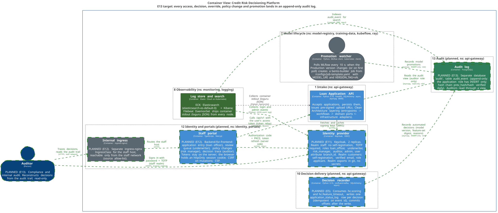
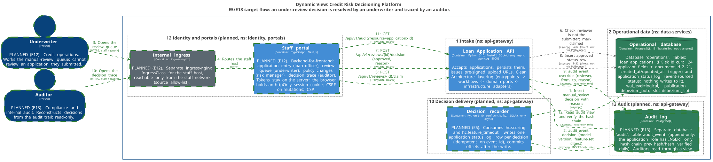
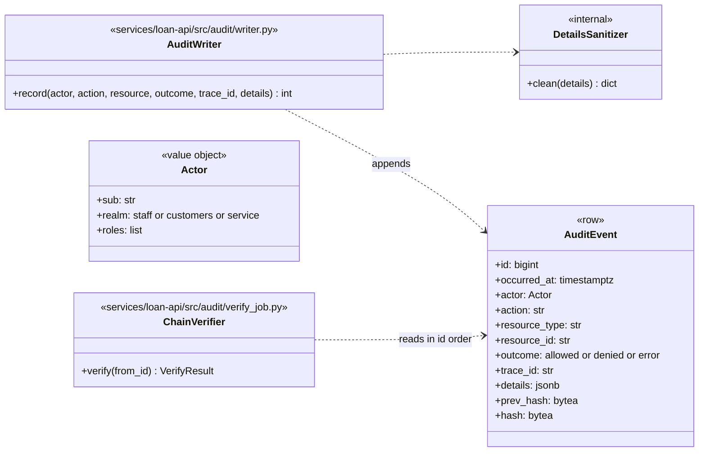
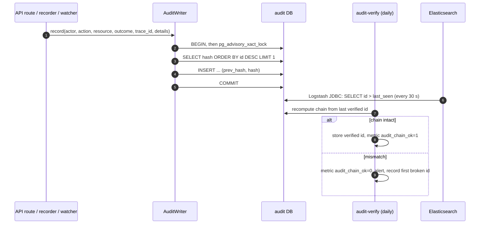

# E13: Audit trail

| Epic | Outcome / KPI | Baseline → target | Size | Depends on |
|---|---|---|---|---|
| [E13](../02-product/epics.md#e13-audit-trail) | O8 accountable decisions | No record of who did what → every access, decision, override, policy change and model promotion recorded; a decision reconstructed in ≤ 5 minutes; tampering detected by a daily check | M | E11 (verified actors), E5 (decisions) |

## 1. Why

A credit decision has to be defensible later: to the applicant, to internal audit, to a regulator. Today the platform cannot answer any of these questions:
- Who entered this application?
- Who looked at this person's data?
- Which model, with which inputs, produced this decision?
- Who overrode it, and why?

Application logs are not an audit trail:
- They are mutable.
- They are sampled.
- They mix PII into free text.
- They are rotated on an operational schedule rather than a retention policy.

## 2. Scope

**In**
- **Storage.** A separate PostgreSQL database `audit` holding `audit_event`. It is append-only by privilege and hash-chained.
- **Writer.** `services/loan-api/src/audit/` with one function, `record(...)`, used by the API (E11), the decision recorder (E5) and the MLflow promotion watcher (E7).
- **What is recorded** (§5): sign-in events from Keycloak, every allowed and denied API action on applications, decisions, reviews, policy changes, and model promotions.
- **Reading.** A read view for auditors and `GET /api/v1/audit?resource=…` (auditor only).
- **Verification.** A daily job `audit-verify` that re-computes the chain and alerts on a break.
- **Search.** A searchable copy in Elasticsearch (ECK, already deployed) via the Logstash JDBC input. PostgreSQL stays the system of record.
- **Retention policy** written down (§5); no automatic deletion in this epic.

**Out**
- WORM object storage or an external notary for the chain head. Recorded as a follow-up: publish the daily chain head to a write-once bucket.
- SIEM integration and alert routing beyond Prometheus.

## 3. Today

Nothing is recorded beyond container logs. `application_status_log.created_by` holds a service name, not a person.

## 4. Target design

### 4.1 C4

[`T-E13-Audit-Trail`](../architecture/c4/docs/images/T-E13-Audit-Trail.svg):



Review and trace flow [`T-D13-Review-and-Audit`](../architecture/c4/docs/images/T-D13-Review-and-Audit.svg):



### 4.2 Module interface (UML)



**Hash chain.** `hash = sha256(prev_hash || canonical_json(row without hash))`. The `prev_hash` of row *n* is the `hash` of row *n−1*.

**Concurrency.** Appends are serialised with a transaction-level advisory lock (`pg_advisory_xact_lock(4242)`): the writer reads the last hash, computes, inserts and commits. Measured cost: one short lock per action. If throughput ever needs it, move to per-partition chains.

**Sanitising.** `DetailsSanitizer` keeps an allow-list of keys per action (for example `band`, `score`, `reason_codes`, `model_version`, `feature_set_sha256`, `from_status`, `to_status`, `reason`). Names, dates of birth, phone numbers and document ids never enter `details`.

### 4.3 Behaviour



If writing the audit event fails, the business action fails too: the API returns `503`, because the event and the action commit together. The API's audit writes go through the API's own connection to the `audit` database. Strict atomicity across two databases is not attempted; the decision recorder writes the audit event first, then the status row, so a retry reproduces both.

## 5. Data contracts

**Table**

```sql
CREATE TABLE audit_event (
  id            BIGSERIAL PRIMARY KEY,
  occurred_at   TIMESTAMPTZ NOT NULL DEFAULT now(),
  actor_sub     VARCHAR(64) NOT NULL,
  actor_realm   VARCHAR(16) NOT NULL CHECK (actor_realm IN ('staff','customers','service')),
  actor_roles   TEXT[] NOT NULL,
  action        VARCHAR(48) NOT NULL,
  resource_type VARCHAR(24) NOT NULL,
  resource_id   VARCHAR(64) NOT NULL,
  outcome       VARCHAR(8)  NOT NULL CHECK (outcome IN ('allowed','denied','error')),
  trace_id      VARCHAR(32),
  details       JSONB NOT NULL DEFAULT '{}'::jsonb,
  prev_hash     BYTEA NOT NULL,
  hash          BYTEA NOT NULL UNIQUE
);
CREATE INDEX ON audit_event (resource_type, resource_id, id);
CREATE INDEX ON audit_event (actor_sub, occurred_at DESC);

-- privileges
REVOKE ALL ON audit_event FROM PUBLIC;
GRANT INSERT, SELECT ON audit_event TO audit_writer;       -- SELECT needed for the last hash
GRANT USAGE ON SEQUENCE audit_event_id_seq TO audit_writer;
CREATE VIEW audit_trace AS SELECT id, occurred_at, actor_sub, actor_realm, actor_roles,
       action, resource_type, resource_id, outcome, trace_id, details FROM audit_event;
GRANT SELECT ON audit_trace TO audit_reader;
-- no role except the database owner (not used by any service) holds UPDATE, DELETE or TRUNCATE
```

**Recorded actions**

| Source | Actions |
|---|---|
| Keycloak (shipped to ECK, summarised daily into `audit_event` as `realm_login_summary`) | `LOGIN`, `LOGIN_ERROR`, `UPDATE_TOTP`, admin role changes |
| API | `submit_application`, `read_application`, `read_customer_profile`, `lookup_customer` (with its purpose), `read_decision`, `read_explanation`, `add_case_note`, `flag_concern`, `claim_review`, `review_decision`, `propose_policy_change`, `approve_policy_change`, `read_audit`, and every `403` |
| Decision recorder | `decision` (band, score, reason codes, model version, feature-set digest), `decision_fallback` (timeout, scoring unavailable) |
| Promotion watcher | `model_promoted` (model name, version, git commit, approver if recorded in MLflow tags) |

**Retention** (proposal for the credit policy owner)

| Data | Keep |
|---|---|
| `audit_event` | 7 years after the application is closed |
| Keycloak event log in ECK | 1 year |
| Application logs | 30 days |

## 6. Change list

| File | Change |
|---|---|
| `platform/core/schemas/audit/001_audit_event.sql` | **new** |
| `services/loan-api/src/audit/{__init__,writer,sanitizer}.py` | **new** |
| `services/loan-api/src/audit/verify_job.py`, CronJob in `platform/core/k8s/09-decision-recorder.yaml` | **new**: daily CronJob; Prometheus metric `audit_chain_ok` |
| `services/loan-api/src/entrypoints/api/*.py` | call `record` on every allowed or denied action (E11) |
| decision recorder (E5) | `decision` and `decision_fallback` events |
| `services/model-lifecycle/mlflow-watcher/poller-configmap.yaml` (watcher script) | `model_promoted` event |
| `platform/ops/k8s/logging/` | Logstash JDBC pipeline `audit_event` → index `audit-*`; Keycloak event log shipping |

## 7. Acceptance criteria → tests

| # | Given / When / Then | Test |
|---|---|---|
| AC1 | Given the `audit_writer` role, when it runs `UPDATE`, `DELETE` or `TRUNCATE` on `audit_event`, then permission denied | `tests/integration/audit/test_privileges.py` |
| AC2 | Given 1,000 events written by 8 concurrent tasks, then the chain verifies and ids are gap-free in hash order | `test_chain_concurrency.py` |
| AC3 | Given one row's `details` altered by the owner role, then `verify` reports that row id | `test_chain_tamper.py` |
| AC4 | Given details containing `name` or `phone`, then they are dropped before insert | `tests/unit/audit/test_sanitizer.py` |
| AC5 | Given an application through submit → decision → override, then `GET /api/v1/audit?resource=application:{id}` returns the events in order, with actors and reasons | `tests/integration/api/test_audit_trace.py` |
| AC6 | Given a non-auditor token, when calling `/api/v1/audit`, then `403`, and that denial is itself audited | same |
| AC7 | Given the UAT environment, an auditor reconstructs a chosen decision in ≤ 5 minutes | UAT script (E16) |

## 8. Test plan by layer

| Layer | What |
|---|---|
| Pure logic | canonical JSON, hash computation, sanitizer |
| Integration | real PostgreSQL (the integration database) with the two roles; concurrency and tamper tests |
| UAT | auditor journey (E12, E16) |

## 9. Rollout, rollback, observability

1. Create the `audit` database and roles; insert a genesis row (`prev_hash` = 32 zero bytes).
2. Deploy the writer with E11.
3. Enable the verify CronJob.

**Rollback:** the audit DB stays. Rolling the API back stops new events and must be recorded as an incident.

**Signals:**
- `audit_chain_ok`
- `audit_write_errors_total`
- Lag between the newest event and Elasticsearch.

## 10. Risks and open questions

| Item | Owner | Note |
|---|---|---|
| The database owner can still rewrite history and recompute the chain | security | Mitigation: publish the daily chain head to a write-once bucket (follow-up); restrict the owner role to break-glass |
| Global advisory lock limits write throughput | dev | Measured in load test; partition the chain per day if needed |
| Reading PII is itself sensitive | compliance | `read_application` events record the reader and resource id, never the data |
