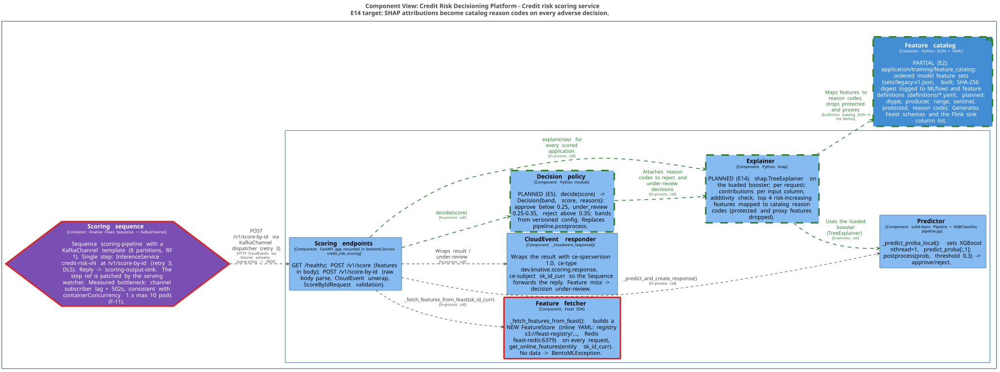
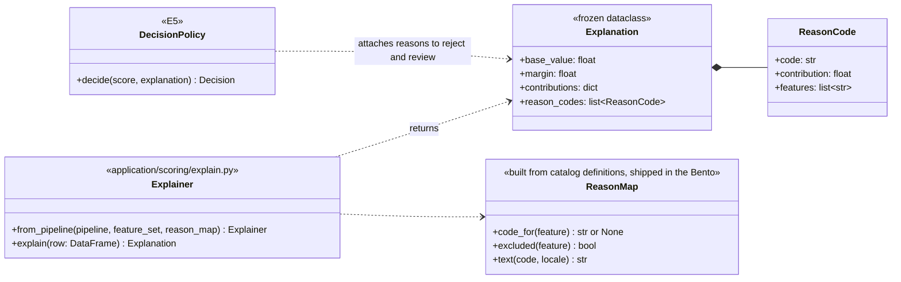
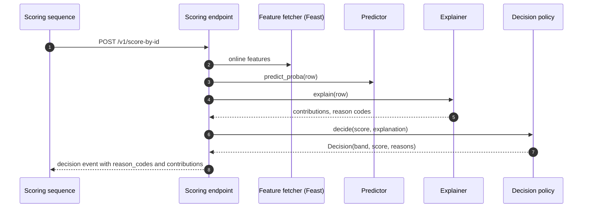

# E14: Explainability

| Epic | Outcome / KPI | Baseline → target | Size | Depends on |
|---|---|---|---|---|
| [E14](../02-product/epics.md#e14-explainability) | O2 consistent decisions; O8 explainable decisions | No reasons are produced → 100% of reject and under-review decisions carry up to four reason codes; attributions additive to 1e-4; no protected attribute ever used as a reason | M | E6 (gender-free model), E5 (decision record), E2 (catalog definitions with `reason_code`) |

## 1. Why

- **Applicants** who are declined or held for review should learn the principal reasons.
- **Underwriters** need to see what pushed a score up before they override it.
- **Risk managers and auditors** need evidence that the model relies on sensible inputs, and on no protected attribute or obvious proxy.

Wilson (*ML Engineering in Action*, §15.4 "Model interpretability") makes the case for answering "why did the model predict this?" with Shapley additive explanations. NIST AI RMF 1.0 treats explainability and interpretability as characteristics of trustworthy AI.

## 2. Scope

**In**
- **Local explanations.** `shap.TreeExplainer` on the XGBoost booster inside the scoring service, computed for every scored application. The cost is small; see §9.
- **Mapping back to inputs.** Attributions map back to the 23 model inputs; the preprocessing is 1:1 per column (clip, impute, ordinal encode).
- **Reason codes.** Each risk-increasing attribution maps to a catalog `reason_code`. Contributions of features sharing a code are summed, for example `EXT_SOURCE_1/2/3` → `EXT_SCORE_LOW`. Features marked `protected` or `proxy_for` are dropped, and up to four codes are kept, largest first.
- **Storage.** The decision event and record carry `reason_codes` (applicant-facing) and `contributions` (staff-facing).
- **Global explanations.** A mean |SHAP| ranking and a summary plot logged with each model version and included in `model_card.md` (E6).
- **Version stability check** at registration: top-10 global features overlap with Production by ≥ 7, or the gate tags `explanation_review_required=true`.

**Visibility tiers** ([ADR-0013](../adr/0013-role-based-data-and-explanation-visibility.md)), enforced by the API (E11), not only by the portals:

| Role | Sees |
|---|---|
| Applicant, loan officer | Up to four reason texts. No score, thresholds or contributions |
| Underwriter | Score, band, contributions, model and feature-set version, shown after the evidence on the review screen |
| Risk manager | Global explanations and reason-code distributions |
| Auditor | The explanation as recorded at decision time |

**Out**
- Counterfactual explanations ("what would change the decision"). Deferred.
- Explanations for the hard rules of E10; rules explain themselves with `rule:<id>`.

## 3. Today

The scoring service returns `{probability, prediction, threshold}`. No explanation exists anywhere. The decision is not stored (E5).

## 4. Target design

### 4.1 C4

[`T-E14-Explainability`](../architecture/c4/docs/images/T-E14-Explainability.svg):



### 4.2 Module interface (UML)



**Details**
- **Explainer construction.** The explainer is built once, when the model loads, from `pipeline.named_steps["clf"]`, with `model_output="raw"` (log-odds).
- **`explain(row)`.** The method:
  1. transforms the row with `pipeline.named_steps["pre"]`;
  2. computes SHAP values;
  3. maps output columns back to input names using the ColumnTransformer's group order, which comes from the feature set;
  4. checks additivity: `abs(base + sum(contributions) - margin) < 1e-4` (float32 boosters), otherwise it logs, counts and returns no reasons;
  5. builds the reason codes.
- **Calibrated models.** If a model is wrapped in a calibrator, contributions explain the uncalibrated margin. The ranking of reasons is unchanged because calibration is monotonic. This is stated in the model card.

### 4.3 Behaviour



## 5. Data contracts

**Catalog definition fields** (added to E2 definitions)

```yaml
- {name: EXT_SOURCE_2, reason_code: EXT_SCORE_LOW}
- {name: AMT_CREDIT, reason_code: CREDIT_AMOUNT_HIGH}
- {name: NAME_INCOME_TYPE, reason_code: INCOME_TYPE, proxy_for: CODE_GENDER}   # dropped from reasons
- {name: CODE_GENDER, protected: true}                                          # never a model input in v2 sets
```

**Reason texts** (`feature_catalog/reasons.yaml`)

```yaml
EXT_SCORE_LOW:      {en: "External credit scores are low", vi: "Điểm tín dụng từ nguồn bên ngoài thấp"}
CREDIT_AMOUNT_HIGH: {en: "Requested credit amount is high for the profile", vi: "Số tiền vay cao so với hồ sơ"}
```

**Decision event additions** (`hc.scoring`, E5)

```jsonc
{
  "reason_codes": ["EXT_SCORE_LOW", "CREDIT_AMOUNT_HIGH"],   // reject and under_review only; [] for approve
  "contributions": {"EXT_SOURCE_2": 0.84, "AMT_CREDIT": 0.31, "DAYS_BIRTH": -0.12},  // all inputs, staff only
  "explanation": {"base_value": -2.41, "margin": -0.93, "additive_ok": true}
}
```

## 6. Change list

| File | Change |
|---|---|
| `application/scoring/explain.py` | **new**: `Explainer`, `ReasonMap` |
| `application/scoring/service.py` | build the explainer at model load; call it per request; add fields to the response |
| `application/scoring/bentofile.yaml`, requirements | add `shap` (pinned) |
| `contracts/feature_catalog/definitions/*.yaml`, `reasons.yaml` | `reason_code`, `proxy_for`, texts |
| bento builder (E7) | ship `reason_map.json` generated from the catalog next to the model |
| `services/model-lifecycle/training/` recipe (E6) | global SHAP summary, stability check, model card section |
| `portals/` (E12) | applicant: texts only; staff: contribution bar chart |

## 7. Acceptance criteria → tests

| # | Given / When / Then | Test |
|---|---|---|
| AC1 | Given a fitted pipeline on a synthetic 2,000-row dataset, then for 100 rows `base + sum(contributions)` equals the booster margin within 1e-4 (XGBoost evaluates in float32) | `tests/unit/scoring/test_explain.py` |
| AC2 | Given features sharing a reason code, then their contributions are summed into one code | same |
| AC3 | Given a feature marked `protected` or `proxy_for`, then it never appears in `reason_codes`, even when its contribution is the largest | same |
| AC4 | Given an approve decision, then `reason_codes` is empty; given reject or under-review, then 1–4 codes, ordered by contribution | `tests/unit/scoring/test_policy_reasons.py` |
| AC5 | Given 30 RPS for 10 minutes, then scoring p95 rises by no more than 10 ms compared with the same run without explanations | load test, recorded in `tests/test_load/RESULTS.md` |
| AC6 | Given a candidate model whose top-10 global features overlap with Production by fewer than 7, then it is registered with `explanation_review_required=true` | `tests/unit/training/test_gate.py` (E6) |
| AC7 | Given 50 synthetic applications reviewed by an SME in UAT, then disagreements with the stated reasons are logged and triaged | UAT (E16) |

## 8. Test plan by layer

| Layer | What |
|---|---|
| Pure logic | reason aggregation, exclusion, ordering |
| Module interface | `Explainer` on a real small XGBoost pipeline (no mocks of SHAP) |
| Load | latency delta |
| UAT | SME review of reasons |

## 9. Rollout, rollback, observability

1. Ship with the first gender-free model (E6).
2. Measure latency in the load test before enabling reasons in the applicant portal.

**Rollback:** feature flag `SCORING_EXPLAIN=false` returns decisions without reasons. Reject and review then show the generic text "Your application needs further review".

**Signals:**
- `explain_seconds` histogram.
- `explain_additivity_failures_total`.
- Distribution of reason codes per day; a sudden shift is a drift signal.

## 10. Risks and open questions

| Item | Owner | Note |
|---|---|---|
| Reasons describe the model, not the world | compliance | Wording says "factors that most affected the assessment"; no causal language |
| Proxy list is incomplete | data scientist | The E6 proxy scan feeds `proxy_for`; reviewed at each model version |
| Correlated features split credit between them | data scientist | Grouping by reason code reduces the effect; documented in the model card |
