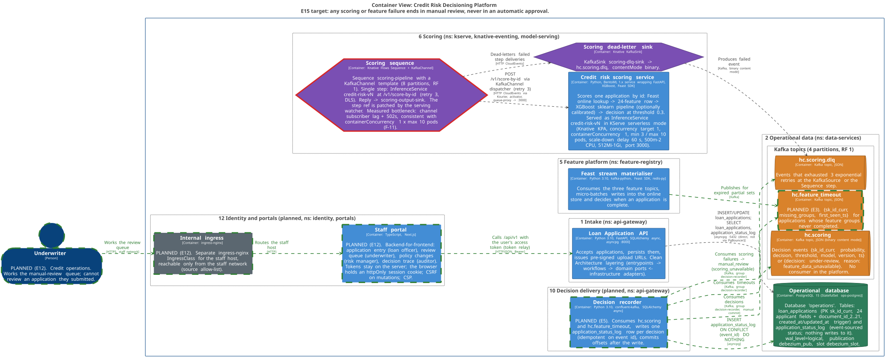
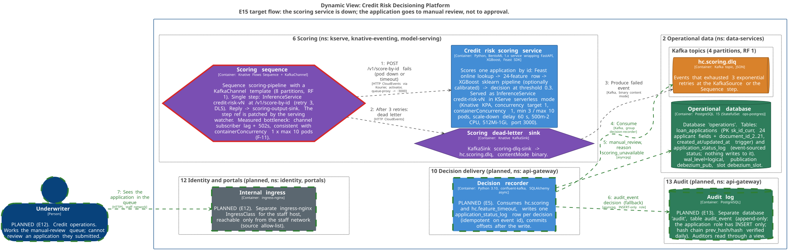
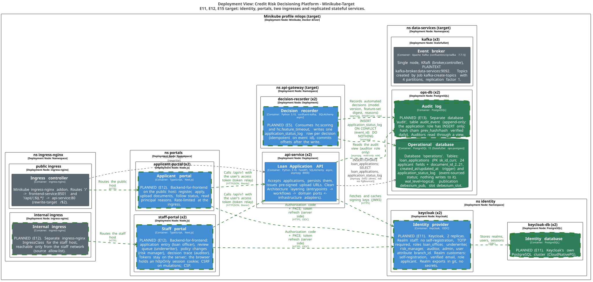
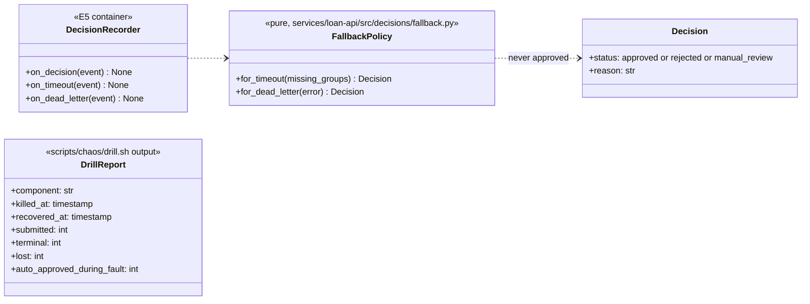
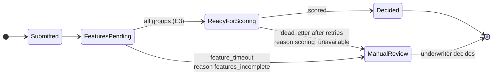
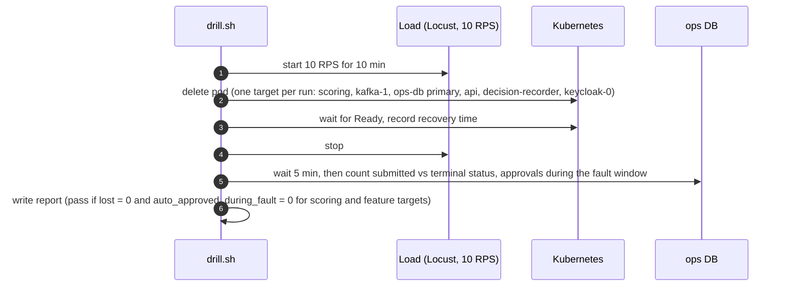

# E15: Resilience and failover

| Epic | Outcome / KPI | Baseline → target | Size | Depends on |
|---|---|---|---|---|
| [E15](../02-product/epics.md#e15-resilience-and-failover) | O5 scale and recover without loss | Single replicas, Kafka RF 1, no backups, no drills → 0 applications lost and 0 auto-approved when any single pod fails; operational DB RPO ≤ 5 min, RTO ≤ 15 min; monthly drill report | L | E3 (timeouts), E5 (decision recorder), E8 (retries, DLQ), E11 (Keycloak) |

## 1. Why

A credit platform that approves by default when something breaks is worse than one that is down. Today:
- A scoring outage dead-letters events that nobody consumes.
- A Kafka broker loss is total: single broker, RF 1.
- The operational database has no replica and no backup.
- Failure behaviour has never been exercised.

Wilson (*ML Engineering in Action*, §15.2 "Fallbacks and cold starts") argues for planning what the system does when the model cannot answer. **Our rule: the fallback is a human, never an automatic approval.**

## 2. Scope

**In**
- **A failure-mode table** (§5) with the designed behaviour for each component, and a test for each row.
- **Fallback to manual review.** The decision recorder consumes `hc.feature_timeout` (E3) and `hc.scoring.dlq`, and turns both into `manual_review` with an explicit reason. No other component may write `approved`.
- **Kafka:** 3 brokers (KRaft), RF 3, `min.insync.replicas=2`, producers `acks=all`. Topics are recreated with the new replication factor.
- **Operational and identity databases:** CloudNativePG clusters (primary + 1 replica), synchronous replication off (RPO ≤ 5 min via WAL archiving to MinIO), automated failover. Applications connect through the cluster's `-rw` Service.
- **Stateless services:** 2 replicas each with PodDisruptionBudgets (API, decision recorder, portals, Keycloak); readiness probes that check dependencies.
- **Scoring:** KServe keeps the last ready revision when a new one fails to become ready (already true); `minReplicas` 3 stays.
- **Drills:**
  - `scripts/chaos/drill.sh` deletes one pod of each critical component under load and writes a report.
  - `scripts/chaos/restore.sh` restores the operational DB from backup into a new cluster and checks row counts.
- **Runbooks** in `docs/runbooks/`: scoring down, Kafka broker lost, DB failover, Keycloak down, DLQ re-drive.

**Out**
- Node or zone failure (single-node Minikube), multi-region DR, Redis and ClickHouse replication. Their loss is covered by the timeout fallback and documented as accepted risk.

## 3. Today

As-built: [`Deploy-Minikube-All`](../architecture/c4/docs/images/Deploy-Minikube-All.svg). Failure behaviour:

| Failure | What happens today |
|---|---|
| Scoring pod down | Sequence retries 3 times, then `hc.scoring.dlq`; nobody reads it; the application never gets a status |
| Feature group never arrives | Readiness key expires silently (F-15); no status |
| Kafka broker down | Everything stops; RF 1 data on the broker's volume only |
| PostgreSQL down | API returns 500; Debezium stalls; data on one PVC, no backup |

## 4. Target design

### 4.1 C4

Container view [`T-E15-Failover`](../architecture/c4/docs/images/T-E15-Failover.svg):



Outage flow [`T-D15-Scoring-Outage`](../architecture/c4/docs/images/T-D15-Scoring-Outage.svg):



Target deployment [`T-Deploy-Target`](../architecture/c4/docs/images/T-Deploy-Target.svg):



### 4.2 Module interface (UML)



`FallbackPolicy` can only return `manual_review`. The type check plus a unit test (AC1) make an automatic approval on a fallback path impossible to introduce by accident.

### 4.3 Behaviour



Drill procedure:



## 5. Data contracts

**Failure-mode table** (each row has a drill target or a test)

| Component fails | Detection | Designed behaviour | Applicant sees | Recovery |
|---|---|---|---|---|
| Scoring service | Sequence retries exhausted | Dead letter → recorder → `manual_review` (`scoring_unavailable`) | "Under review" | KServe restarts pods; DLQ re-drive is optional, because the human decision stands |
| Feast / Redis online store | Fetcher error → scoring error | Same as scoring | "Under review" | Redis restarts; Flink and the materialiser replay from Kafka |
| One feature group late | Readiness TTL (E3) | `feature_timeout` → `manual_review` (`features_incomplete`) | "Under review" | none needed |
| One Kafka broker | Under-replicated partitions metric | Clients fail over; `acks=all` with min ISR 2 keeps writes durable | nothing | Broker pod restarts and catches up |
| Ops DB primary | CloudNativePG health check | Replica promoted; `-rw` Service moves; API retries the connection | One failed submit possible; the portal retries once | Old primary rejoins as replica |
| API pod | Readiness probe | Traffic to the other replica | nothing | restart |
| Decision recorder | Consumer lag alert | The other replica takes the partitions; manual commit means no loss | Status appears later | restart |
| Keycloak | Health check | Second replica serves; if both are down, existing sessions work until the access token expires (5 min) and refresh fails; new sign-ins fail | Sign-in error page | restart; sessions resume |
| Portal session Redis | Health check | Users are signed out | Sign-in again | restart |

**Backup settings** (CloudNativePG `Cluster`)

```yaml
backup:
  barmanObjectStore:
    destinationPath: s3://pg-backups/ops-db
    endpointURL: http://data-minio-server.data-services.svc:9000
    wal: {compression: gzip}
  retentionPolicy: "14d"
# ScheduledBackup: daily base backup at 02:00; WAL archived continuously (archive_timeout 300 s → RPO ≤ 5 min)
```

## 6. Change list

| File | Change |
|---|---|
| `platform/data/k8s/message-broker/` | 3-broker StatefulSet, topic init with RF 3 and min ISR 2 |
| `platform/ml/k8s/knative/` | KafkaChannel and sinks `replicationFactor: 3` |
| `platform/data/k8s/operational-db/` | CloudNativePG operator + `Cluster` + `ScheduledBackup`; Debezium points at the `-rw` Service |
| `platform/core/k8s/` | replicas 2 and PodDisruptionBudgets for API, recorder, portals; readiness probes |
| `services/loan-api/src/decisions/fallback.py` | **new**: `FallbackPolicy` |
| decision recorder (E5) | consume `hc.scoring.dlq` |
| `scripts/chaos/{drill,restore}.sh` | **new** |
| `docs/runbooks/*.md` | **new**: five runbooks |
| `Makefile` | `chaos-drill TARGET=…`, `restore-drill` |

## 7. Acceptance criteria → tests

| # | Given / When / Then | Test |
|---|---|---|
| AC1 | Given any input, `FallbackPolicy` returns `manual_review` | `tests/unit/decisions/test_fallback.py` (property-based with Hypothesis) |
| AC2 | Given a dead-lettered scoring event, then exactly one `manual_review` row with reason `scoring_unavailable` | `tests/integration/recorder/test_dead_letter.py` |
| AC3 | Given the scoring pods are deleted under 10 RPS, then `lost = 0` and `auto_approved_during_fault = 0` | `make chaos-drill TARGET=scoring` report |
| AC4 | Given one Kafka broker deleted under load, then `lost = 0` | `make chaos-drill TARGET=kafka-1` |
| AC5 | Given the ops DB primary deleted, then the API serves again within 60 s and `lost = 0` for committed applications | `make chaos-drill TARGET=ops-db` |
| AC6 | Given last night's backup and WAL, when restoring into a new cluster, then row counts match up to 5 minutes before the restore point, in under 15 minutes | `make restore-drill` report |

## 8. Test plan by layer

| Layer | What |
|---|---|
| Pure logic | fallback policy |
| Integration | recorder with a local Kafka (Testcontainers) |
| Drills | monthly in UAT; reports linked from the [release checklist](../release/checklist.md) |

## 9. Rollout, rollback, observability

1. Run the CloudNativePG migration first, during a maintenance window: logical dump, then restore into the new cluster.
2. Kafka next: create a new 3-broker cluster and recreate the topics. CDC snapshots again from PostgreSQL.
3. Then replicas and PDBs.
4. Then the drills.

**Rollback:** keep the old single-instance manifests until the first successful drill.

**Signals:**
- Under-replicated partitions.
- CloudNativePG `cnpg_pg_replication_lag`.
- Consumer lag per group.
- `decisions_total{reason="scoring_unavailable"}` (a spike means scoring is down).
- Drill report history.

## 10. Risks and open questions

| Item | Owner | Note |
|---|---|---|
| Resource budget on one node (3 brokers, 2 DB clusters, Keycloak, portals) | platform | Measure after Wave 4; reduce broker heap and DB shared buffers for Minikube |
| Manual review volume during a long scoring outage | credit operations | Alert at 50 queued reviews; the runbook says to pause intake if the queue exceeds capacity |
| Node failure is still total | architect | Accepted for the portfolio; documented in business constraints |
