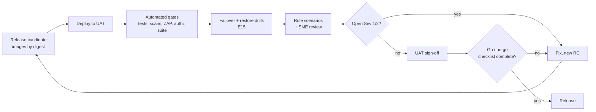
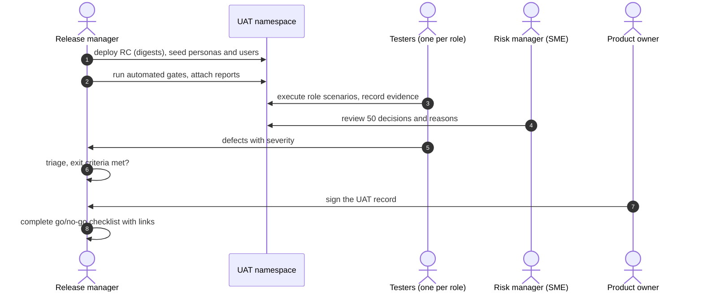

# E16: UAT and release readiness

| Epic | Outcome / KPI | Baseline → target | Size | Depends on |
|---|---|---|---|---|
| [E16 UAT and release](../02-product/epics.md#e16-uat-and-release-readiness) | [O6](../01-business/business-outcomes.md#o6-model-and-platform-changes-ship-safely) ship safely; [O7](../01-business/business-outcomes.md#o7-applicant-data-is-protected) data protection | No UAT, no release gate → every release has a UAT sign-off and a completed go/no-go checklist with evidence | M | [E11 Identity and access](../02-product/epics.md#e11-identity-and-access)–[E15](../02-product/epics.md#e15-resilience-and-failover) (everything UAT exercises) |

## 1. Why

Passing tests and good offline metrics are not acceptance. Wilson (*ML Engineering in Action*, §15.3 "End user vs. internal use testing") lists three reasons not to release on the data science team's internal evaluation alone:
- The builders are biased.
- Quantitative metrics do not guarantee qualitative behaviour.
- The data that matters most may not be in the feature vector.

He recommends SME evaluation and dogfooding before release. For a credit platform, the users who must accept it are loan officers, underwriters, risk managers and auditors. Applicants are represented by test personas.

## 2. Scope

**In**
- **UAT environment:** namespace set `uat-*` on the same cluster, or a second Minikube profile when resources allow. It deploys the release candidate images by digest, never `:latest`.
- **Synthetic data only:** 200 applicant personas generated from Kaggle distributions with fake names and contacts. No real or Kaggle-identifying rows are shown in the UI.
- **Test users:** one per role per branch, created by a script from the realm export. Passwords are generated at creation and stored in a Kubernetes Secret, never in git. TOTP is enrolled by the tester.
- **Role scenarios** (§5), each with steps, expected results and evidence (screenshot or API response).
- **SME evaluation:** a risk manager reviews 50 decisions and their reasons. Disagreements are logged and triaged.
- **Defects:** severity scale, triage, and exit criteria.
- **Release go/no-go:** the [release checklist](../release/checklist.md) and the [UAT sign-off record](../release/uat-signoff-template.md).
- **Security testing in UAT:** ZAP baseline against both portals; authorization tests ([E11 Identity and access](../02-product/epics.md#e11-identity-and-access)) run against UAT; scan reports attached.

**Out**
- Performance testing beyond the existing load test ([E4 Real-time scoring](../02-product/epics.md#e4-real-time-scoring)/E8). Its report is a checklist input.

## 3. Today

No UAT environment, no test users, no checklist. Releases are `make` targets run by the developer.

## 4. Target design

### 4.1 C4

UAT runs the same containers as [`T-Deploy-Target`](../architecture/c4/docs/images/T-Deploy-Target.svg), with synthetic data and test identities.

### 4.2 Process model

### 4.3 Behaviour

## 5. Data contracts

**Role scenarios** (minimum set; each traces to an epic AC)

| ID | Role | Scenario | Expected | Traces to |
|---|---|---|---|---|
| UAT-01 | applicant | Register, verify email, apply with two documents | Status visible within 15 s; documents listed | [E1 Intake](../02-product/epics.md#e1-application-intake-and-document-capture), [E12](../02-product/epics.md#e12-staff-and-applicant-portals), [O1](../01-business/business-outcomes.md#o1-applicants-get-an-answer-fast) |
| UAT-02 | applicant | Declined application | Up to four reasons in plain language; no score shown | [E14](../02-product/epics.md#e14-explainability) AC4, [O8 Accountable](../01-business/business-outcomes.md#o8-decisions-are-explainable-and-accountable) |
| UAT-03 | applicant | Open another applicant's application URL | "Not found"; a denied audit event exists | [E11](../02-product/epics.md#e11-identity-and-access) AC3 |
| UAT-04 | loan_officer | First sign-in | TOTP enrolment forced | [E11](../02-product/epics.md#e11-identity-and-access) AC9 |
| UAT-05 | loan_officer | Submit for a walk-in customer; see the decision | `channel=staff`, own branch; decision shown | [E1 Intake](../02-product/epics.md#e1-application-intake-and-document-capture), [E12](../02-product/epics.md#e12-staff-and-applicant-portals) |
| UAT-06 | loan_officer | Open an application from another branch | Refused | [E11](../02-product/epics.md#e11-identity-and-access) AC4 |
| UAT-06b | loan_officer | Look up a co-applicant by citizen ID with a purpose; try a name search | ID lookup works and is audited; name search is not offered | [E11](../02-product/epics.md#e11-identity-and-access) AC11 |
| UAT-06c | loan_officer | Open the case view of a declined application | Reasons shown; no score, contributions or decide buttons | [E11](../02-product/epics.md#e11-identity-and-access) AC12, ADR-0013 |
| UAT-07 | underwriter | Claim and decide a review with a reason | Status updated; override audited | [E5 Decision delivery](../02-product/epics.md#e5-decision-delivery-and-status-tracking), [E13](../02-product/epics.md#e13-audit-trail) AC5 |
| UAT-08 | underwriter | Try to review an application they submitted | Refused: separation of duties | [E11](../02-product/epics.md#e11-identity-and-access) AC5 |
| UAT-09 | risk_manager | Propose a band change; approve own proposal; second manager approves | Own approval refused; second approval activates | [E11](../02-product/epics.md#e11-identity-and-access) AC6 |
| UAT-10 | auditor | Reconstruct a chosen decision | Timeline complete in ≤ 5 min; chain verified | [E13](../02-product/epics.md#e13-audit-trail) AC7, [O8 Accountable](../01-business/business-outcomes.md#o8-decisions-are-explainable-and-accountable) |
| UAT-11 | all | During a scoring drill, submit applications | All end in `manual_review`, none approved | [E15](../02-product/epics.md#e15-resilience-and-failover) AC3 |
| UAT-12 | SME | Review 50 decisions and reasons | Agreement rate recorded; every disagreement triaged | [E14](../02-product/epics.md#e14-explainability) AC7 |

**Severity and exit criteria**

| Severity | Definition | Exit rule |
|---|---|---|
| Sev 1 | Wrong decision state, data exposure, auth bypass, data loss | 0 open |
| Sev 2 | A role cannot complete a scenario | 0 open |
| Sev 3 | Workaround exists | ≤ 5 open, each with an owner and a date |
| Sev 4 | Cosmetic | no limit |

## 6. Change list

| File | Change |
|---|---|
| `platform/environments/uat/` | **new**: Kustomize overlay (namespaces `uat-*`, image digests, smaller resources), see [ADR-0011](../adr/0011-monorepo-layout-for-portals-contracts-and-environments.md) |
| `scripts/uat/seed_personas.py` | **new**: 200 synthetic personas (fake identity fields, feature values sampled from Kaggle marginals) |
| `scripts/uat/create_test_users.sh` | **new**: Keycloak admin API; writes generated passwords to a Secret |
| `docs/release/checklist.md`, `docs/release/uat-signoff-template.md` | **new** |
| `docs/security/threat-model.md` | **new**; reviewed per release |
| `Makefile` | `uat-deploy`, `uat-seed`, `uat-gates` (tests, scans, ZAP baseline) |

## 7. Acceptance criteria → tests

| # | Given / When / Then | Test |
|---|---|---|
| AC1 | Given a release candidate, when `make uat-deploy` runs, then every image is referenced by digest | script check in `uat-deploy` |
| AC2 | Given `make uat-gates`, then it produces test, SAST, dependency, image, secret and ZAP reports in `reports/<rc>/` | run log |
| AC3 | Given the scenarios in §5, then each has evidence and a pass or a linked defect | UAT record |
| AC4 | Given open defects, then exit criteria hold before sign-off | UAT record |
| AC5 | Given the go/no-go checklist, then every gate links to evidence | checklist review |

## 8. Test plan by layer

UAT is the top layer. It reuses the [E11](../02-product/epics.md#e11-identity-and-access) authorization suite, the [E12](../02-product/epics.md#e12-staff-and-applicant-portals) Playwright journeys and the [E15](../02-product/epics.md#e15-resilience-and-failover) drills, and adds the human scenarios and the SME review.

## 9. Rollout, rollback, observability

The first UAT cycle runs once [E11 Identity and access](../02-product/epics.md#e11-identity-and-access)–[E15](../02-product/epics.md#e15-resilience-and-failover) are built.

**Rollback:** the previous release's digests stay recorded in the last signed checklist.

**Signals:** scenario pass rate; defects by severity over cycles; time from RC to sign-off.

## 10. Risks and open questions

| Item | Owner | Note |
|---|---|---|
| One person plays all roles in a portfolio setting | product owner | Record that roles were simulated; ask a peer to act as SME where possible |
| Cluster resources for a parallel UAT | platform | Fall back to sequential: UAT replaces the dev deployment during a cycle |
