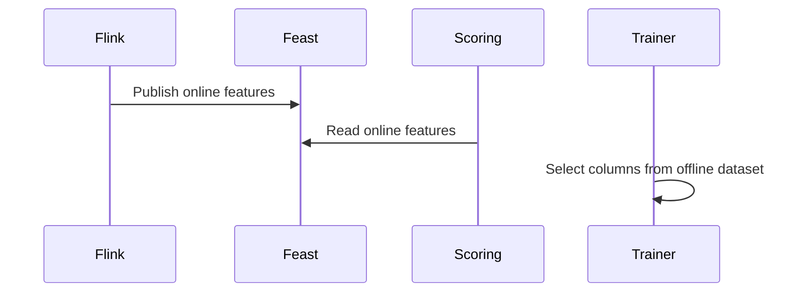
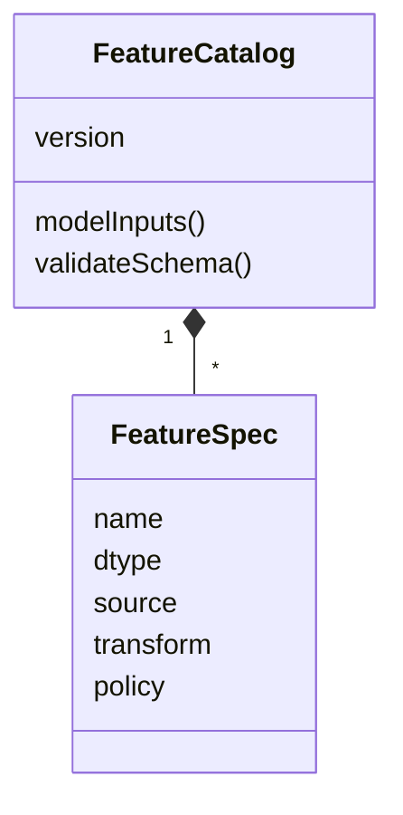
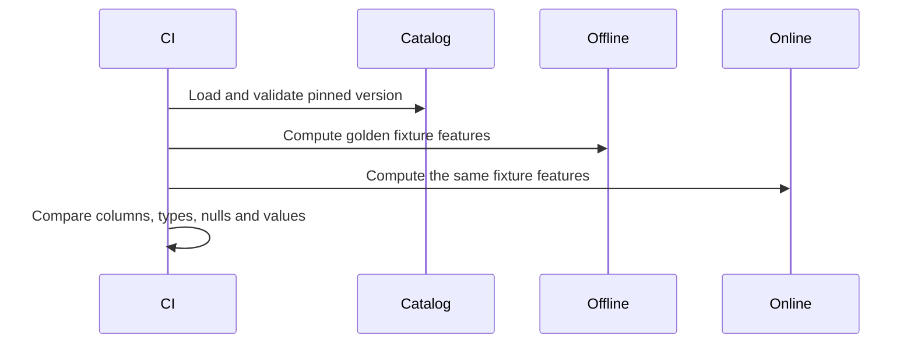

# E2. Feature catalog and parity

| Epic | Outcomes | Baseline → target | Size | Depends on |
|---|---|---|---|---|
| [E2](../02-product/epics.md#e2-feature-engineering-with-trainingserving-parity) | O3, O4 | Known skew → 50 golden cases within 1e-6. Bureau lookup → p95 < 50 ms at 30 RPS. | M | None |

## 1. Why

Feature skew can change the same applicant's score across environments. See [business outcomes](../01-business/business-outcomes.md) and [findings F-01, F-02, F-07, F-09 and F-13](../architecture/c4/docs/07-findings.md).

## 2. Scope

Version the feature definitions, align employment-day and bureau transforms, and benchmark the ClickHouse layout. Track Flink checkpoint recovery separately under E3. E6 owns protected-input exclusion and model governance.

## 3. Today

The [feature pipeline](../architecture/c4/docs/images/L2-2-Feature-Pipeline.svg) and [model lifecycle](../architecture/c4/docs/images/L2-5-Model-Lifecycle.svg) maintain feature definitions independently.



## 4. Target design

See the [target catalog view](../architecture/c4/docs/images/T-E2-Feature-Catalog.svg).





## 5. Data contracts

Proposed catalog excerpt. Feature order is explicit in the generated model metadata. Unknown versions and duplicate feature names fail validation.

```yaml
version: 1
features:
  - name: DAYS_EMPLOYED
    dtype: int64
    source: applicant
    transform: signed_employment_days_v1
    policy: model_input
```

Employment days are nonpositive, with 365243 preserved as the sentinel. Compare missing values by the same catalog policy on both paths. Compare discrete values exactly and finite floats with absolute tolerance 1e-6. Include a catalog version and ordered names/types in the generated Feast metadata and the model run.

## 6. Change list

- Add the catalog and generation/check entry point. Wire the output into [Feast views](../../application/feast_repo/feature_views.py), Flink sink schemas, [training](../../application/training/train_register.py) and [scoring](../../application/scoring/pipeline.py).
- Compare bureau transform semantics against the training snapshot, including time windows and missing aggregates. Update the [ClickHouse client](../../application/infrastructure/external/dwh_client_ch.py) and warehouse table layout for keyed lookups.

## 7–8. Acceptance and test plan

| Criterion | Planned test |
|---|---|
| Four consumers agree with the catalog | CI `test_catalog_generated_artifacts_are_current`, including schema/type/order drift |
| 50 applicants agree and employment days follow the contract | Integration `test_offline_online_golden_parity`, including sentinel, nulls and bureau history boundaries |
| Bureau p95 < 50 ms at 30 RPS | Load `test_bureau_lookup_p95_at_30_rps`, using representative table size and key distribution |

## 9. Rollout and rollback

Generate both schemas from a pinned version, shadow-compare online output, then switch the feature materializer and compatible model together. Benchmark the replacement ClickHouse table before switching reads. Retain the prior schemas, model and table for coordinated rollback. Track parity mismatches, schema rejections and lookup p95.

## 10. Open questions

Data engineering owns the golden fixture and canonical bureau computation. Model risk approves any corrected transform that changes predictions before the cutover.
