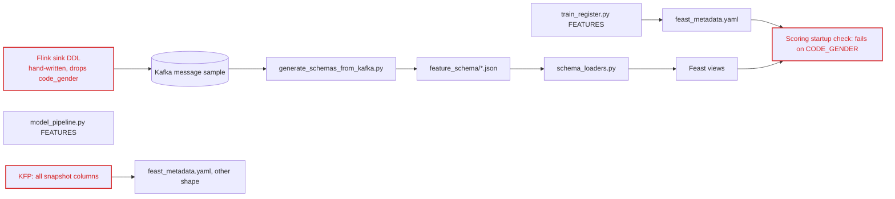
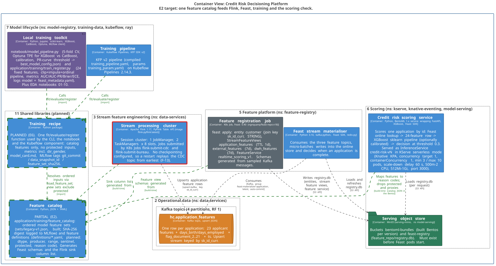
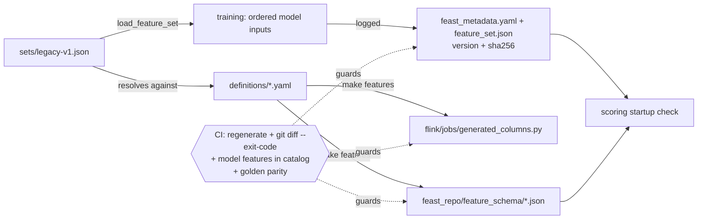
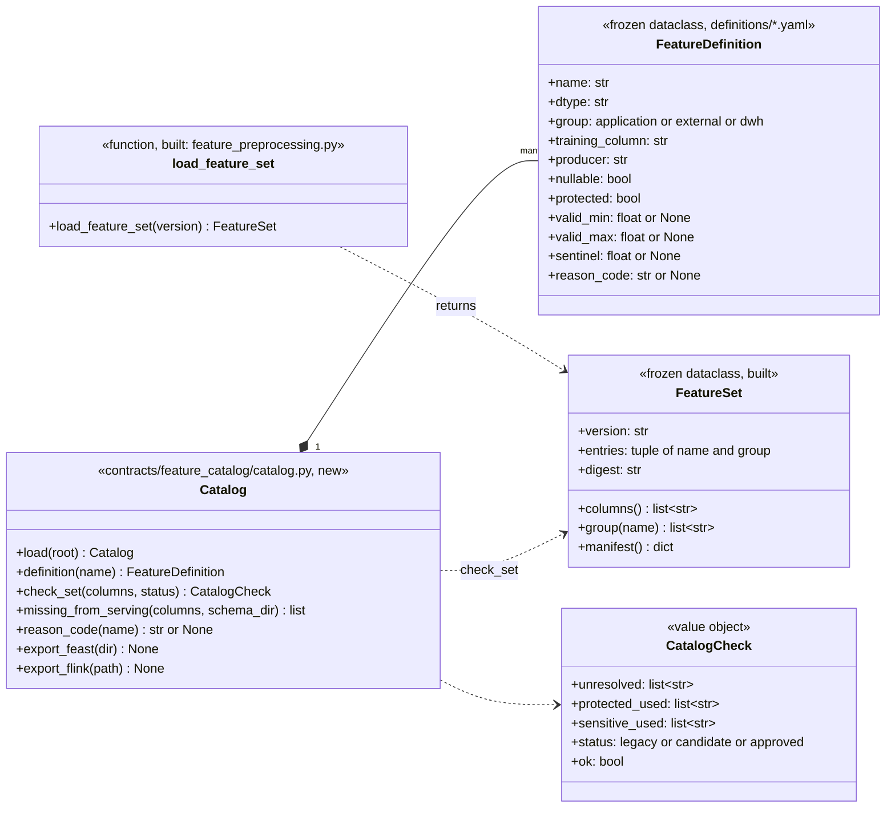
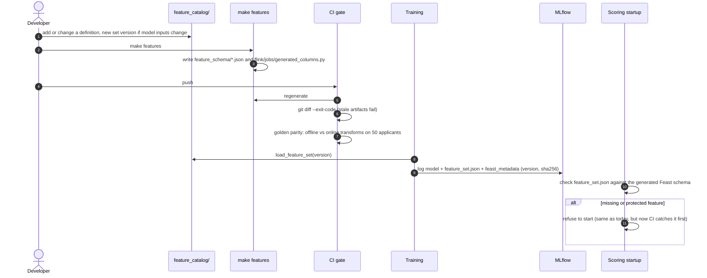

# E2: Feature catalog and training–serving parity

| Epic | Outcome / KPI | Baseline → target | Size | Depends on |
|---|---|---|---|---|
| [E2](../02-product/epics.md#e2-feature-engineering-with-trainingserving-parity) | O3 risk quality; O4 fair lending | Feature list defined in ~6 places, one model feature missing at serving, `DAYS_EMPLOYED` sign flipped, bureau logic duplicated → one declaration, CI-enforced parity, golden-record equality | M | none (E6 builds on it) |

## 1. Why

The model is trained on one feature definition and served with another:

- **F-07:** no module declares the feature set. Feast schemas are sampled from Kafka, so `CODE_GENDER` disappeared from serving while the model still needs it.
- **F-01:** `DAYS_EMPLOYED` is positive at serving (`created - start`) but negative in training, with `365243` meaning unemployed.
- **F-02:** bureau aggregates exist twice, once in dbt SQL for training and once in a Flink Python UDF for serving.
- **F-09:** bureau lookups scan whole ClickHouse tables (`ORDER BY tuple()`).

## 2. Scope

**In**
- **Feature definitions**: `contracts/feature_catalog/definitions/{application,external,dwh}.yaml`, one entry per feature (meaning, dtype, producer, training column, valid range, sentinel, `protected`, `reason_code`).
- **Model feature sets**: `feature_catalog/sets/<version>.json`, an ordered list of definition names with a preprocessing group. **Done:** `legacy-v1`, `load_feature_set()` with a SHA-256 digest, and the version and digest logged with every model (CLI, notebook, Kubeflow).
- A check that every set entry resolves to exactly one definition and that no `protected` definition is in a new approved set.
- A generator that writes the derived artifacts, plus a CI check that fails when they are stale.
- Fix `DAYS_EMPLOYED` (sign and sentinel) in the Flink UDF.
- A golden-record parity test for applicant features and bureau features.
- ClickHouse tables ordered by their lookup key.

**Out**
- Dropping `CODE_GENDER` from the model and retraining: E6. E2 only marks it `protected` in the catalog.
- Merging the two bureau implementations into one. This decision is deferred; E2 proves parity with a test first (open question 1).
- Flink checkpointing (F-13): E8.

## 3. Today

As-built views: [`L2-2-Feature-Pipeline`](../architecture/c4/docs/images/L2-2-Feature-Pipeline.svg) and [`L3-Flink`](../architecture/c4/docs/images/L3-Flink.svg). The data-flow lineage table is in [`05-data-flow.md` §5.7](../architecture/c4/docs/05-data-flow.md#57-feature-lineage-training-vs-serving).



## 4. Target design

### 4.1 C4

Container view [`T-E2-Feature-Catalog`](../architecture/c4/docs/images/T-E2-Feature-Catalog.svg). The catalog is a library: other containers depend on it at build or import time. It is dashed green.



Because Flink, Feast and scoring are built from **separate Docker contexts** (`application/flink`, `application/feast_repo`, `application/scoring`), the catalog is not imported at runtime by those images. A generator writes small artifacts **into** each context; they are committed, and CI regenerates them and fails on any diff.



### 4.2 Module interface (UML)



`FeatureSet` and `load_feature_set()` already exist in `application/training/feature_preprocessing.py`. `Catalog` adds the definitions and the checks; it does not change how training resolves a set.

### 4.3 Behaviour



## 5. Data contracts

**`feature_catalog/definitions/application.yaml`** (excerpt, new)

```yaml
- {name: DAYS_EMPLOYED, dtype: Int32, producer: flink.cdc_application_etl, training_column: DAYS_EMPLOYED,
   valid_max: 0, sentinel: 365243, reason_code: EMPLOYMENT_LENGTH}   # employed: <= 0; none: 365243
- {name: CODE_GENDER, dtype: String, producer: flink.cdc_application_etl, training_column: CODE_GENDER,
   protected: true}
```

**`feature_catalog/sets/legacy-v1.json`** (exists)

```json
{"version": "legacy-v1",
 "features": [{"name": "EXT_SOURCE_3", "preprocessing_group": "num_other"}, "... 24 entries in model order"]}
```

A set is immutable once a model is registered with it. Changing model inputs means a new set (for example `v2-no-gender` in E6).

Initial definitions: import the 43 + 57 + 156 fields from today's `feature_schema/*.json` with a one-off script, then fill meaning, ranges, `protected` and `reason_code` by hand for the 24 entries of `legacy-v1`.

**`DAYS_EMPLOYED` at serving** (`cdc_udfs.calculate_days_employed`)

| Input | Output |
|---|---|
| `employment_start_date` set | `(employment_start - created_at).days` (≤ 0) |
| `employment_start_date` NULL | `365243` (Kaggle "not employed" sentinel) |

**ClickHouse ordering** (`02-clickhouse-init.yaml` `load_csv`, dbt `config(order_by=…)`)

| Table | ORDER BY |
|---|---|
| `application_external.bureau`, `external_score`, all marts | `SK_ID_CURR` |
| `application_external.bureau_balance` | `SK_ID_BUREAU` |

## 6. Change list

| File | Change |
|---|---|
| `contracts/feature_catalog/catalog.py`, `definitions/{application,external,dwh}.yaml` (the 24 model inputs), `reasons.yaml` | **done** (2026-11-22); `train_register.py` refuses a non-legacy set with a protected input |
| `contracts/feature_catalog/sets/v2-no-gender.json` | **done**: candidate set for E6 |
| `contracts/feature_catalog/export.py`; definitions for the remaining Feast-only fields | **new** (pending) |
| `contracts/feature_catalog/sets/legacy-v1.json`, `feature_preprocessing.load_feature_set` | **done** |
| `Makefile` | `features` target (runs the exporter); `check` runs it and `git diff --exit-code` |
| `application/feast_repo/feature_schema/*.json` | now generated |
| `application/feast_repo/generate_schemas_from_kafka.py` | delete (replaced by the exporter) |
| `application/flink/jobs/generated_columns.py` | **new, generated**; `cdc_application_etl.py` builds sink DDL and SELECT from it |
| `application/flink/jobs/application_transforms.py`, `cdc_udfs.py` | **done** (2026-11-22): `days_employed` is a pure function (≤ 0, `365243` when not employed) and the UDF delegates to it; tests in `tests/unit/flink/` |
| `application/training/train_register.py`, `notebook/model_pipeline.py`, KFP `pipeline.py` | **done**: resolve inputs with `load_feature_set()`; log `feature_set.json` |
| `application/scoring/service.py` (startup) | compare the model's `feature_set.json` with the generated Feast schema shipped in the Bento |
| `platform/data/k8s/data-warehouse/02-clickhouse-init.yaml`, `ml_data_mart/models/mart/*.sql` | ordering keys |
| `tests/fixtures/golden_applicants.csv`, `golden_bureau_rows.json`, `golden_mart_bureau.csv` | **new**: 50 applicants exported once from the cluster |

## 7. Acceptance criteria → tests

| # | Given / When / Then | Test |
|---|---|---|
| AC1 | Given the catalog when exporting then the JSON files equal the committed ones | `make check` (`git diff --exit-code`) |
| AC2 | Given a set entry with no matching definition then `check_set().ok` is false and `unresolved` lists it | `tests/unit/training/test_catalog.py` |
| AC3 | Given a list containing `CODE_GENDER` then `check_set().protected_used = [CODE_GENDER]` (allowed only for `legacy-v1`) | same |
| AC4 | Given an employment start 5 years before `created_at` then `days_employed ≈ -1826`; given none then `365243` | `tests/unit/flink/test_cdc_udfs.py` |
| AC5 | Given the 50 golden applicants when computing applicant features via the UDFs then they equal the Kaggle `application_train` values (DAYS_* within 1 day) | `tests/parity/test_application_parity.py` |
| AC6 | Given the golden bureau rows when running `aggregate_bureau_features` then the 3 model bureau features equal `mart_bureau_features` within 1e-6 | `tests/parity/test_bureau_parity.py` |
| AC7 | Given 30 RPS then the bureau lookup p95 is under 50 ms | load test with ClickHouse `system.query_log` |

## 8. Test plan by layer

| Layer | What |
|---|---|
| Pure logic | catalog load/check, UDF transforms |
| Parity (new layer) | golden fixtures, no infrastructure; run in `make check` |
| Integration | none new |
| Delete | none; `generate_schemas_from_kafka.py` goes, and it has no tests |

## 9. Rollout, rollback, observability

1. Ship the catalog and the generated artifacts. They must equal today's JSON, apart from the explicit changes.
2. Ship the UDF fix together with a **retrained** model (E6). A model trained on the Kaggle convention plus the fixed UDF is the correct pair; the fixed UDF with today's model is also strictly better than today.
3. Recreate the ClickHouse tables with ordering keys: `make k8s-load-dwh` after dropping them, then `make k8s-dbt`.

Signal: the scoring log shows "Startup validation passed" with `feature_set_version` and `feature_set_sha256`; a drift monitor on `days_employed` sign (E8) would catch regressions.

## 10. Risks and open questions

| # | Item | Owner | Note |
|---|---|---|---|
| 1 | Keep two bureau implementations with a parity test, or read `mart_bureau_features` like the DWH service does? | architect | Reading the mart removes the Flink bureau job (revisit ADR-0007 scope). Decide after AC6 shows how far apart they are |
| 2 | The Kaggle data has no `employment_start_date`; golden applicants need synthesised dates consistent with `DAYS_EMPLOYED` | dev | Generate from `DAYS_EMPLOYED` with a fixed `created_at` |
| 3 | 256 definitions is long | dev | Only entries referenced by a set need full metadata; others are carried for Feast |
| 4 | Where definitions live once other teams consume them | architect | Stay in this repository until a second product needs them; see [feature governance plan](feature-governance-plan.md) |
