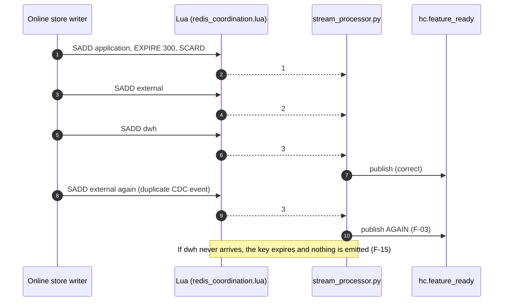
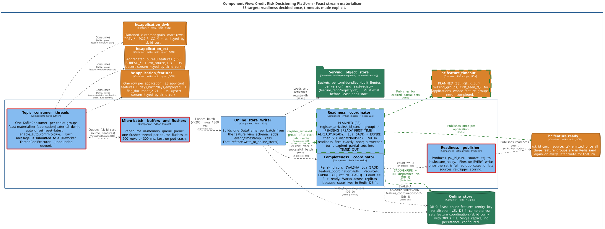
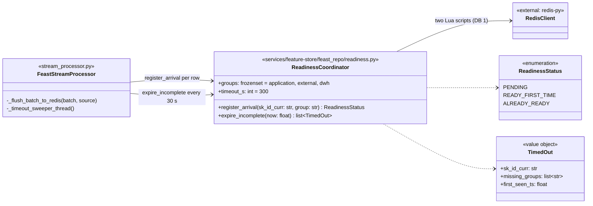
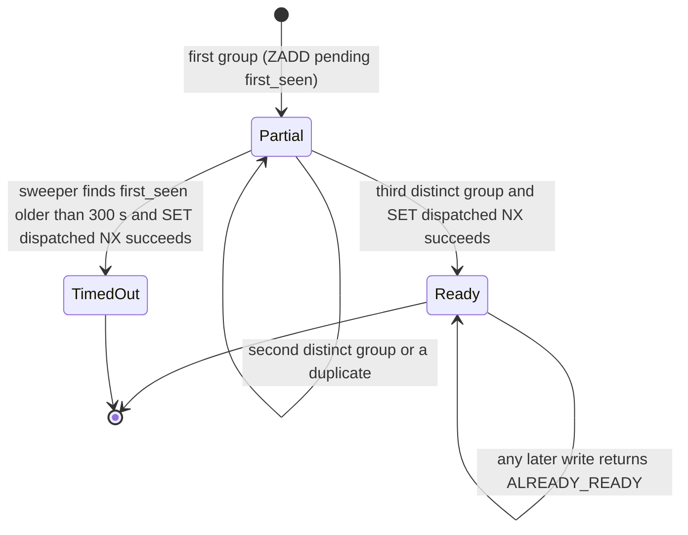
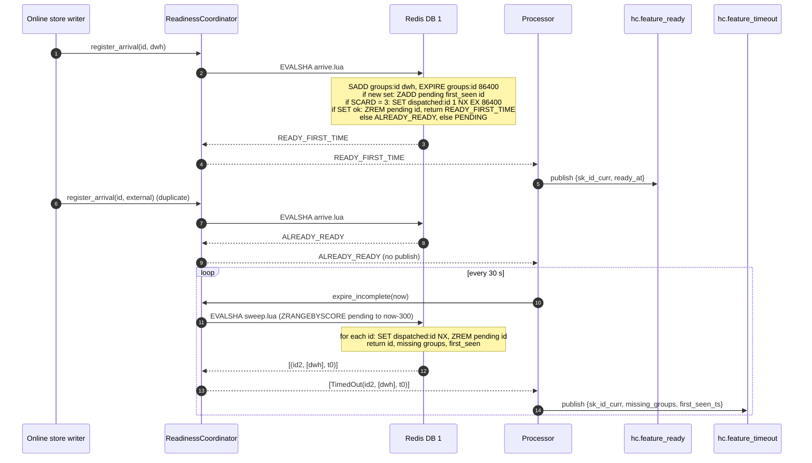

# E3: Exactly-once application readiness

| Epic | Outcome / KPI | Baseline → target | Size | Depends on |
|---|---|---|---|---|
| [E3](../02-product/epics.md#e3-exactly-once-application-readiness) | O1 fast decision; O5 no silent loss | Up to 3 readiness events per application, silent drop when a group is missing → exactly 1 readiness **or** 1 timeout per application | M | none |

## 1. Why

The Feast materialiser decides an application is complete when a Redis set reaches 3 members. The check runs on **every** write, so any later or duplicate write fires `hc.feature_ready` again, and the application is scored again (F-03). If a group never arrives, the set expires after 300 s and nothing happens: no decision, no alert (F-15). E5 (decision delivery) is unsafe until this is fixed.

## 2. Scope

**In**
- A **readiness coordinator** module that owns the rule. Today it is split between `redis_coordination.lua` and an `== 3` check in `stream_processor.py`.
- An atomic "ready exactly once" transition (`SET dispatched:<id> NX`).
- A **timeout sweeper** that turns expired partial sets into `hc.feature_timeout` events.
- Tests against Redis with real Lua (fakeredis with Lua, or a Redis container).

**Out**
- Making Feast consumers at-least-once (manual commit, bounded buffers): E8.
- Removing the API's dual write: E1/E9 work. That only removes the source of duplicates; this epic makes duplicates harmless.

## 3. Today

As-built view: [`L3-Feast-Materialiser`](../architecture/c4/docs/images/L3-Feast-Materialiser.svg). The step-by-step coordination is in [sequence S2](../architecture/c4/docs/04-runtime-sequences.md).



## 4. Target design

### 4.1 C4

Component view [`T-E3-Readiness`](../architecture/c4/docs/images/T-E3-Readiness.svg). The new readiness coordinator is dashed green.



### 4.2 Module interface (UML)



Interface rule: callers never see keys, TTLs or Lua. Publishing stays in `FeastStreamProcessor`; it publishes only on `READY_FIRST_TIME` and for each `TimedOut`.

### 4.3 Behaviour

State machine for one application:



Sequence (target):



Both scripts set `dispatched:<id>` with `NX`. Whichever runs first (ready or timeout) wins, and the other becomes a no-op. This is what makes "exactly one of ready / timeout" hold across replicas.

## 5. Data contracts

**Redis DB 1 keys** (replaces `feature_coordination:<id>`)

| Key | Type | TTL | Meaning |
|---|---|---|---|
| `readiness:groups:<id>` | set | 24 h | groups that landed |
| `readiness:pending` | sorted set (score = first_seen epoch s) | none, members removed on ready or timeout | applications not yet decided |
| `readiness:dispatched:<id>` | string | 24 h | set exactly once, by ready or by timeout |

**`hc.feature_ready`** (unchanged key `sk_id_curr`; body gets `ready_at`, and drops `source`)

```json
{"sk_id_curr": "215354", "ready_at": "2026-12-03T10:15:01.900Z"}
```

**`hc.feature_timeout`** (new topic, 4 partitions, key `sk_id_curr`)

```json
{"sk_id_curr": "215354", "missing_groups": ["dwh"], "first_seen_ts": 1764756901.2}
```

**Settings** (`FEAST_` prefix): `FEAST_READINESS_TIMEOUT_S=300`, `FEAST_READINESS_SWEEP_S=30`.

## 6. Change list

| File | Change |
|---|---|
| `services/feature-store/feast_repo/readiness.py` | **new**: `ReadinessCoordinator`, `ReadinessStatus`, `TimedOut` |
| `services/feature-store/feast_repo/readiness_arrive.lua`, `readiness_sweep.lua` | **new**: replace `redis_coordination.lua` |
| `services/feature-store/feast_repo/redis_coordination.lua` | delete |
| `services/feature-store/feast_repo/stream_processor.py` | use the coordinator; publish only on `READY_FIRST_TIME`; add the sweeper thread; remove the inline `== 3` logic |
| `platform/data/k8s/message-broker/04-kafka-init.yaml` | add `hc.feature_timeout` |
| `pyproject.toml` (test extra) | `fakeredis[lua]` |
| `docs/architecture/c4/workspace.dsl` | built: drop `Planned`; close F-03, F-15 |

## 7. Acceptance criteria → tests

| # | Given / When / Then | Test |
|---|---|---|
| AC1 | Given the 3 groups arrive in each of the 6 orders then exactly one `READY_FIRST_TIME` | `tests/unit/feast/test_readiness.py` (fakeredis + Lua), parametrised |
| AC2 | Given any group arrives twice, before or after readiness, then no second `READY_FIRST_TIME` | same |
| AC3 | Given 2 groups and the clock at first_seen + 301 s when `expire_incomplete` then one `TimedOut` with the missing group | same, with `now` injected |
| AC4 | Given an application timed out when its last group arrives late then `ALREADY_READY`, no readiness event | same |
| AC5 | Given 2 coordinators (2 replicas) racing on the third group then exactly one `READY_FIRST_TIME` in total | threads against one fakeredis |
| AC6 | Given the processor with a fake producer when a batch is flushed then publish is called only for `READY_FIRST_TIME` | `tests/unit/consumers/test_stream_processor.py` (rewrite the mock-the-script tests) |

## 8. Test plan by layer

| Layer | What |
|---|---|
| Module interface | AC1–AC5 against fakeredis with Lua: the real scripts run, nothing is mocked inside the module |
| Integration (optional) | Same suite against `redis:7` via Testcontainers |
| Delete | `test_stream_processor.py` tests that mock `coordination_script` to return 3 (they test past the interface) |

## 9. Rollout, rollback, observability

The new keys use a new prefix, so old and new can coexist. Deploy and let the old `feature_coordination:*` keys expire (300 s). Rollback means redeploying the previous image; in-flight applications may then score twice, which is today's behaviour.

Signals: counters `readiness_ready_total`, `readiness_duplicate_total`, `readiness_timeout_total` (log events at least). Size of `readiness:pending` (should stay small). Ratio of `hc.feature_ready` messages to inserted applications (target 1.0).

## 10. Risks and open questions

| Item | Note |
|---|---|
| Timeout value | 300 s is today's TTL. O1 targets 15 s p95, so 300 s only catches failures, not slowness |
| fakeredis Lua fidelity | Run AC5 against a real Redis container at least once before merging |
| Late groups after timeout | Data lands in the online store but no rescoring happens; a reviewer handles it (E5) |
