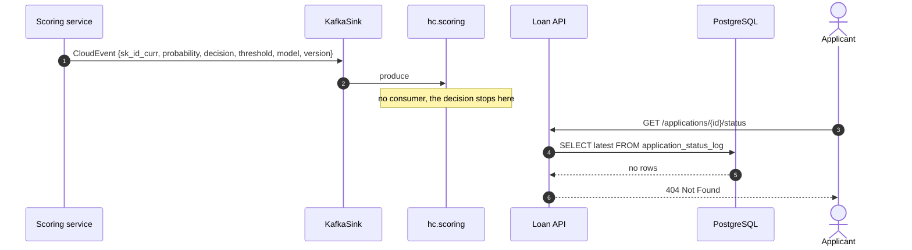
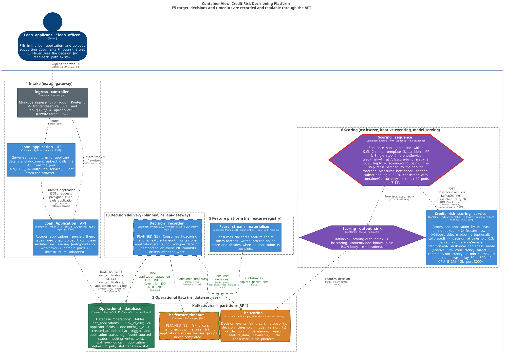
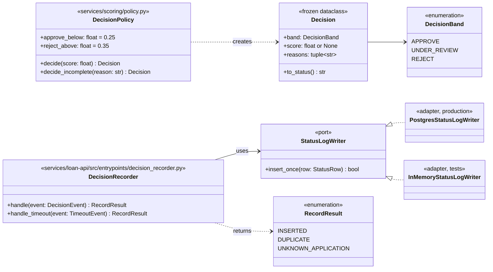
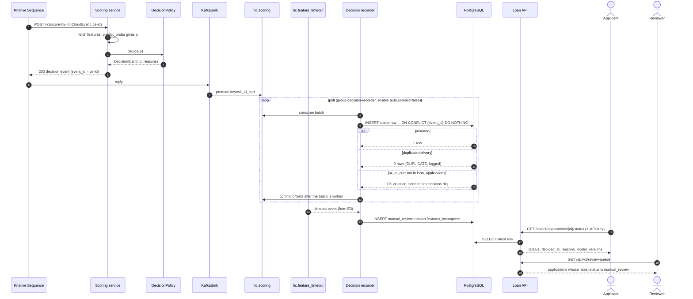

# E5: Decision delivery and status tracking

| Epic | Outcome / KPI | Baseline → target | Size | Depends on |
|---|---|---|---|---|
| [E5 Decision delivery](../02-product/epics.md#e5-decision-delivery-and-status-tracking) | [O1](../01-business/business-outcomes.md#o1-applicants-get-an-answer-fast) fast decision; [O2](../01-business/business-outcomes.md#o2-every-application-ends-in-a-clear-decision) consistent, explainable | No decision is ever stored or returned → p95 ≤ 15 s to a readable status; 100% of decisions stored with versions and reasons | M | [E3 Exactly-once readiness](../02-product/epics.md#e3-exactly-once-application-readiness) (exactly-once readiness), otherwise one application gets several decisions |

## 1. Why

The pipeline scores applications and publishes the result to `hc.scoring`, but nothing reads that topic. The applicant never learns the outcome, reviewers have no queue, and there is no audit record. Finding F-04. Until this epic exists, the business goal "decide in seconds" is not met at all.

## 2. Scope

> **Extended by [E15](E15-resilience-failover.md):** the recorder also consumes `hc.scoring.dlq` and records `manual_review` with reason `scoring_unavailable`. Fallback paths never record `approved`. Overrides by underwriters ([E11](E11-identity-access.md), [E13](E13-audit-trail.md)) and reason codes ([E14](E14-explainability.md)) build on the record defined here.

**In**
- A **decision policy** module in the scoring service: three bands with configurable boundaries and reason codes. It replaces `pipeline.postprocess`.
- A richer **decision event** on `hc.scoring` (band, reasons, versions, event id).
- A **decision recorder** consumer that writes one `application_status_log` row per decision, idempotently. It also writes `manual_review` rows for `hc.feature_timeout` events (from [E3 Exactly-once readiness](../02-product/epics.md#e3-exactly-once-application-readiness)).
- `GET /api/v1/applications/{id}/status` returns the latest decision with its reason. New `GET /api/v1/review-queue` lists applications in `manual_review`.

**Out**
- Reviewer UI and reviewer actions (approve or reject from the queue). Next increment.
- Notifications (email, SMS, webhooks).
- Pre-screening rules ([E10 Pre-screening](../02-product/epics.md#e10-pre-screening-business-rules)).

## 3. Today

As-built views: [`L2-3-Scoring`](../architecture/c4/docs/images/L2-3-Scoring.svg) and [`D3-Score-Application`](../architecture/c4/docs/images/D3-Score-Application.svg).



## 4. Target design

### 4.1 C4

Container view [`T-E5-Decision-Delivery`](../architecture/c4/docs/images/T-E5-Decision-Delivery.svg). New pieces are dashed green.



Component view inside the scoring service, [`T-E5-Scoring-Policy`](../architecture/c4/docs/images/T-E5-Scoring-Policy.svg), and the numbered flow [`T-E5-Decision-Flow`](../architecture/c4/docs/images/T-E5-Decision-Flow.svg).

### 4.2 Module interfaces (UML)



The `StatusLogWriter` seam has two adapters (Postgres in production, in-memory in unit tests), so it is a real seam. The Kafka loop around `DecisionRecorder.handle` is thin. It reuses the consumer harness from [E8 Reliable ops](../02-product/epics.md#e8-reliable-delivery-and-operations) when that lands; until then it follows the manual-commit pattern below.

### 4.3 Behaviour



## 5. Data contracts

**Decision bands** (scoring settings, env prefix `SCORING_`)

| Setting | Default | Rule |
|---|---|---|
| `SCORING_APPROVE_BELOW` | 0.25 | p < value → `APPROVE` |
| `SCORING_REJECT_ABOVE` | 0.35 | p > value → `REJECT`; otherwise `UNDER_REVIEW` |

Constraint, checked at startup: `0 < approve_below ≤ reject_above < 1`. Both bands and the model version go into every event.

**Band → `application_status_log.status`** (existing CHECK constraint values; no constraint change)

| Band / case | status | reasons |
|---|---|---|
| APPROVE | `approved` | `["score_band"]` |
| REJECT | `rejected` | `["score_band"]` |
| UNDER_REVIEW | `manual_review` | `["score_band"]` |
| no online features | `manual_review` | `["feature_data_unavailable"]` |
| readiness timeout ([E3 Exactly-once readiness](../02-product/epics.md#e3-exactly-once-application-readiness)) | `manual_review` | `["features_incomplete"]` |

**Decision event on `hc.scoring`** (JSON body; replaces today's shape, additive except `decision`)

```jsonc
{
  "event_id": "5b0c…",            // = CloudEvent ce-id, used for idempotency
  "sk_id_curr": "215354",
  "band": "UNDER_REVIEW",
  "status": "manual_review",
  "score": 0.31,
  "reasons": ["score_band"],
  "bands": {"approve_below": 0.25, "reject_above": 0.35},
  "model": "credit_risk_model", "model_version": "14",
  "feature_set_sha256": "9f2c…",  // digest of the model's feature set (E2)
  "decided_at": "2026-12-03T10:15:02.120Z"
}
```

**Migration `services/loan-api/schema/003_status_log_event_id.sql`**

```sql
ALTER TABLE application_status_log ADD COLUMN IF NOT EXISTS event_id VARCHAR(64);
CREATE UNIQUE INDEX IF NOT EXISTS uq_status_log_event_id
    ON application_status_log(event_id) WHERE event_id IS NOT NULL;
```

Row written: `status` (above), `created_by = 'decision-recorder'`, `metadata = {score, reasons, bands, model, model_version, feature_set_sha256}`, `event_id`.

**API responses**

`GET /api/v1/applications/{id}/status` → `200 {"customer_id","status","updated_at","updated_by","metadata"}`. This is the existing shape, now populated. `404` only when the application does not exist; an application with no decision yet returns `200` with `status = "submitted"`.

`GET /api/v1/review-queue?limit=50` → `200 [{"customer_id","score","reasons","since"}]`, ordered by oldest first.

## 6. Change list

| File | Change |
|---|---|
| `services/scoring/policy.py` | **new**: `DecisionPolicy`, `Decision`, `DecisionBand` |
| `services/scoring/pipeline.py` | delete `postprocess` (replaced) |
| `services/scoring/service.py` | call the policy; build the event above; `event_id` = incoming `ce-id` |
| `services/scoring/config.py` | `approve_below`, `reject_above` (+ validator); remove `prediction_threshold` |
| `services/loan-api/src/entrypoints/decision_recorder.py` | **new**: consumer loop + `DecisionRecorder` |
| `services/loan-api/src/infrastructure/persistence/status_log.py` | **new**: `StatusLogWriter` port, Postgres adapter |
| `services/loan-api/src/infrastructure/persistence/models/sqlalchemy_models.py` | `event_id` column |
| `services/loan-api/src/entrypoints/api/main.py` | status route: `submitted` fallback; new review-queue route |
| `services/loan-api/schema/003_status_log_event_id.sql`, `platform/data/k8s/operational-db/03-db-init.yaml` | migration, include in init |
| `platform/data/k8s/query-services/04-decision-recorder.yaml` | **new** Deployment (consumers image, `command: python entrypoints/decision_recorder.py`) |
| `platform/data/k8s/message-broker/04-kafka-init.yaml` | topic `hc.decisions.dlq` |
| `tests/test_load/locustfile_e2e_prediction.py` | measure latency to the status row, not only to `hc.scoring` |
| `docs/architecture/c4/workspace.dsl` | drop `Planned` on built elements; close F-04 |

## 7. Acceptance criteria → tests

| # | Given / When / Then | Test |
|---|---|---|
| AC1 | Given p = 0.10, 0.25, 0.30, 0.35, 0.36 when `decide` then APPROVE, UNDER_REVIEW, UNDER_REVIEW, UNDER_REVIEW, REJECT | `tests/unit/scoring/test_policy.py` (boundaries) |
| AC2 | Given `approve_below > reject_above` when the service starts then startup fails with a clear error | `test_scoring_config.py` |
| AC3 | Given a decision event when the recorder handles it then exactly one row exists, with status, reasons and versions | `tests/unit/entrypoints/test_decision_recorder.py` (in-memory writer) |
| AC4 | Given the same event delivered twice then the second returns DUPLICATE and no second row exists | same file; plus `tests/integration/repository/test_status_log.py` against Postgres (unique index) |
| AC5 | Given a timeout event then a `manual_review` row with reason `features_incomplete` exists | recorder unit test |
| AC6 | Given a decided application when GET `/status` then 200 with that status; given an undecided one then `submitted` | `tests/integration/api/test_status.py` |
| AC7 | Given 3 applications in `manual_review` when GET `/review-queue` then all 3, oldest first | integration API test |
| AC8 | Given 30 RPS for 10 min then p95 submit → status row ≤ 15 s and ≥ 99% decided | `run_e2e_load_test.sh` (manual, cluster) |

## 8. Test plan by layer

| Layer | What | Notes |
|---|---|---|
| Pure logic | policy boundaries, band → status mapping | no mocks |
| Module interface | `DecisionRecorder` with `InMemoryStatusLogWriter` | replaces nothing; new |
| Integration | Postgres unique index + API routes | SQLite cannot test the partial unique index, so run it against Postgres (Testcontainers) |
| E2E | load test measures to the status row | needs the cluster |
| Delete | `tests/unit/scoring/test_pipeline.py::TestPostprocess` once `postprocess` is removed | replaced by `test_policy.py` |

## 9. Rollout, rollback, observability

1. Deploy the migration (additive and safe).
2. Deploy the recorder with `auto.offset.reset=earliest` on a new group so it back-fills existing `hc.scoring` events. Idempotency makes reruns safe.
3. Deploy the scoring service with the policy. The old consumers of the event shape are none, so this is not a breaking change.

Rollback: scale the recorder to 0. The rows already written are correct. Revert the scoring image if needed; the event stays additive.

Signals: recorder lag on `hc.scoring` (Kafka UI or Prometheus), count of DUPLICATE results, `hc.decisions.dlq` size, and the share of applications older than 60 s still in `submitted` (should trend to 0).

## 10. Risks and open questions

| Item | Owner | Note |
|---|---|---|
| Review band 0.25–0.35 is a proposal | credit risk owner | Set from the cost matrix ([E6](../02-product/epics.md#e6-fair-governed-credit-model) threshold document) |
| Duplicate scoring before [E3](../02-product/epics.md#e3-exactly-once-application-readiness) ships | dev | Idempotency on `event_id` does not help when two *different* scoring calls happen; [E3 Exactly-once readiness](../02-product/epics.md#e3-exactly-once-application-readiness) must land first |
| Reason codes are coarse (`score_band`) | data scientist | Top SHAP contributors as reasons is a follow-up |
