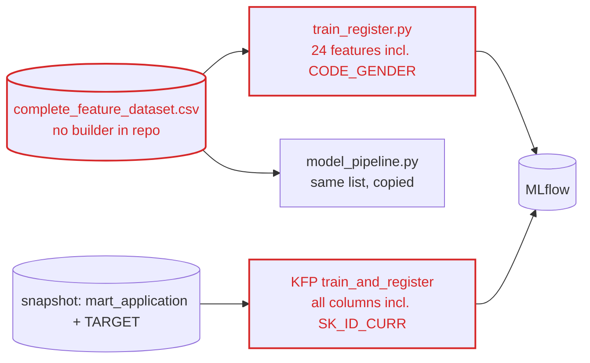
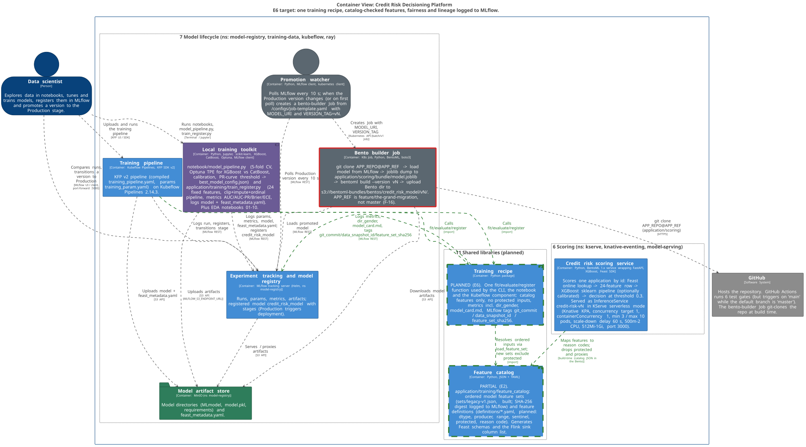
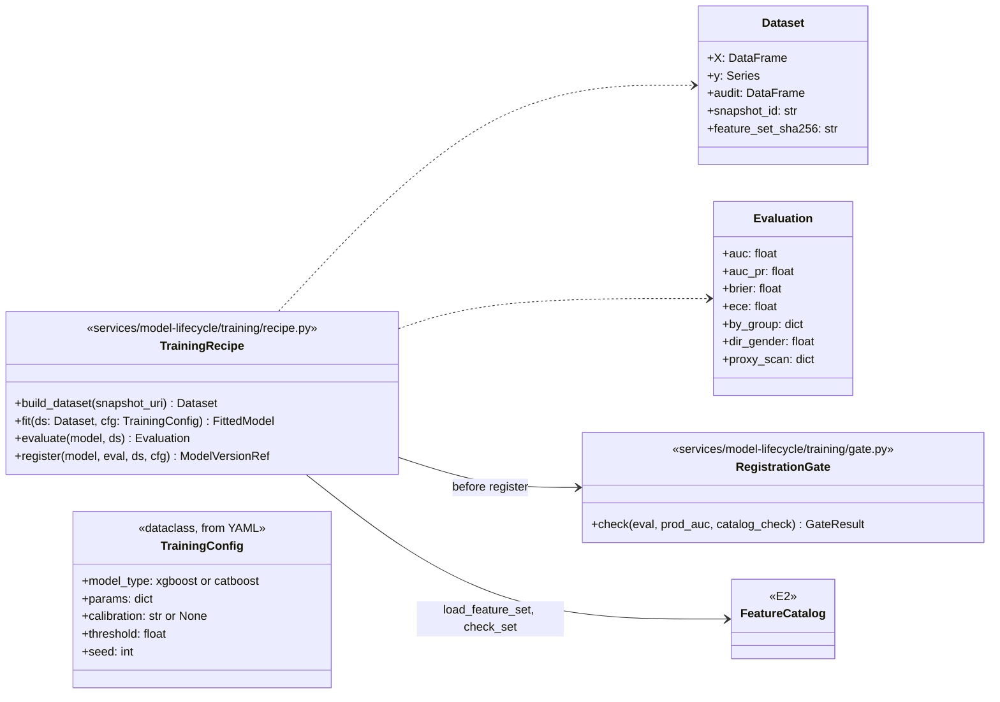
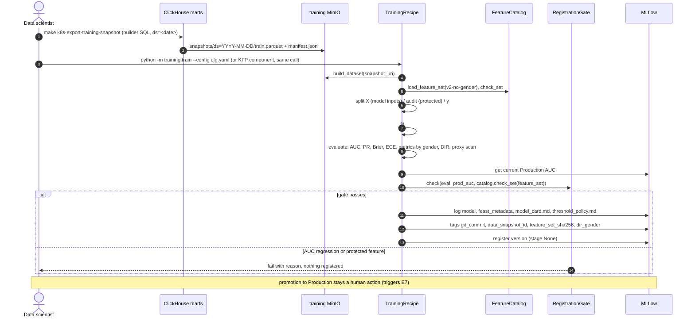

# E6: Fair, governed credit model

| Epic | Outcome / KPI | Baseline → target | Size | Depends on |
|---|---|---|---|---|
| [E6 Governed model](../02-product/epics.md#e6-fair-governed-credit-model) | [O3](../01-business/business-outcomes.md#o3-we-lend-to-good-risks-and-decline-bad-ones) risk quality; [O4](../01-business/business-outcomes.md#o4-lending-is-fair) fair lending; [O6](../01-business/business-outcomes.md#o6-model-and-platform-changes-ship-safely) safe model change | Gender is a model input; three training paths with different features; no fairness evidence, model card or lineage → no protected inputs, one recipe, `dir_gender` and a model card per version, gate on AUC regression | M | [E2 Feature parity](../02-product/epics.md#e2-feature-engineering-with-trainingserving-parity) (catalog) |

> **Proposed change ([ADR-0016](../adr/0016-training-data-lineage-and-reproducible-models.md)).** This package builds around a dated snapshot in training MinIO and the tag `data_snapshot_id`. If the ADR is accepted, the training data is identified by a lineage record (dataset digest, data window, dbt run, code commit) instead, every run's de-identified frame is kept only until a staging period ends, and data is kept for good only for versions that serve. §4, §5 and AC6 then change as described in the [E7 package](E7-model-lineage.md). Nothing below has been changed yet.

## 1. Why

- **Disparate treatment.** `CODE_GENDER` is one of the 24 inputs. Using it in credit decisions is disparate treatment, so it must go (NIST AI 100-1 §3.7; F-07 reversed).
- **Three training paths.** The CLI, the notebook and Kubeflow train different models. Kubeflow even uses `SK_ID_CURR` as a feature (F-08).
- **Missing dataset builder.** The dataset the README trains on, `complete_feature_dataset.csv`, is not built by anything in the repository.
- **No governance artifacts.** No artifact says why the threshold is 0.3, how the model behaves per group, or which commit and data produced it.

## 2. Scope

**In**
- **Dataset builder:** one SQL over the dbt marts gives a versioned snapshot in training MinIO, used by every path.
- **Training recipe:** `fit / evaluate / register`, with features from the catalog and protected features excluded.
- **Offline bias audit:** disparate impact ratio by gender, and a proxy scan.
- **Model card and threshold rationale,** logged as MLflow artifacts.
- **Registration gate:** relative AUC check, catalog check, required tags.
- **Retrain and promote** the first gender-free model.

**Out**
- SHAP reason codes per decision (follow-up to [E5 Decision delivery](../02-product/epics.md#e5-decision-delivery-and-status-tracking)).
- Automated scheduled retraining.

## 3. Today

As-built views: [`L2-5-Model-Lifecycle`](../architecture/c4/docs/images/L2-5-Model-Lifecycle.svg), [`D6-Train-and-Register`](../architecture/c4/docs/images/D6-Train-and-Register.svg) and [`L3-Training-Pipeline`](../architecture/c4/docs/images/L3-Training-Pipeline.svg).

## 4. Target design

### 4.1 C4

Container view [`T-E6-Governed-Model`](../architecture/c4/docs/images/T-E6-Governed-Model.svg). The training recipe and the feature catalog are dashed green.

### 4.2 Module interface (UML)

`Dataset.audit` holds protected attributes (`CODE_GENDER`) **aligned row by row but never passed to `fit`**. Only `evaluate` reads it.

### 4.3 Behaviour

## 5. Data contracts

**Snapshot** `s3://training-data/snapshots/ds=YYYY-MM-DD/`

| File | Content |
|---|---|
| `train.parquet` | `SK_ID_CURR`, `TARGET`, all catalog `model_input` columns, and the protected `CODE_GENDER` (audit only) |
| `manifest.json` | `{"snapshot_id","created_at","row_count","feature_set_sha256","sql_sha256"}` |

Builder SQL: `mart_application` ⋈ `mart_application_train` ⋈ `external_score` ⋈ `mart_bureau_features` ⋈ `mart_previous_application` ⋈ `mart_pos_cash_balance` ⋈ `mart_credit_card_balance` on `SK_ID_CURR` (left joins after the train join).

**Registration gate**

| Rule | Fails when |
|---|---|
| No regression | `auc < prod_auc − 0.005` (skipped when there is no Production version) |
| Floor | `auc < 0.72` |
| Catalog | any model feature missing from the catalog, or any protected feature used |
| Fairness | `dir_gender < 0.80` → **does not fail**; registers with tag `fairness_review_required=true` |

**MLflow artifacts and tags per version**

| Kind | Name |
|---|---|
| tags | `git_commit`, `data_snapshot_id`, `feature_set_sha256`, `dir_gender`, `fairness_review_required` |
| artifacts | `model/`, `feast_metadata.yaml` (with `feature_set_sha256`), `model_card.md`, `threshold_policy.md`, `evaluation.json` |
| input example | synthetic row ([E9 Security baseline](../02-product/epics.md#e9-security-baseline)) |

**`model_card.md` sections:** intended use and out-of-scope uses; training data (snapshot id, rows, default rate); features (count, groups, protected excluded); performance overall and by gender; calibration; threshold and bands (link to the policy); known limitations; versions.

**`threshold_policy.md`:** cost assumptions (loss given default vs. lost margin), expected loss as a function of the threshold, the chosen review band ([E5 Decision delivery](../02-product/epics.md#e5-decision-delivery-and-status-tracking): 0.25–0.35) and its justification.

## 6. Change list

| File | Change |
|---|---|
| `services/model-lifecycle/training/recipe.py`, `gate.py`, `fairness.py`, `model_card.py`, `train.py` (CLI) | **new** |
| `services/model-lifecycle/training/train_register.py` | delete (replaced by `train.py`, which uses the recipe) |
| `services/model-lifecycle/training/model_pipeline.py` | tuning only; calls `recipe.fit/evaluate`; writes `TrainingConfig` YAML |
| `services/model-lifecycle/pipeline/pipeline.py` | `train_and_register` calls the recipe; recompile `training_pipeline.yaml` |
| `Makefile` `k8s-export-training-snapshot` | builder SQL; parquet + manifest; `ds` parameter instead of the hard-coded date |
| `README.md` Results, Quick Start | 23 features, gender-free, snapshot-based quick start |

## 7. Acceptance criteria → tests

| # | Given / When / Then | Test |
|---|---|---|
| AC1 | Given the catalog when building X then no protected column is in X, and `CODE_GENDER` is in `audit` | `tests/unit/training/test_recipe.py` |
| AC2 | Given predictions and groups with approval rates 0.6 vs 0.4 then `dir_gender = 0.667` | `test_fairness.py` |
| AC3 | Given eval AUC 0.760 and prod 0.770 then the gate fails; given 0.766 then it passes | `test_gate.py` |
| AC4 | Given a feature list with `CODE_GENDER` then the gate fails with `protected_used` | `test_gate.py` |
| AC5 | Given a synthetic 2,000-row dataset when CLI and KFP paths train with the same config and seed then the feature lists and metrics are equal | `test_recipe.py::test_entrypoints_equivalent` |
| AC6 | Given a registered version then tags `git_commit`, `data_snapshot_id`, `feature_set_sha256` exist and `model_card.md` is an artifact | `test_recipe.py` with a local file-store MLflow |
| AC7 | Given the real snapshot when retraining without gender then AUC ≥ 0.72 and the card shows by-gender metrics | manual run, numbers recorded in the PR |

## 8. Test plan by layer

| Layer | What |
|---|---|
| Pure logic | fairness metrics, gate rules, card rendering |
| Module interface | recipe on a small synthetic dataset with a local MLflow file store (`mlruns/` in a tmp dir): no mocks of MLflow |
| Manual | full retrain on the snapshot, recorded |
| Delete | none today (no training tests exist) |

## 9. Rollout, rollback, observability

1. Export the snapshot.
2. Retrain.
3. Review the model card; check `fairness_review_required`.
4. Promote in MLflow. [E7](../02-product/epics.md#e7-automated-traceable-model-promotion) deploys it.

Rollback: promote the previous version again. The watcher redeploys it.

Signal: the scoring health endpoint shows the new version; decision events carry `model_version` ([E5 Decision delivery](../02-product/epics.md#e5-decision-delivery-and-status-tracking)).

## 10. Risks and open questions

| Item | Owner | Note |
|---|---|---|
| AUC may drop slightly without gender | risk owner | Expected and acceptable; the gate floor is 0.72 |
| Proxies (for example `NAME_INCOME_TYPE = Maternity leave`) | data scientist | The proxy scan reports mutual information with gender; dropping a proxy is a human decision recorded in the card |
| Cost figures for the threshold policy | risk owner | Placeholder assumptions until provided |
