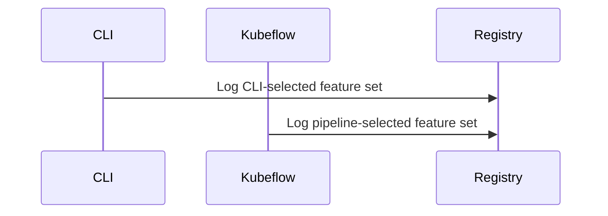
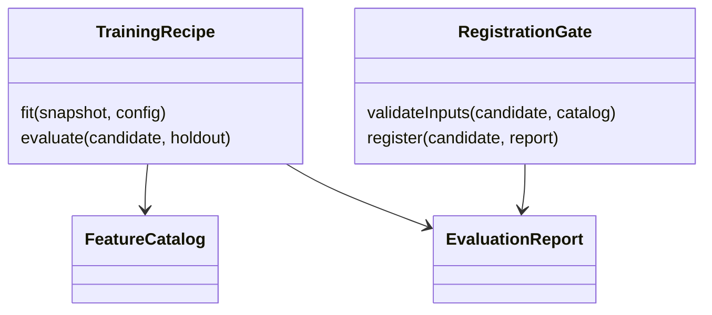
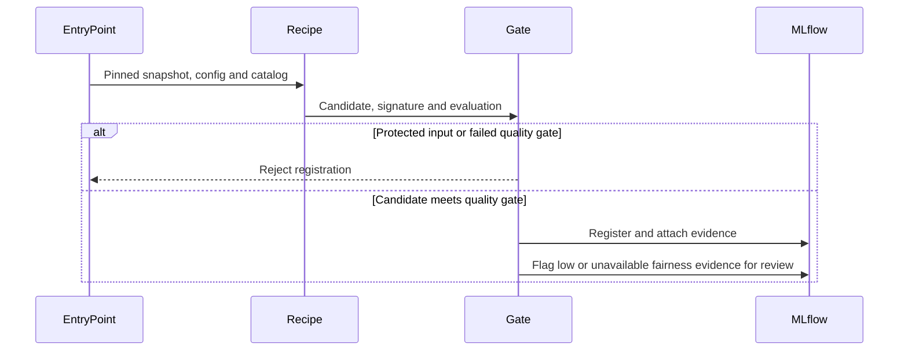

# E6. Fair, governed model

| Epic | Outcomes | Baseline → target | Size | Depends on |
|---|---|---|---|---|
| [E6](../02-product/epics.md#e6-fair-governed-credit-model) | O3, O4, O6 | AUC ≈ 0.77, unaudited fairness and divergent trainers → shared recipe, documented threshold and versioned evidence | M | E2 |

## 1. Why

A candidate needs a reproducible feature list, threshold rationale, fairness evidence and lineage before it can be promoted. See [business outcomes](../01-business/business-outcomes.md) and [findings F-07 and F-08](../architecture/c4/docs/07-findings.md).

## 2. Scope

Share the training recipe across CLI, notebook and Kubeflow, reject protected inputs, and capture evaluation evidence. E2 owns the catalog and E7 owns changes to promotion automation.

## 3. Today

The [as-built model lifecycle](../architecture/c4/docs/images/L2-5-Model-Lifecycle.svg) has multiple training entry points.



## 4. Target design

See the [governed model target](../architecture/c4/docs/images/T-E6-Governed-Model.svg).





## 5. Data contracts

Each candidate carries a model signature, catalog version, source commit, immutable snapshot reference, split seed and threshold policy version. The model card includes evaluation cohorts, sample counts, AUC, cost matrix and limitations. Example MLflow fields:

```yaml
metrics:
  auc: 0.77
  dir_gender: 0.78
tags:
  fairness_review_required: "true"
  feature_catalog_version: "1"
  threshold_policy_version: "1"
```

Compute DIR as female approval rate divided by male approval rate using the same decision threshold for both. Keep protected labels in restricted offline evaluation data. When a group is absent or the denominator is zero, record the reason and require review. Record the counts used for each rate and log aggregate evidence only. The quality gate uses the larger of 0.72 and incumbent AUC minus 0.005, measured on the same holdout.

## 6. Change list

Share the recipe between [CLI training](../../application/training/train_register.py), [notebook tooling](../../notebook/model_pipeline.py) and [Kubeflow](../../platform/ml/k8s/training-pipeline/pipeline.py). Regenerate the compiled pipeline when the recipe wiring changes. Validate signatures before registry creation and replace the training-row example with the [E9 synthetic fixture](E9-security-baseline.md).

## 7–8. Acceptance and test plan

| Criterion | Planned test |
|---|---|
| Protected feature or entity ID rejected | Unit `test_registration_rejects_disallowed_inputs` |
| DIR logged and a ratio below 0.80 flagged | Integration `test_mlflow_persists_fairness_evidence`; unit fixtures cover zero denominator and missing cohorts |
| Entry points produce the same inputs and metrics | Integration `test_training_entrypoint_parity` with pinned split, seed and dependencies |
| AUC and threshold evidence enforced | Unit `test_candidate_quality_gate` and integration `test_model_card_and_lineage_artifacts` |

## 9. Rollout and rollback

Register a candidate without changing serving traffic, compare it with the incumbent on one holdout, and require risk review of threshold and fairness evidence before promotion. Verify the feature signature against live serving. Roll back to the last approved compatible model through the registry, subject to the protected-input policy.

## 10. Open questions

Model risk owns the cost matrix, minimum cohort sizes, missing-label treatment and approval of the fairness review. Data science owns the reproducible snapshot and metric tolerances.
