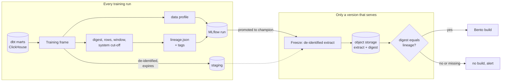
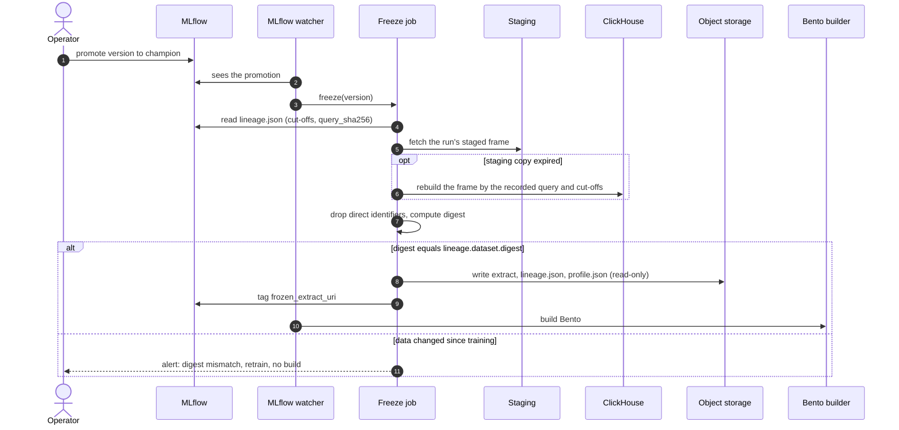

# E7: Model lineage and reproducibility

| Epic | Outcome / KPI | Baseline → target | Size | Depends on |
|---|---|---|---|---|
| [E7 Model promotion](../02-product/epics.md#e7-automated-traceable-model-promotion) | [O6](../01-business/business-outcomes.md#o6-model-and-platform-changes-ship-safely) safe change; [O8](../01-business/business-outcomes.md#o8-decisions-are-explainable-and-accountable) accountable decisions | No recorded link from a model to its data → every serving model rebuilds its training data and matches a digest | M | [E6 Governed model](../02-product/epics.md#e6-fair-governed-credit-model) (registration gate), [E2 Feature parity](../02-product/epics.md#e2-feature-engineering-with-trainingserving-parity) (feature-set digest) |

Decision: [ADR-0016](../adr/0016-training-data-lineage-and-reproducible-models.md) (**Proposed**). Nothing here is built.

## 1. Why

Someone will ask, months after a decision, which data the deciding model learned from. Two things make that hard to answer today:
- **Nothing records it.** The training run logs the feature-set digest and the feature list, and nothing about the data.
- **The one file that might have answered it is overwritten.** The export target writes a single snapshot to a fixed path, so it cannot say which model used which data.

Keeping a full copy per run would answer it, but it is costly and multiplies copies of credit data. This package records enough on every run to trace and compare, keeps each run's de-identified frame only for a short time, and keeps data for good only for models that serve.

## 2. Scope

**In**
- **Lineage record** written by every training run (§4.2), and the same keys as tags on the registered version.
- **Data profile** attached to every run (§4.3).
- **Staging area** that holds each run's de-identified training frame until it expires (§4.1).
- **Frozen, de-identified extract** for a version promoted to serve (§4.4), with a digest check before the build.
- **Compare** two runs by digest and profile (§4.5).

**Out**
- Rebuilding the data of a run that was not promoted after its staging copy expired (only its digest and profile remain).
- A table format (Iceberg, Delta) for the training tables. The mechanism is replaceable; see the ADR.
- Retention period for frozen extracts (open question, §7).
- Scheduled retraining and the champion comparison ([E6](../02-product/epics.md#e6-fair-governed-credit-model) gate).

## 3. Today

| What | State (read from the code) |
|---|---|
| Tags `git_commit`, `data_snapshot_id` | Promised by E7.1; **no code sets them** |
| Logged by the training run | Parameters, `feature_set_sha256`, `model/feature_set.json`, `feast_metadata.yaml` |
| Training input | One CSV at a fixed path `ds=2025-09-19`, written by `make k8s-export-training-snapshot` with truncate-on-insert, so it is overwritten |
| Promotion | A stage parameter sets the `champion` alias; the MLflow watcher builds the Bento when a version is promoted |

## 4. Target design

### 4.1 Two levels



### 4.2 Lineage record

Written to the run as the artifact `lineage.json`. These keys are also set as tags on the version: `dataset_digest`, `git_commit`, `feature_set_sha256`, `dbt_run_id`, `data_cutoff`.

```json
{
  "schema": 1,
  "dataset": {
    "digest": "sha256:9f2c…",
    "rows": 307511,
    "columns": 24,
    "event_time": {"from": "2018-01-01T00:00:00Z", "to": "2025-09-19T00:00:00Z"},
    "system_cutoff": "2026-11-20T00:00:00Z",
    "source_tables": ["application_mart.mart_application", "application_mart.mart_application_train"],
    "mutable_sources": [],
    "query_sha256": "b71a…"
  },
  "transform": {
    "dbt_git_sha": "4c8529b…",
    "dbt_run_id": "2026-11-20T01:05:11Z",
    "feature_set_version": "v2-no-gender",
    "feature_set_sha256": "ac01…"
  },
  "code": {
    "git_commit": "68dedfb…",
    "image_digest": "sha256:0ea3…",
    "seed": 42,
    "libraries": {"python": "3.9", "xgboost": "x.y.z", "scikit-learn": "x.y.z"}
  }
}
```
All values are examples, except that 307,511 is the row count of the public Home Credit training table.

**How the digest is computed.** Sort the training frame by `SK_ID_CURR`, write the columns in feature-set order, hash the canonical serialisation with SHA-256. The same data in a different row order gives the same digest.

### 4.3 Data profile

Artifact `profile.json`, small enough to read by eye. One entry per model input and one for the target.

```json
{"rows": 307511, "target_rate": 0.0807,
 "features": {"AMT_INCOME_TOTAL": {"type": "num", "mean": 168797.9, "std": 237123.1, "min": 25650.0, "max": 117000000.0,
                                    "null_rate": 0.0, "quantiles": {"p05": 81000.0, "p50": 147150.0, "p95": 337500.0}},
              "NAME_EDUCATION_TYPE": {"type": "cat", "null_rate": 0.0, "top": {"Secondary / secondary special": 0.711}}}}
```
Example values are only illustrative. The profile answers "where did the data change" without opening the data.

### 4.4 Freeze at promotion



Layout of one frozen extract (example path): `s3://model-evidence/<model>/v<version>/` holding `train.parquet`, `lineage.json`, `profile.json`. Written once; no overwrite.

### 4.5 Compare two runs

A small command takes two run ids. It prints "same data" when the digests match, and otherwise lists per feature the change in row count, mean, spread, null rate and quantiles, ordered by size of change.

## 5. Acceptance criteria → tests

Every test below is **to be written**; none exists yet.

| # | Given / When / Then | Test |
|---|---|---|
| AC1 | Given a training run then `lineage.json` holds every key in §4.2 and the five tags exist on the registered version | `tests/unit/training/test_lineage.py` |
| AC2 | Given the same frame in two row orders then the digest is equal; given one changed cell then it differs | `test_lineage.py` |
| AC3 | Given a candidate without a lineage record then registration fails with `lineage_missing` | `test_gate.py` (extends E6) |
| AC4 | Given a run then `profile.json` has an entry per model input with the §4.3 statistics | `test_profile.py` |
| AC5 | Given a promotion with no frozen extract, or a digest that differs, then no Bento build starts | `tests/unit/model_lifecycle/test_freeze.py` |
| AC6 | Given a frozen extract then no column is on the direct-identifier list | `test_freeze.py` |
| AC7 | Given a frozen extract when the model is retrained from it with the recorded seed then the metrics equal the run's | manual run on the real data, numbers recorded |
| AC8 | Given two runs then the compare command reports "same data" for equal digests and lists changed features otherwise | `test_compare.py` |
| AC9 | Given a staged frame past its period then it is deleted; given a promotion after that then the frame is rebuilt and promotion goes on only if the digest matches | `test_freeze.py` |

## 6. Rollout, rollback, signal

1. Write the lineage record and profile first. Nothing else depends on them, so rollback is removing the step.
2. Add the registration check once every training path writes the record (the three paths are being merged in [E6](../02-product/epics.md#e6-fair-governed-credit-model)).
3. Add the freeze job and the build check last, behind a flag, because it can block a promotion.
4. Signal that it works: every version registered after step 2 has the five tags; every champion has a `frozen_extract_uri`.

## 7. Open questions

| Question | Owner |
|---|---|
| How long must a frozen extract be kept? Not in the sources we read; compliance must set it. Until then nothing is deleted. | Compliance, with the project owner |
| How long does the staging area keep a run's frame? It bounds how late a model can be promoted and still be frozen exactly. | Project owner |
| Are the warehouse tables appended to, or rewritten in place? This decides whether a cut-off on event time and load time can rebuild a window. | Data engineering |
| Which columns does the training frame hold, and are any direct identifiers? | Data science |
| Is the frozen extract a Parquet file tracked by DVC, or an Iceberg tag? Replaceable, but one must be chosen to build. | Project owner |
| Does a regulator expect an exact rebuild of every serving model, or is trace and compare enough for some? | Compliance |
