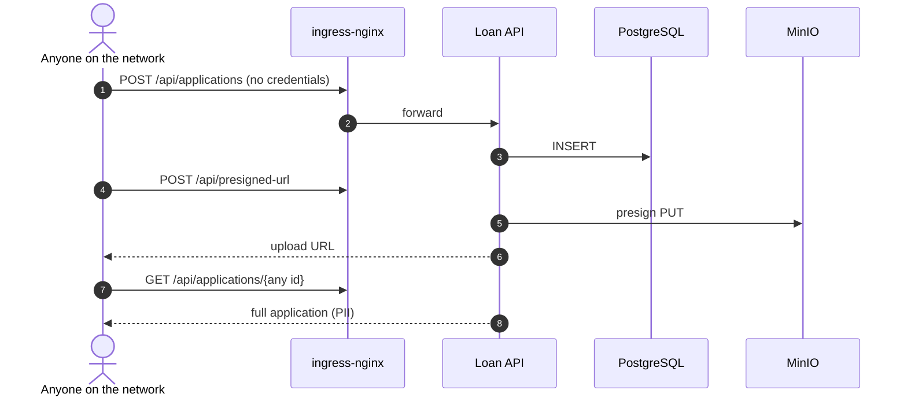
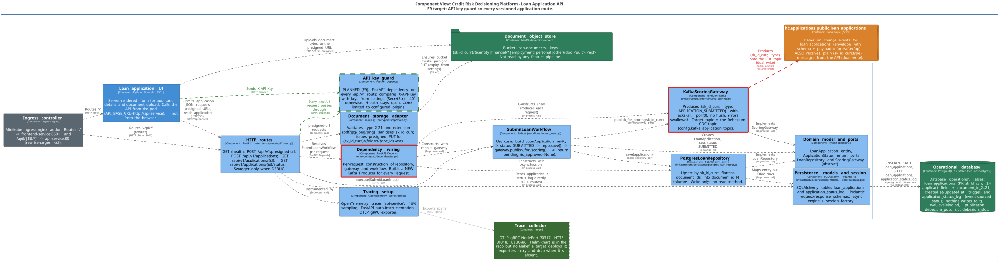
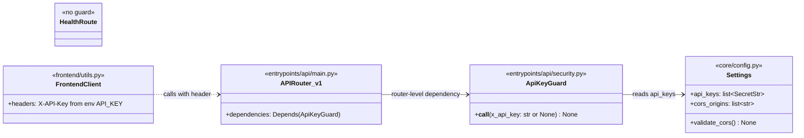
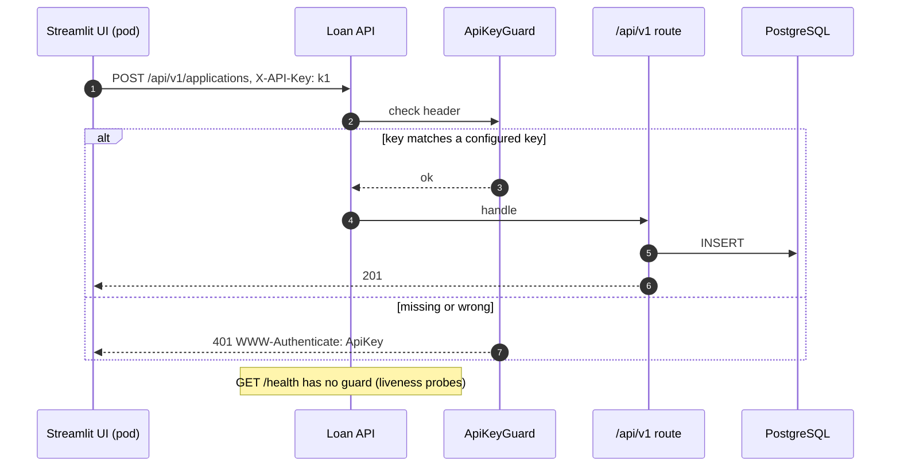

# E9: Security baseline

| Epic | Outcome / KPI | Baseline → target | Size | Depends on |
|---|---|---|---|---|
| [E9 Security baseline](../02-product/epics.md#e9-security-baseline) | [O7](../01-business/business-outcomes.md#o7-applicant-data-is-protected) protect applicant data | Write endpoints are unauthenticated; credentials were committed; MLflow stores a real applicant row → API key on every `/api/v1` route, no tracked secrets, synthetic `input_example`, gitleaks before every commit | S | none |

> **Scope change (2026-11-22).** People now sign in through Keycloak ([E11](E11-identity-access.md)): staff with MFA and applicants with a verified account. The API key in this package is the **interim** guard until [E11](../02-product/epics.md#e11-identity-and-access) ships, and afterwards protects only the load-test client. The rest of [E9 Security baseline](../02-product/epics.md#e9-security-baseline) (CORS, secrets hygiene, synthetic `input_example`, gitleaks, risk acceptance) stands as written. Security testing before release is in [E16](E16-uat-release.md) and the [threat model](../security/threat-model.md).

## 1. Why

Anyone who can reach the ingress can submit applications, request presigned upload URLs and read any application by id (F-17). Credentials sat in tracked `.env` files. These are untracked since 2026-11-21, but still in history, so they must be rotated. The trained model logs one training row (`X_train.iloc[:1]`) as its MLflow `input_example`, which copies applicant data into the model registry.

## 2. Scope

**In**
- API-key guard on all `/api/v1/*` routes. `/health` stays open.
- CORS: explicit methods and headers. Startup fails if `*` is an allowed origin while credentials are allowed.
- Frontend sends the key. The key is provisioned as a Kubernetes Secret by `make k8s-secrets`.
- Synthetic `input_example` in both training paths.
- `.pre-commit-config.yaml` with gitleaks and `make check` as the local quality gate. `.github/workflows/test.yml` triggers on `master`.
- `docs/security/risk-acceptance.md`: Kafka PLAINTEXT inside the cluster, Kubernetes Secrets instead of Vault, and rotation of the historic credentials.

**Out**
- Per-user authentication ([E11 Identity and access](../02-product/epics.md#e11-identity-and-access)), rate limiting ([E12](../02-product/epics.md#e12-staff-and-applicant-portals)), TLS inside the cluster, rewriting git history. NetworkPolicies are a release gate ([checklist 3.9](../release/checklist.md#3-security)).

## 3. Today

As-built view: [`L3-API`](../architecture/c4/docs/images/L3-API.svg). The routes call the workflow and the ORM directly, with no guard.

## 4. Target design

### 4.1 C4

Component view [`T-E9-API-Security`](../architecture/c4/docs/images/T-E9-API-Security.svg). The API key guard is dashed green.

### 4.2 Module interface (UML)

Behaviour of the guard:
- Constant-time compare (`hmac.compare_digest`) against each configured key.
- Missing or wrong key → `401` with header `WWW-Authenticate: ApiKey`.
- If `api_keys` is empty and `debug` is false, startup fails. An empty key list is only allowed in debug.

### 4.3 Behaviour

## 5. Data contracts

| Item | Value |
|---|---|
| Request header | `X-API-Key: <key>` |
| API setting | `APP_API_KEYS`: comma-separated; read as `list[SecretStr]` |
| Frontend env | `API_KEY` from Secret `api-secrets`, key `APP_API_KEYS` (first key) |
| CORS | `allow_methods=["GET","POST"]`, `allow_headers=["Content-Type","X-API-Key"]`, `allow_credentials=False` (the API uses a header, not cookies) |
| Make | `make k8s-secrets` requires `API_KEY` and adds `--from-literal=APP_API_KEYS="$(API_KEY)"` to `api-secrets` |
| `.env.example` | `API_KEY=<set-locally>` |
| Synthetic input example | One row: median of each numeric column, mode of each categorical column, computed on `X_train`. This is aggregate statistics, not an applicant |

## 6. Change list

| File | Change |
|---|---|
| `services/loan-api/src/entrypoints/api/security.py` | **new**: `ApiKeyGuard` |
| `services/loan-api/src/entrypoints/api/main.py` | router for `/api/v1` with the guard; CORS settings above |
| `services/loan-api/src/core/config.py` | `api_keys`, validator for CORS and keys |
| Portal BFF API client and deployment configuration | Review the planned gateway controls against the OIDC token relay in [E11](E11-identity-access.md) and [E12](E12-portals.md) |
| `Makefile` (`k8s-secrets`, new `check`), `.env.example` | key provisioning; local gate |
| `.pre-commit-config.yaml` | **new**: gitleaks (and `check-added-large-files`) |
| `services/model-lifecycle/training/train_register.py:230`, `services/model-lifecycle/pipeline/pipeline.py:361` | `input_example = synthetic_example(X_train)` |
| `.github/workflows/test.yml` | `branches: [master]` |
| `docs/security/risk-acceptance.md` | **new** |
| `tests/load` | `locustfile.py` sends `X-API-Key` |

## 7. Acceptance criteria → tests

| # | Given / When / Then | Test |
|---|---|---|
| AC1 | Given no header when POST `/api/v1/applications` then 401 | `tests/integration/api/test_auth.py` |
| AC2 | Given a wrong key then 401; given a configured key then 201 | same |
| AC3 | Given no header when GET `/health` then 200 | `test_health.py` |
| AC4 | Given `cors_origins=["*"]` when settings load then a validation error | `tests/unit/schemas/test_settings.py` |
| AC5 | Given `api_keys=[]` and `debug=false` when the app starts then startup fails | same |
| AC6 | Given a training frame when building the example then no row of the frame equals the example | `tests/unit/training/test_input_example.py` |
| AC7 | Given a staged file containing an AWS-style key when committing then gitleaks blocks it | manual, recorded in the PR |

## 8. Test plan by layer

Existing integration API tests must send the header: add it in `tests/integration/conftest.py`'s client fixture so each test isn't edited one by one. No tests are deleted.

## 9. Rollout, rollback, observability

1. Rotate local DB and MinIO passwords.
2. Run `make k8s-secrets` with `API_KEY`.
3. Deploy the API and the frontend together; they must ship together, because the frontend without the header gets 401.

Rollback: unset the guard by redeploying the previous image (the Secret is harmless).

Signal: count of 401s in API logs (spikes mean a misconfigured client or a probe).

## 10. Risks and open questions

| Item | Note |
|---|---|
| A single shared key | Acceptable for a portfolio; per-client keys or OAuth come with real users |
| History still holds old credentials | Rotation makes them useless; rewriting history was explicitly declined |
