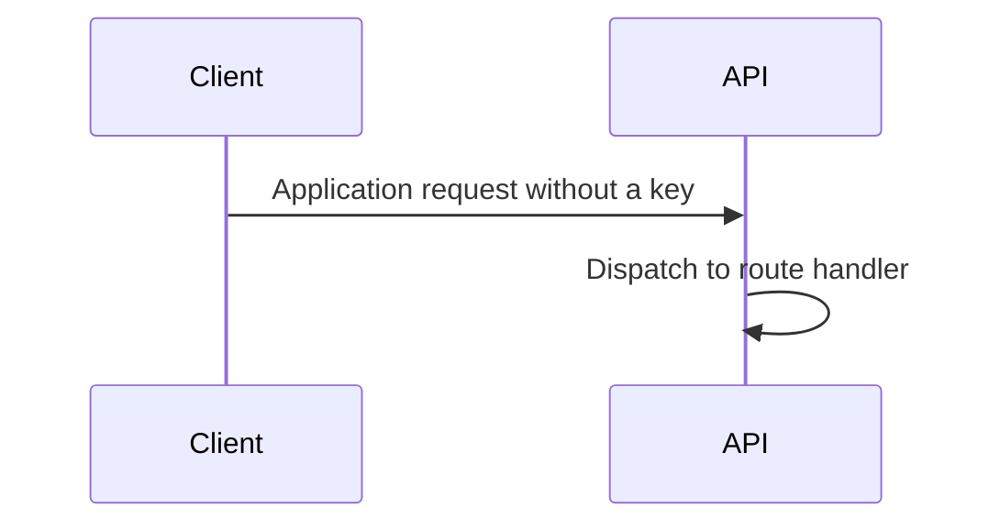
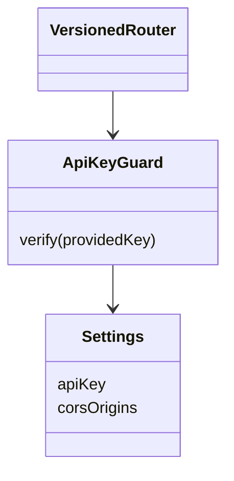
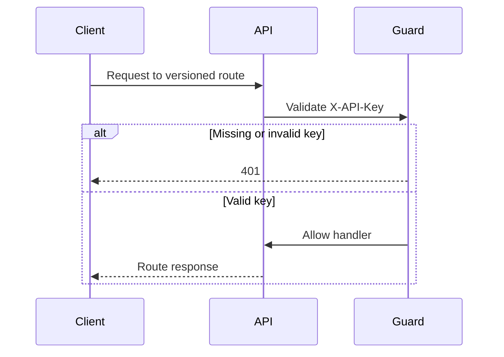

# E9. Security baseline

| Epic | Outcome | Baseline → target | Size | Depends on |
|---|---|---|---|---|
| [E9](../02-product/epics.md#e9-security-baseline) | O7 | Unauthenticated API and historical tracked credentials → authenticated API, restricted CORS and synthetic artifact examples | S | None |

## 1. Why

Application routes handle applicant data. See [outcome O7](../01-business/business-outcomes.md) and [finding F-17](../architecture/c4/docs/07-findings.md).

## 2. Scope

Protect all `/api/v1/*` routes, preserve open health probes and permitted CORS preflights, scan staged changes for secrets and build synthetic model examples. E5 owns ownership checks for applicant status. Credential rotation requires coordination with the owners of the affected systems.

## 3. Today

See the [as-built API view](../architecture/c4/docs/images/L3-API.svg).



## 4. Target design

See the [API security target](../architecture/c4/docs/images/T-E9-API-Security.svg).





## 5. Data contracts

```http
GET /api/v1/applications/example/status HTTP/1.1
X-API-Key: <injected-service-key>
```

The status route is planned in E5. Apply the guard at the router so future versioned routes inherit it. Inject the key from a Kubernetes Secret into the API and server-side clients. Use constant-time comparison and keep the key out of logs, browser code and repository examples. Reject blank keys and wildcard origins at startup. Example allowed origin is `https://credit-ui.example`. Compare the full scheme, host and port. An allowed cross-origin preflight may advertise `X-API-Key` without granting application access.

Build MLflow examples from the ordered input schema with deterministic fabricated values of the expected types. Examples must be accepted by the registered model signature and must never be sampled from applicant rows.

## 6. Change list

- Wire settings in [core config](../../application/core/config.py) and the router dependency and CORS policy in [API main](../../application/entrypoints/api/main.py).
- Update [frontend](../../application/frontend/frontend.py), load tests and deployment configuration to inject and send the key server-side.
- Add a pinned gitleaks hook and quality-gate entry point. Replace the sampled MLflow example in [training registration](../../application/training/train_register.py).

## 7–8. Acceptance and test plan

| Criterion | Planned test |
|---|---|
| Missing or wrong key yields 401 on all registered versioned routes, health stays open | Integration `test_versioned_routes_require_key`, including valid-key and ingress smoke cases |
| Unlisted origin receives no access-control allow headers and wildcard config fails startup | Integration `test_cors_allowlist` and unit `test_reject_wildcard_origin` |
| Staged credential is blocked | Tooling `test_gitleaks_blocks_staged_fixture` in a temporary Git repo using a fabricated test secret |
| Model example is synthetic | Unit `test_input_example_uses_signature_only` and integration `test_mlflow_artifact_has_synthetic_example` |

## 9. Rollout and rollback

Provision the key and configure supported callers before enabling enforcement. Smoke-test authorized routes through ingress and verify probes continue to pass. Watch 401 rates and CORS failures without logging credentials. Roll back to a prior secure API/client revision or restrict ingress until the key configuration is repaired. Rotate historical credentials and verify that former values no longer authenticate.

## 10. Open questions

Platform owns the service key and rotation inventory. Security owns the disposition of historical credential exposure. Application owners supply the exact deployed origin allowlist.
