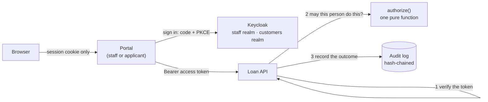
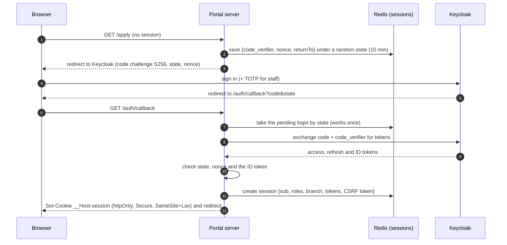
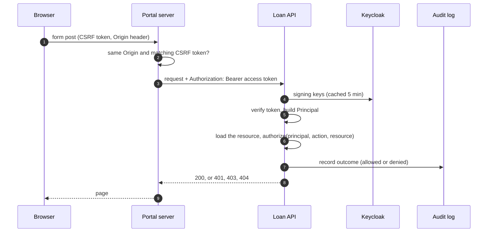

# Authentication and authorization

How a person proves who they are, and how the platform decides what they may do. Everything on this page comes from the code and the Keycloak realm files; the last section lists what is not checked or not covered.

## Where this fits

| Layer | What | Where |
|---|---|---|
| Outcome (why) | [O7 Data protection](../01-business/business-outcomes.md#o7-applicant-data-is-protected): only signed-in, authorised people reach applicant data. [O8 Accountable](../01-business/business-outcomes.md#o8-decisions-are-explainable-and-accountable): every access is recorded | [Business outcomes](../01-business/business-outcomes.md) |
| Epic (what) | [E11 Identity and access](../02-product/epics.md#e11-identity-and-access), which [E12 Portals](../02-product/epics.md#e12-staff-and-applicant-portals) and [E13 Audit trail](../02-product/epics.md#e13-audit-trail) build on | [Epics](../02-product/epics.md#e11-identity-and-access) |
| Features | **F1** sign-in for two kinds of people (sections 1 and 2 below), **F2** the API trusts only tokens it can verify (section 3), **F3** each person can do only what their role allows (sections 4 and 5) | [E11 features and stories](../02-product/epics.md#e11-identity-and-access) |
| Decisions (why this way) | [ADR-0012](../adr/0012-keycloak-realms-and-bff-portals.md) Keycloak, two realms, portals as backends-for-frontend. [ADR-0013](../adr/0013-role-based-data-and-explanation-visibility.md) who sees which data. [ADR-0014](../adr/0014-applicant-personal-data-and-opaque-ids.md) personal data and opaque ids | [Decisions](../adr/README.md) |
| Design and tests | The package that says how it is built and how each acceptance criterion is tested | [E11 handoff](../03-handoff/E11-identity-access.md) |

This page explains how the pieces work together. The documents above say why they exist and how each is checked.

## In one picture

Three rules hold the design together:

1. **The browser never holds a token.** It holds an opaque, `httpOnly` session cookie. The portal's server keeps the tokens and calls the API for the user.
2. **The API decides, not the portal.** The portal hides buttons, but the API checks every call, so a bypassed portal gains nothing.
3. **Deny by default.** A request is allowed only when a rule says so, and every outcome, allowed or denied, is written to the audit log.

## 1. Who can sign in

Two separate Keycloak realms. A person is in exactly one.

| | `staff` realm | `customers` realm |
|---|---|---|
| Who | Loan officers, underwriters, risk managers, auditors, admins | Applicants |
| Account creation | An administrator only (self-registration is off) | The person registers and must verify their email |
| Second factor | Required: TOTP setup is a default required action, and tokens must carry `acr = mfa` | Not required |
| Password policy | At least 12 characters, not the username, not one of the last 5 | At least 10 characters, not the username or email |
| Roles in the token | `loan_officer`, `underwriter`, `risk_manager`, `auditor`, `admin` | `applicant` |
| Extra claim | `branch_id` (a loan officer sees only their branch) | none |
| Brute-force protection | On | On |
| Portal client | `staff-portal` (confidential, authorization code + PKCE S256) | `applicant-portal` (same) |

Both realms issue 5-minute access tokens and end an SSO session after 30 minutes idle or 8 hours in total. Direct password grants are off for every client.

The staff realm also defines a `decision-recorder` client with a service account, for machine access to the API. See the last section.

## 2. Signing in (browser, portal, Keycloak)

The portal is a backend-for-frontend: the browser talks to the portal, and the portal talks to Keycloak and the API.

What protects this step:

- **PKCE and one-time state.** The login state is read once and deleted, so a callback cannot be replayed. `nonce` ties the ID token to this login.
- **No open redirects.** After sign-in the portal only follows a path that starts with a single `/`.
- **Cookie.** `__Host-` prefix (HTTPS, no domain, path `/`), `httpOnly`, `Secure`, `SameSite=Lax`.
- **Session lifetime.** 30 minutes idle (sliding) and 8 hours absolute, both stored server-side in Redis. Destroying the Redis key ends the session at once.
- **Refresh.** Within 30 seconds of the access token expiring, the portal refreshes it on the server. If that fails, the session is destroyed and the user signs in again.
- **Sign-out.** The portal deletes the session and redirects to Keycloak's end-session endpoint with the ID token as a hint.

## 3. Calling the API

Every server component and server action first calls `requireSession(realm, roles?)`. It loads the session, refreshes the token if needed, redirects to sign-in when there is no session, and to `/forbidden` when the person has none of the allowed roles (a convenience check, not the security check).

Then the portal calls the API with the user's own access token (token relay):

**Portal side, for every change (POST):** the form must carry the session's CSRF token and the request's `Origin` must be the portal's own origin (`assertMutation`). Calls made from client components with no form check the `Origin` only (`assertSameOrigin`). The portal also sends a strict Content-Security-Policy with a per-request nonce, `frame-ancestors 'none'`, and a `connect-src` limited to itself and the document-storage origin.

**API side, what makes a token acceptable** (`TokenVerifier`, `entrypoints/api/security.py`). Anything else is `401`:

| Check | Detail |
|---|---|
| Algorithm | Only `RS256` |
| Issuer | Must be one of the configured realm issuers (`APP_OIDC_ISSUERS`) |
| Signature | Verified with the issuer's published keys (JWKS), cached 5 minutes |
| Required claims | `exp`, `iat`, `sub`, `iss`, `aud` all present |
| Audience | `credit-api` |
| Expiry | Not expired |
| Role | At least one role the application knows (Keycloak's default roles are ignored), and only roles valid for that realm |
| Multi-factor | A `staff` token must have `acr = mfa` |

The result is a `Principal`: who (`sub`), which realm, which roles, and for staff the `branch_id`. A customer token can never carry a staff role, and the other way round (the `Principal` refuses to be built).

## 4. Deciding: roles plus rules

`authorize(principal, action, resource)` is one pure function with no I/O (`authz/policy.py`). The API loads only the facts a rule needs about the target, then asks. A request is allowed when **a role the person holds has a rule for the action and that rule's condition holds**. If no role has a rule, it is denied with rule `role`.

Facts about the target (`Resource`): the channel the application came through (`staff` or `self`), who the applicant is, who submitted it, its branch, its latest status, whether bureau consent was recorded, who proposed a policy change, and the purpose of a customer lookup.

| Action | Who may, and under which rule |
|---|---|
| Submit an application | Applicant: own, self-service. Loan officer: staff channel, same branch |
| Read an application | Applicant: own. Loan officer: same branch. Underwriter: while it is in manual review |
| Read the customer profile | Loan officer: the one handling the case, with consent recorded. Underwriter: in manual review |
| **Reveal citizen ID and phone** | Loan officer: the one handling the case. Underwriter: in manual review. A reason is required and is audited, never the values |
| Attach a document | Applicant: own, while the file is open. Loan officer: same branch |
| Look up an existing customer | Loan officer, with a valid purpose (`co_applicant`, `guarantor`, `customer_present`) |
| Add a case note, flag a concern | Loan officer: same branch. Underwriter: in manual review |
| Read a decision | Applicant: own. Loan officer: same branch. Underwriter, risk manager, auditor: any |
| Read an explanation | Underwriter: in manual review. Auditor: as recorded |
| Claim or decide a review | Underwriter: **not their own submission** (separation of duties) |
| Propose a policy change | Risk manager |
| Approve a policy change | Risk manager: **not the proposer** (four eyes) |
| Read the audit trail | Auditor |

Two details worth knowing:

- **404 or 403.** An unknown, malformed, or someone else's application id all return the same `404`, so ids are not an oracle for guessing. `403` is returned only for a real application the person may not act on, with the rule that failed.
- **Application ids in URLs are opaque UUIDs.** Citizen ID, phone and amounts never appear in a URL (ADR-0014).

## 5. Recording

Every `authorize` call is written to the audit log, allowed or denied, with the actor, realm, roles, action, resource, rule and trace id (`require_action`). The log is its own database, append-only, and each event carries `hash = sha256(previous hash + the event)`, so an edit or a deletion breaks the chain. A scheduled job verifies the chain. Details are sanitised before they are stored, and for an identity reveal the reason is kept but not the revealed values.

## 6. Where it lives

| Concern | Code |
|---|---|
| Realms, clients, roles, MFA, lifetimes | `platform/foundation/identity/` (`realms/staff.json`, `realms/customers.json`, `02-keycloak.yaml`) |
| Login, callback, logout routes | `portals/packages/auth/src/routes.ts`, `oidc.ts` |
| Sessions, CSRF, cookies, token relay | `session.ts`, `csrf.ts`, `cookies.ts`, `server.ts` in the same package |
| CSP and security headers | `portals/packages/auth/src/security-headers.ts` |
| Token verification | `services/loan-api/src/entrypoints/api/security.py` |
| Permission matrix | `services/loan-api/src/authz/policy.py` |
| Enforcement and audit | `services/loan-api/src/entrypoints/api/access.py`, `src/audit/` |

Public host names that the sign-in URLs use are configured per environment ([configuration and secrets](../security/configuration-and-secrets.md)).

## 7. What this page does not claim

- **Machine access is not wired.** The staff realm defines a `decision-recorder` client with a service account, but the decision recorder code does not request a token: it consumes Kafka and writes to the database directly. No other service calls the API with a service token. If one is added, `TokenVerifier` would need to accept service accounts, because today it only accepts tokens that carry a staff or customer role.
- **How MFA is enforced.** Three things work together: TOTP setup is a default required action for new staff accounts, the `staff-portal` client asks for `acr = mfa` and refuses a lower level (`default.acr.values` and `minimum.acr.value`), and the API rejects a staff token without `acr = mfa`. The realm file defines no custom login flow, so it relies on Keycloak's standard browser flow. The sign-in behaviour itself was not exercised against a running Keycloak for this page, and the local development stack deliberately drops the `mfa` requirement.
- **No revocation check.** The API validates a token's signature and expiry but does not call Keycloak to ask whether it was revoked. A stolen access token works for up to 5 minutes. The portal can end its own session immediately, but that does not invalidate tokens already issued.
- **Signing keys come from the public issuer URL.** The API fetches keys from `<issuer>/protocol/openid-connect/certs`, where the issuer is the public host (`auth.<domain>`). Inside the cluster this host must resolve and be reachable from the API pod. This was not tested in a cluster.
- **`APP_OIDC_ISSUERS` in the cluster** was added to the API deployment recently. Before that the manifests did not set it, and with no issuer configured the API rejects every token. It is built from the public auth host, so it must match the `iss` claim Keycloak writes (`KC_HOSTNAME`).
- **The staff host is protected by a network allow-list** (ingress source ranges) in addition to sign-in. That is a simulation of a staff network; it is not an identity control.
- **Authorization is checked for correctness by unit and integration tests** (`tests/unit/authz`, `tests/integration/api`), not by an end-to-end test that covers the whole permission matrix.
