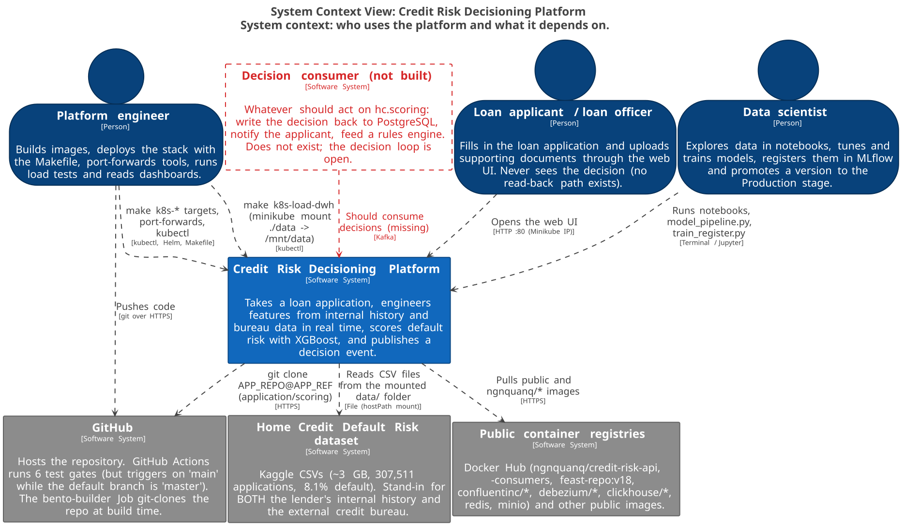
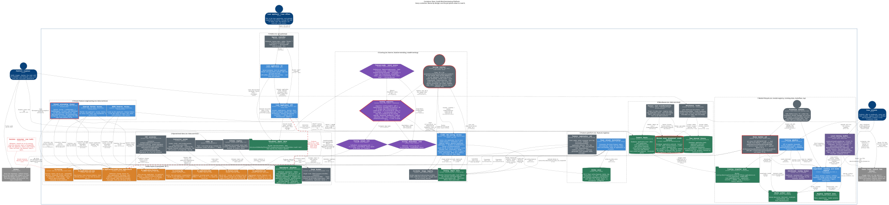
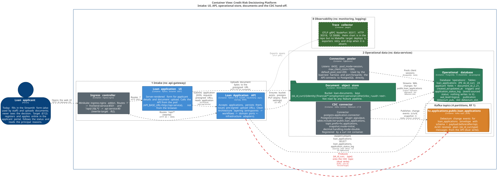
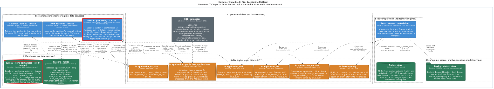
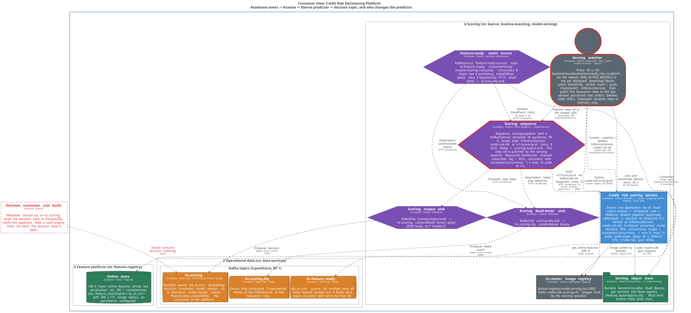
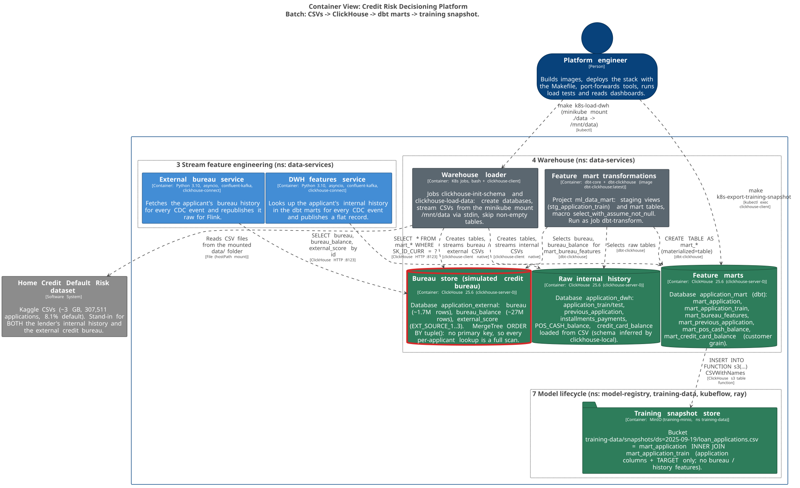
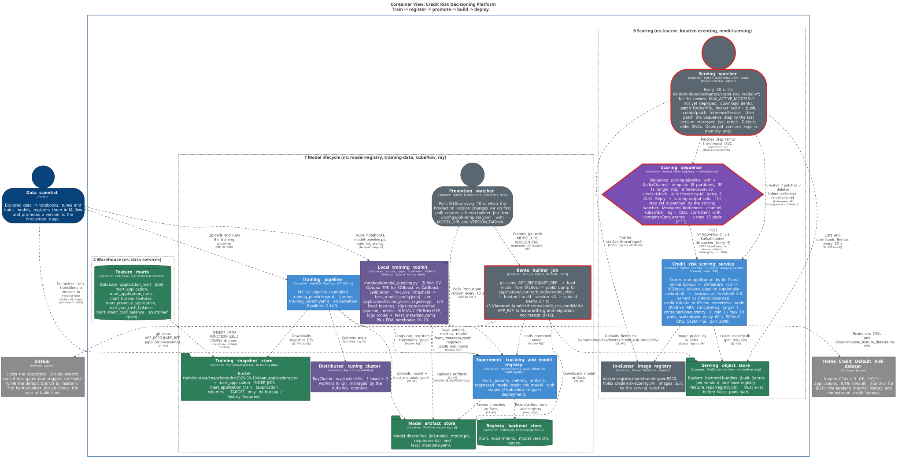
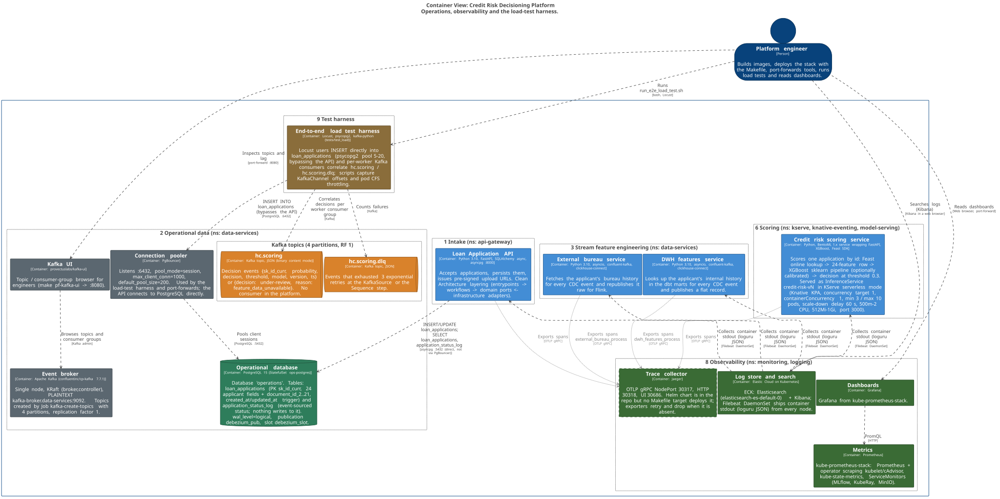
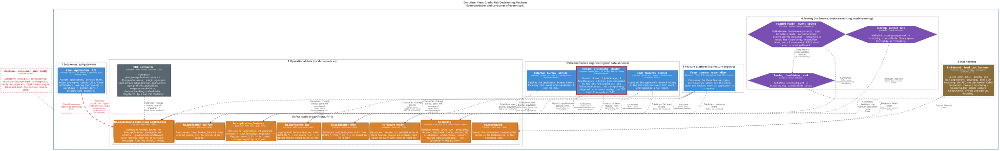

# 2. Context and containers

## 2.1 System context (L1)

| Actor / system | Interaction | Notes |
|---|---|---|
| Loan applicant / loan officer | Uses the Streamlit UI through the ingress | Gets `status: SUBMITTED` back and nothing more. No path returns the decision (see F-04). |
| Data scientist | Notebooks, `train_register.py`, Kubeflow runs, MLflow promotion | Promoting a version to `Production` is the only deployment action a human takes. |
| Platform engineer | `make k8s-*`, port-forwards, Kafka UI, Grafana, Kibana, load tests | |
| Home Credit Default Risk dataset | CSVs mounted into Minikube and read by notebooks | Stands in for **both** the lender's internal history and the external credit bureau. The applicant's `sk_id_curr` must match a Kaggle `SK_ID_CURR` for any history or bureau feature to exist. |
| Public container registries | Image pulls | `ngnquanq/credit-risk-api`, `-consumers`, `feast-repo:v18` are pushed by the author. `flink-pyflink`, `dbt-clickhouse` and the scoring images are built into Minikube's Docker daemon. |
| GitHub | Source, CI, and a build-time dependency | The bento-builder Job clones the repo during every promotion, so a model rollout depends on GitHub being reachable. |
| Decision consumer (not built) | Should read `hc.scoring` | Missing (F-04). |

## 2.2 Containers (L2)

The overview is dense on purpose. Read it plane by plane:

| Plane | View |
|---|---|
| Intake |  |
| Feature pipeline |  |
| Scoring |  |
| Warehouse |  |
| Model lifecycle |  |
| Ops |  |
| Kafka topology |  |

## 2.3 Container catalogue

Namespaces and workload kinds are from `platform/**/k8s`. "Owns" means the container is the only writer.

### Intake (ns `api-gateway`)

| Container | Technology | Workload | Owns | Code / config |
|---|---|---|---|---|
| Ingress controller | ingress-nginx (Minikube addon) | addon | routes `/` and `/api/*` | `platform/core/k8s/06-ingress.yaml`, `08-frontend-ingress.yaml` |
| Loan application UI | Streamlit :8501 | Deployment `frontend-service` ×1 | n/a | `application/frontend/` |
| Loan Application API | FastAPI, SQLAlchemy async, asyncpg :8000 | Deployment `api-service` ×2 | rows in `loan_applications` | `application/entrypoints/api/`, `workflows/`, `domain/`, `infrastructure/` |

### Operational data (ns `data-services`)

| Container | Technology | Workload | Owns | Code / config |
|---|---|---|---|---|
| Operational database | PostgreSQL 15, `wal_level=logical` | StatefulSet `ops-postgres-0` | `operations.loan_applications`, `application_status_log` | `platform/core/schemas/*.sql`, `platform/data/k8s/operational-db/` |
| Connection pooler | PgBouncer :6432, session mode, pool 200 | Deployment `ops-pgbouncer` | n/a | `platform/core/pgbouncer.ini` |
| Document object store | MinIO `data-minio-server`, bucket `loan-documents` | Deployment | uploaded documents | `platform/data/k8s/object-storage/01-minio.yaml` |
| CDC connector | Debezium 2.7.3 on Kafka Connect | Deployment `debezium-connect` | topic `hc.applications.public.loan_applications` | `platform/data/k8s/cdc/01-debezium.yaml` |
| Event broker | cp-kafka 7.7.1, KRaft, 1 node | StatefulSet `kafka-broker-0` | all topics | `platform/data/k8s/message-broker/` |
| Schema registry | cp-schema-registry 7.7.1 | Deployment | unused | `03-schema-registry.yaml` |
| Kafka UI | provectuslabs/kafka-ui | Deployment | n/a | `02-kafka-ui.yaml` |

### Stream feature engineering (ns `data-services`)

| Container | Technology | Workload | Consumes → Produces | Code |
|---|---|---|---|---|
| Stream processing cluster | Flink 1.17 PyFlink, JM ×1, TM ×2 × 8 slots | Deployments + submit Jobs | CDC → `hc.application_features`; `hc.application_ext_raw` → `hc.application_ext` | `application/flink/jobs/` |
| External bureau service | Python asyncio, confluent-kafka | Deployment `bureau-consumer`, HPA 2–6 | CDC → `hc.application_ext_raw` | `application/entrypoints/bureau_consumer.py` |
| DWH features service | Python asyncio, confluent-kafka | Deployment `feature-consumer`, HPA 2–6 | CDC → `hc.application_dwh` | `application/entrypoints/feature_consumer.py` |

### Warehouse (ns `data-services`)

| Container | Technology | Contents |
|---|---|---|
| Bureau store (`application_external`) | ClickHouse 25.6 | `bureau` (~1.7M rows), `bureau_balance` (~27M), `external_score` |
| Raw internal history (`application_dwh`) | ClickHouse 25.6 | `application_train/test`, `previous_application`, `installments_payments`, `pos_cash_balance`, `credit_card_balance` |
| Feature marts (`application_mart`) | ClickHouse 25.6 (dbt output) | `mart_application`, `mart_application_train`, `mart_bureau_features`, `mart_previous_application`, `mart_pos_cash_balance`, `mart_credit_card_balance` |
| Warehouse loader | K8s Jobs `clickhouse-init-schema`, `clickhouse-load-data` | creates DBs, streams CSVs |
| Feature mart transformations | dbt-core + dbt-clickhouse, Job `dbt-transform` | `ml_data_mart/` |

All three databases run in the same pod, `clickhouse-server-0`.

### Feature platform (ns `feature-registry`)

| Container | Technology | Workload | Notes |
|---|---|---|---|
| Feature registration job | Feast 0.40 `feast apply` | Job `feast-apply` | entity `customer` (`sk_id_curr`, STRING); views `application_features` (TTL 1d), `external_features` (7d), `dwh_features` (7d); service `realtime_scoring_v1` |
| Feast stream materialiser | kafka-python, Feast SDK, redis-py | Deployment `feast-stream`, HPA 2–6 | `application/feast_repo/stream_processor.py` |
| Online store | Redis 7 | Deployment `feast-redis` ×1 | DB 0 holds features, DB 1 holds completeness sets |

The `StreamFeatureView` Kafka sources in `feature_views.py` are **metadata only**. Feast does not run its own ingestion here; the custom materialiser pushes rows with `write_to_online_store`. The declared offline `FileSource`s are never populated, and training does not use the Feast offline store.

### Scoring (ns `kserve`, `knative-*`, `model-serving`)

| Container | Technology | Notes |
|---|---|---|
| Feature-ready event source | Knative KafkaSource | 8 consumers on a 4-partition topic |
| Scoring sequence | Knative Sequence + KafkaChannel (8 partitions) | one step, patched by the serving watcher |
| Scoring output sink / dead-letter sink | Knative KafkaSink | `hc.scoring`, `hc.scoring.dlq`, binary content mode |
| Credit risk scoring service | BentoML wrapping FastAPI; InferenceService `credit-risk-vN` | RawDeployment, min 0 / max 4, 1.5–2 CPU |
| Serving watcher | Python + Docker-in-Docker | builds images, manages InferenceServices |
| In-cluster image registry | Docker registry :5000 | `credit-risk-scoring:vN` |
| Serving object store | MinIO `serving-minio` | buckets `bentoml-bundles`, `feast-registry` |

### Model lifecycle (ns `model-registry`, `training-data`, `kubeflow`, `ray`)

| Container | Technology | Notes |
|---|---|---|
| Local training toolkit | Notebooks, `model_pipeline.py` (Optuna), `train_register.py` | runs on the workstation |
| Training snapshot store | MinIO `training-minio` | `training-data/snapshots/ds=2025-09-19/loan_applications.csv` |
| Training pipeline | Kubeflow Pipelines 2.14.3 | 4 components |
| Distributed tuning cluster | KubeRay RayCluster, Ray 2.31 | 1 head + 2 workers |
| MLflow + backend store + artifact store | MLflow, PostgreSQL, MinIO | registered model `credit_risk_model` |
| Promotion watcher | Python poller, 10 s | creates the bento-builder Job |
| Bento builder job | Python, BentoML, boto3 | one Job per promotion |

### Observability (ns `monitoring`, `logging`)

| Container | Technology | Notes |
|---|---|---|
| Metrics / dashboards | kube-prometheus-stack (Prometheus, Grafana) | `make k8s-monitoring` |
| Log store and search | ECK (Elasticsearch, Kibana, Filebeat) | `make k8s-logging`; often Pending on small machines |
| Trace collector | Jaeger, OTLP NodePort 30317 | chart present, **no Makefile target**; all services sample 10% and export to it |
