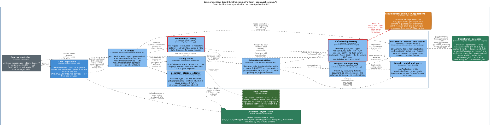
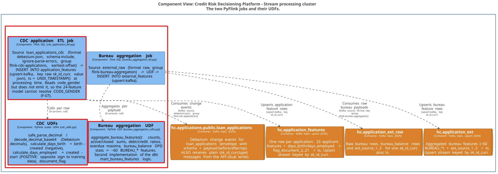
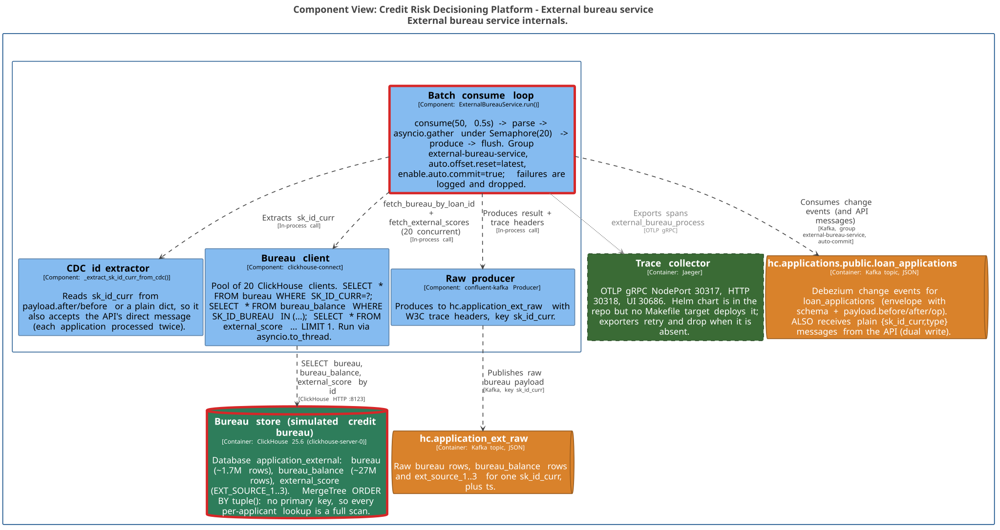
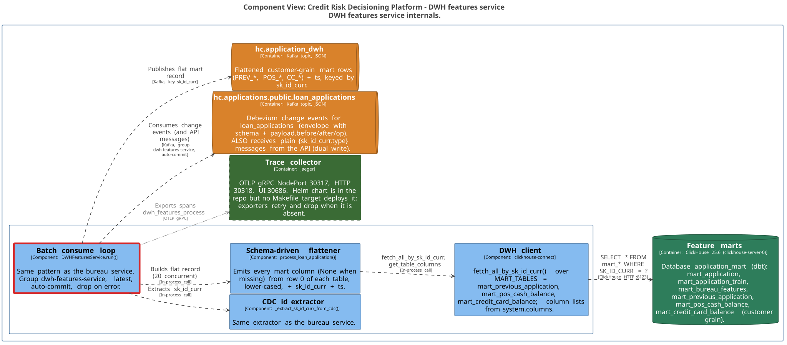
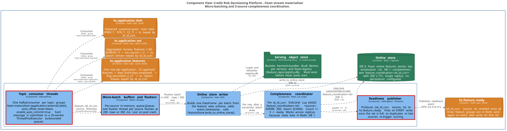
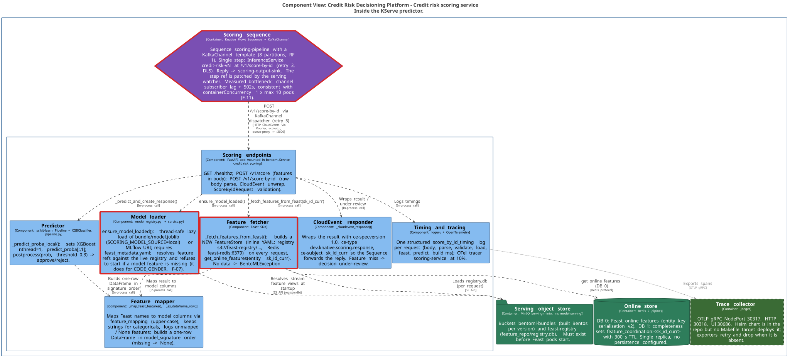
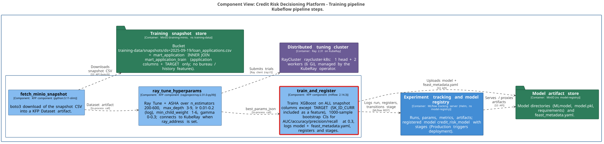
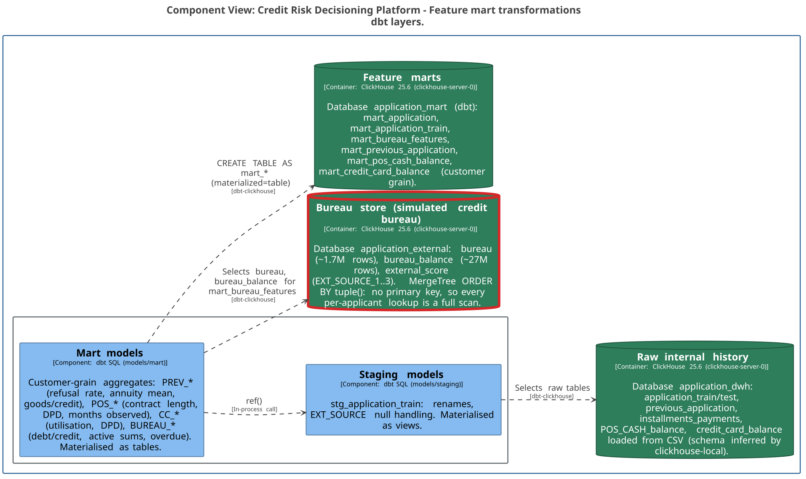

# 3. Components

Component views exist only for containers whose behaviour is custom code. Products such as Kafka, ClickHouse, Redis and MLflow are treated as black boxes.

## 3.1 Loan Application API



Clean Architecture: `entrypoints` → `workflows` → `domain` ports ← `infrastructure` adapters.

| Component | Responsibility | Notes |
|---|---|---|
| HTTP routes | 5 endpoints; the two GET routes query SQLAlchemy directly and bypass the workflow and repository | `GET /{id}/status` reads `application_status_log`, which nothing writes, so it always returns 404 |
| Dependency wiring | Builds repo, gateway and workflow per request | A new `confluent_kafka.Producer` per request: a TCP connection plus a metadata fetch each time, and it is never flushed |
| SubmitLoanWorkflow | save → publish → return pending | Not transactional: the row is committed before the publish, and a failed publish is swallowed |
| Domain model and ports | `LoanApplication` and `ApplicationStatus` (only `SUBMITTED`); ports `LoanRepository`, `ScoringGateway` | The decision rule lives only in scoring (`postprocess`, >= 0.3); the unused domain rule and ports were deleted |
| PostgresLoanRepository | SELECT-then-INSERT/UPDATE upsert | Write-only: there is no read method; the GET routes query the ORM directly |
| KafkaScoringGateway | Publishes `{sk_id_curr, type}` | Writes to the **Debezium topic**, so downstream consumers see every application twice |
| Document storage adapter | Presigned PUT URLs | Path-sanitised, extension allow-list |
| Persistence models and session | ORM + Pydantic schemas | |
| Tracing setup | OTel, 10% sampling | |

## 3.2 Stream processing cluster (PyFlink)



| Job | Source | Sink | Key behaviour |
|---|---|---|---|
| `cdc_application_etl.py` | `loan_applications_cdc`: `debezium-json`, `schema-include=true`, `ignore-parse-errors=true`, group `flink-cdc-applications`, `earliest-offset` | `application_features`: `upsert-kafka`, key `raw` `sk_id_curr`, value `json` | Drops and recreates both tables on start. `ts = UNIX_TIMESTAMP()`, which is processing time, not event time. Silently ignores the API's plain messages. |
| `bureau_aggregation_etl.py` | `external_raw`: `format raw`, group `flink-bureau-aggregation` | `external_features`: `upsert-kafka` | One UDF call per payload returns about 60 features |

No checkpointing is configured. The Kafka source therefore commits no offsets, and on restart each job replays from `earliest-offset`.

## 3.3 External bureau service and DWH features service




Both services follow the same loop:

```
while True:
    msgs = consumer.consume(50, timeout=0.5)        # auto-commit in the background
    tasks = [extract(m) for m in msgs]               # sk_id_curr + W3C trace context
    results = gather(process(t) under Semaphore(20)) # ClickHouse via asyncio.to_thread
    for r in results: produce(...) if r else drop    # errors -> None -> dropped
    producer.flush()
```

Consequences:

- **At-most-once.** Offsets are committed by a timer, regardless of whether processing succeeded.
- **No retries and no dead-letter queue.**
- **`auto.offset.reset=latest`.** A new consumer group skips the backlog.

## 3.4 Feast stream materialiser



```
3 consumer threads ──submit──▶ ThreadPoolExecutor(20) ──put──▶ queue[source]
                                                                  │
flusher thread[source]: collect ≤200 rows or 300 ms ─────────────┘
   └─▶ FeatureStore.write_to_online_store(view, df)          (Redis DB 0)
   └─▶ for each row: count = EVALSHA(SADD key src; EXPIRE key 300; SCARD key)   (Redis DB 1)
          └─ count == 3 ─▶ producer.send(hc.feature_ready, {sk_id_curr, source, ts})
```

Why the completeness state lives in Redis rather than memory: each source has its own consumer group shared by 2–6 replicas, so the three groups for one `sk_id_curr` usually land on different pods.

Edge cases:

| Case | Behaviour |
|---|---|
| A source never arrives | The key expires after 300 s. No readiness event, no decision, no alert. |
| The sources arrive more than 300 s apart | Same as above. |
| A source is delivered twice (always true today, because of the API dual write) | SCARD is still 3, so a second `feature_ready` is sent and the application is scored again. |
| The pod crashes with rows buffered | Rows are lost and their offsets are already committed. |

## 3.5 Credit risk scoring service



| Step | Component | Detail |
|---|---|---|
| Startup | Model loader | Loads `bundle/model.joblib` and `feast_metadata.yaml`. If `SCORING_FEAST_FEATURE_REFS` is empty, it lists the stream feature views in the registry, builds `view:feature` refs for every `selected_features` entry, and fails if any is missing. |
| Request | Scoring endpoints | Parses the raw body (the KafkaSource may omit Content-Type), unwraps a CloudEvent if present, validates `ScoreByIdRequest` |
| | Feature fetcher | `FeatureStore(repo_path=...)` **constructed per request** (`service.py:482`), then `get_online_features` |
| | Feature mapper | `feature_mapping` lower → upper; missing features become `None` in the row |
| | Predictor | `nthread=1`, `predict_proba[:,1]`, `postprocess(prob, 0.3)` |
| | CloudEvent responder | Adds `ce-*` headers so the Sequence forwards the reply. A feature miss returns `decision: under-review` with HTTP 200. |

The in-process Kafka consumer that scoring once had, its settings and its `SCORING_*KAFKA*` env vars were removed on 2026-11-21; Knative delivers all events.

## 3.6 Training pipeline (Kubeflow)



`fetch_minio_snapshot` → `ray_tune_hyperparams` → `train_and_register`.

The snapshot contains only `mart_application` columns plus `TARGET`, and `train_and_register` uses every column except `TARGET`. A Kubeflow-trained model therefore has a different feature set from the 24-feature local model, and it includes `SK_ID_CURR` as an input (F-08).

## 3.7 dbt project



Staging models are views, mart models are tables. All marts are customer grain (`GROUP BY SK_ID_CURR`), which is what lets the DWH service take row 0 of each mart.
