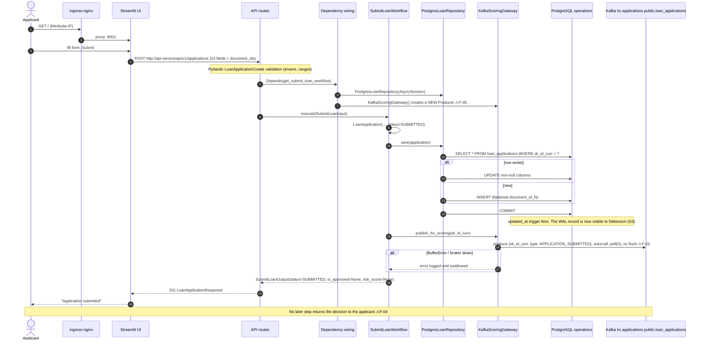
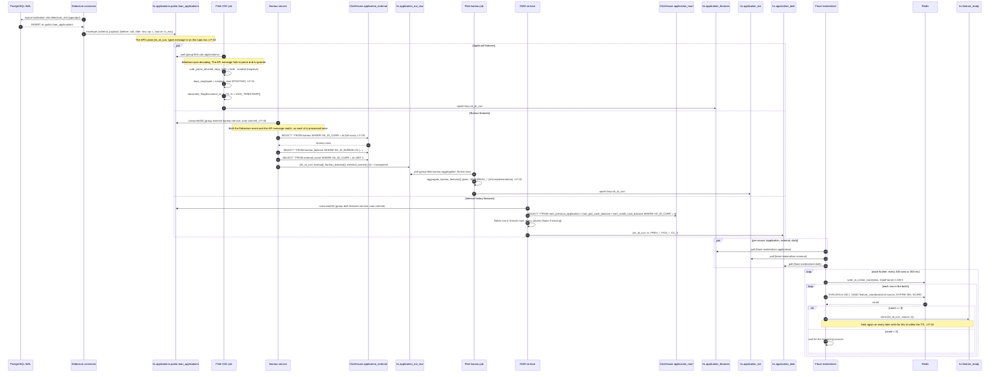
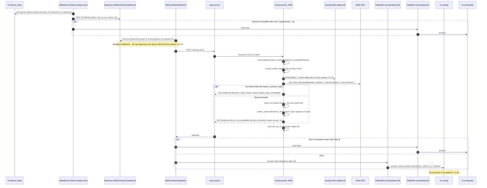
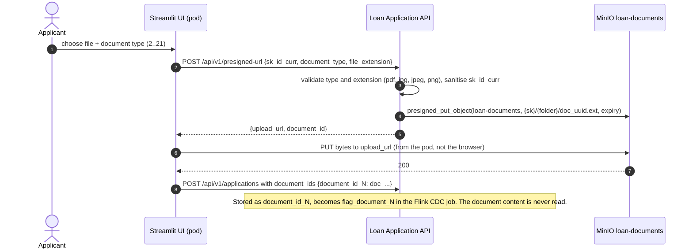
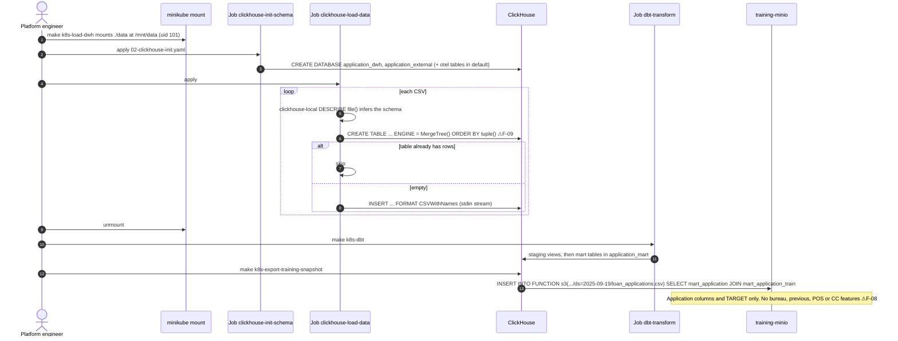
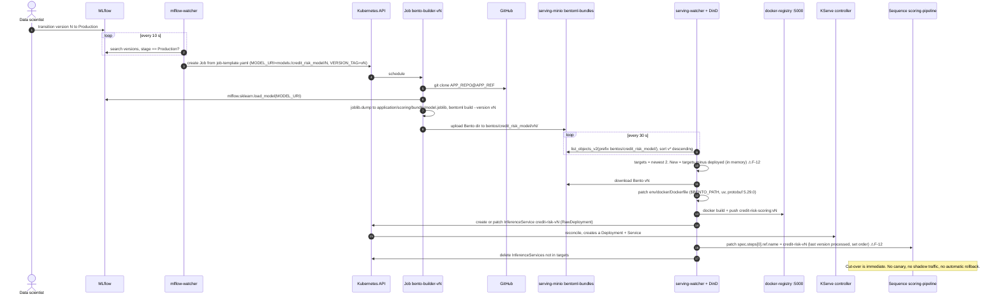
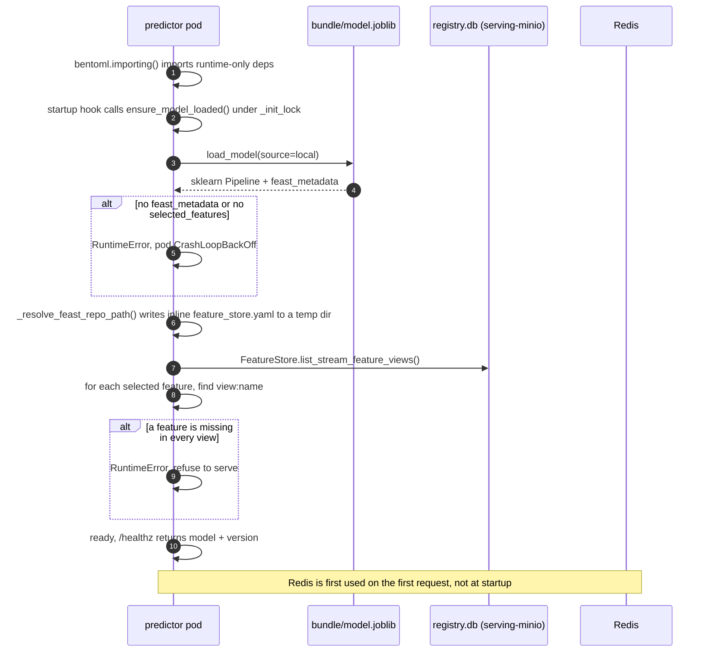
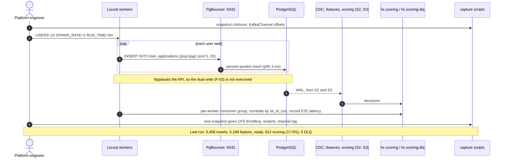

# 4. Runtime sequences

Each sequence below matches a Structurizr dynamic view (`D1` … `D8`). The dynamic views show *which* elements take part. The Mermaid diagrams add the detail a dynamic view cannot show: payloads, consumer groups, retries, alternatives and failure branches. Steps marked ⚠ link to a finding in [07-findings.md](07-findings.md).

| # | Flow | Dynamic view | Trigger |
|---|---|---|---|
| S1 | Submit an application | `D1-Submit-Application`, `D1a-API-Submission` | Applicant presses Submit |
| S2 | CDC fan-out and feature engineering | `D2-Feature-Engineering`, `D3c-Feast-Coordination` | Row committed in PostgreSQL |
| S3 | Score an application | `D3-Score-Application`, `D3s-Scoring-Request` | `hc.feature_ready` event |
| S4 | Upload a document | `D4-Upload-Document` | Applicant attaches a file |
| S5 | Warehouse bootstrap and training snapshot | `D5-Warehouse-Bootstrap` | `make k8s-load-dwh`, `k8s-dbt`, `k8s-export-training-snapshot` |
| S6 | Train and register (two paths) | `D6-Train-and-Register` | Data scientist |
| S7 | Promote a model to serving | `D7-Promote-to-Serving` | MLflow stage → Production |
| S8 | Predictor cold start | part of `D7` | New InferenceService pod |
| S9 | End-to-end load test | `D8-Load-Test` | `run_e2e_load_test.sh` |

---

## S1. Submit an application



**Failure behaviour**

| Failure | Result |
|---|---|
| Validation error | 422 from FastAPI |
| PostgreSQL down | Exception → 500 `Failed to create loan application` |
| Kafka down | 201 returned anyway. Scoring still happens because CDC is independent of this publish. |
| Same `sk_id_curr` submitted twice | Row updated. Debezium emits `op=u`, and the whole pipeline runs again. |

## S2. CDC fan-out and feature engineering



**Timing.** The three branches race. Readiness is decided by whichever source completes the set last, usually the bureau branch, which needs two Kafka hops, a full-scan ClickHouse query and a Flink UDF.

## S3. Score an application



## S4. Upload a document



## S5. Warehouse bootstrap and training snapshot



## S6. Train and register

```mermaid
sequenceDiagram
    autonumber
    actor DSC as Data scientist
    participant WS as Workstation scripts
    participant KFP as Kubeflow Pipelines
    participant RAY as RayCluster
    participant TM as training-minio
    participant ML as MLflow
    participant MA as MLflow MinIO

    rect rgb(235, 242, 255)
    Note over DSC,MA: Path A, local (the README path, produces the 24-feature model)
    DSC->>WS: python notebook/model_pipeline.py
    WS->>WS: 5-fold CV, Optuna TPE (XGBoost vs CatBoost), calibration, PR-curve threshold
    WS-->>DSC: data/best_model_config.json
    DSC->>WS: train_register.py --data complete_feature_dataset.csv --config ... --stage Production
    WS->>WS: stratified 80/20, ClipQuantiles + SimpleImputer + OrdinalEncoder + XGBClassifier
    WS->>WS: AUC, AUC-PR, Brier, ECE, precision, recall, F1 at threshold
    WS->>ML: log_params, log_metric, log_model(registered_model_name=credit_risk_model)
    WS->>MA: model/ + feast_metadata.yaml (selected_features, mapping, model_signature)
    opt --stage
        WS->>ML: transition_model_version_stage(version, Production)
    end
    end

    rect rgb(240, 250, 240)
    Note over DSC,MA: Path B, Kubeflow
    DSC->>KFP: run training_pipeline.yaml (training_param.yaml)
    KFP->>TM: fetch_minio_snapshot
    KFP->>RAY: ray_tune_hyperparams (ASHA, 5 dimensions; in-pod Ray if no ray_address)
    KFP->>KFP: train_and_register on all snapshot columns except TARGET ⚠F-08
    KFP->>KFP: 1000-sample bootstrap CIs
    KFP->>ML: register + stage
    KFP->>MA: model + feast_metadata.yaml
    end
```

## S7. Promote a model to serving



## S8. Predictor cold start



## S9. End-to-end load test



## Failure-mode summary

| Component fails | Immediate effect | Data loss? | Recovery |
|---|---|---|---|
| API pod | 1 of 2 replicas serves | No | K8s restart |
| PostgreSQL | Submissions fail (500) | No (PVC) | StatefulSet restart. The Debezium slot holds the WAL. |
| Debezium | Events stop | No (slot retains the WAL; disk grows) | Restart. Resumes from the slot. |
| Kafka broker (RF 1) | Everything stops | Possible (single replica) | Restart. Producers retry. |
| Flink job | No `hc.application_features` / `hc.application_ext` | No, but full replay from earliest on restart (no checkpoints) | Re-submit Job |
| Bureau / DWH service mid-batch | Batch partly produced | **Yes**: auto-committed offsets | None |
| Feast materialiser mid-batch | Buffered rows lost | **Yes** | None; the coordination key expires |
| Redis | Features and coordination lost (no persistence) | **Yes** | Re-run the pipeline for affected ids |
| Predictor 5xx | 3 retries, then DLQ | No (DLQ) | Manual replay from `hc.scoring.dlq` |
| MLflow / GitHub down during promotion | Bento build fails | No | Re-promote; the watcher retriggers only when the version changes |
