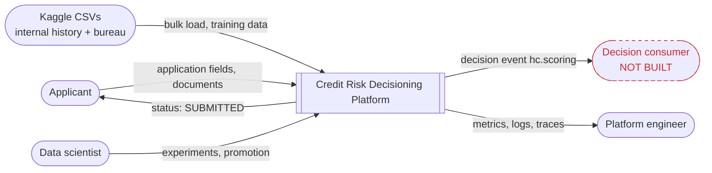
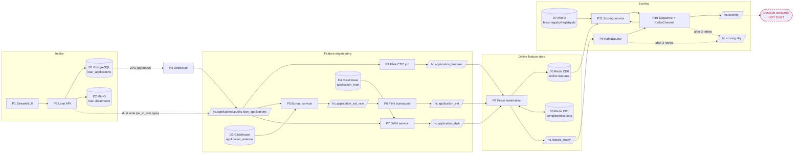
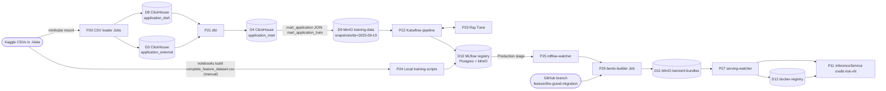

# 5. Data flow

C4 views show dependencies. This section follows the **data**: where each record is created, how it is transformed, where it is stored, and how long it lives. Diagrams use data-flow notation: rectangles are processes, cylinders are stores, parallelograms are Kafka topics (data in motion), and rounded boxes are external entities.

## 5.1 Level 0: context data flow



## 5.2 Level 1: real-time path (one application)



## 5.3 Level 1: batch and model path



## 5.4 Topic catalogue

All topics: 4 partitions, replication factor 1, default retention (7 days), JSON values, no schema registry.

| Topic | Producer(s) | Key | Consumer groups | Offset policy | Delivery |
|---|---|---|---|---|---|
| `hc.applications.public.loan_applications` | Debezium (`postgres-application-connector`); **also** the API's `KafkaScoringGateway` | Debezium: struct key `{sk_id_curr}`. API: `sk_id_curr` bytes | `flink-cdc-applications`, `external-bureau-service`, `dwh-features-service` | Flink: earliest. Python: latest + auto-commit | At-least-once from Debezium, at-most-once in the Python consumers |
| `hc.application_features` | Flink CDC job (`upsert-kafka`) | `sk_id_curr` (raw) | `feast-materializer-application` | latest, auto-commit | Upsert changelog. Deletes would be tombstones. |
| `hc.application_ext_raw` | Bureau service | `sk_id_curr` | `flink-bureau-aggregation` | Flink default | |
| `hc.application_ext` | Flink bureau job (`upsert-kafka`) | `sk_id_curr` (raw) | `feast-materializer-external` | latest, auto-commit | |
| `hc.application_dwh` | DWH service | `sk_id_curr` | `feast-materializer-dwh` | latest, auto-commit | |
| `hc.feature_ready` | Feast materialiser | `sk_id_curr` | `knative-scoring-consumer` (KafkaSource, 8 consumers) | latest | Can be duplicated (F-03) |
| *KafkaChannel topic* `knative-messaging-kafka.kserve.scoring-pipeline-kn-sequence-0` | KafkaSource → channel | n/a | channel subscriber group | n/a | 8 partitions. This is where lag builds up (F-11). |
| `hc.scoring` | KafkaSink `scoring-output-sink` | n/a | load-test monitors only | n/a | **No platform consumer** (F-04) |
| `hc.scoring.dlq` | KafkaSink `scoring-dlq-sink` | n/a | load-test monitors only | n/a | No replay tooling |

## 5.5 Message shapes

**`hc.applications.public.loan_applications`** (Debezium, `decimal.handling.mode=double`):

```json
{
  "schema": { "...": "inline Connect schema" },
  "payload": {
    "before": null,
    "after": {
      "sk_id_curr": "215354", "code_gender": "M", "birth_date": 5644,
      "cnt_children": 1, "amt_income_total": 250000.0, "amt_credit": 500000.0,
      "amt_annuity": 25000.0, "amt_goods_price": 450000.0,
      "name_contract_type": "Cash loans", "name_income_type": "Working",
      "employment_start_date": 16495, "flag_own_car": 1, "own_car_age": 5,
      "document_id_3": "doc_9f…", "created_at": 1763700000000000, "updated_at": 1763700000000000
    },
    "source": { "connector": "postgresql", "table": "loan_applications", "lsn": 0 },
    "op": "c", "ts_ms": 1763700000123
  }
}
```

Dates arrive as days since epoch, which is why the UDFs accept both integers and ISO strings. **API message on the same topic:** `{"sk_id_curr": "215354", "type": "APPLICATION_SUBMITTED"}`.

**`hc.application_features`**: `sk_id_curr, cnt_children, amt_income_total, amt_credit, amt_annuity, amt_goods_price, name_contract_type, name_income_type, name_education_type, name_family_status, name_housing_type, occupation_type, organization_type, days_birth, days_employed, flag_mobil, flag_emp_phone, flag_work_phone, flag_phone, flag_email, flag_own_car, flag_own_realty, own_car_age, flag_document_2 … flag_document_21, ts`. `code_gender` is read from the CDC source but **not emitted** (F-07).

**`hc.application_ext_raw`**: `{sk_id_curr, bureau: [ {sk_id_bureau, credit_active, amt_credit_sum, amt_credit_sum_debt, amt_credit_max_overdue, …} ], bureau_balance: [ {sk_id_bureau, months_balance, status} ], external_scores: {ext_source_1, ext_source_2, ext_source_3}, ts}`

**`hc.application_ext`**: `sk_id_curr`, about 60 `BUREAU_*` aggregates, `ext_source_1..3`, `ts`

**`hc.application_dwh`**: `sk_id_curr, ts`, and every column of the three customer-grain marts, lower-cased (`prev_app_count`, `prev_refusal_rate`, `prev_annuity_mean`, `pos_mean_contract_length`, `pos_latest_month`, `cc_utilization_mean`, …; 156 fields in the Feast view)

**`hc.feature_ready`**: `{"sk_id_curr": "215354", "source": "external", "ts": "2026-11-21T07:00:00.000Z"}`. `source` is whichever group completed the set, not the event's origin.

**`hc.scoring`**: `{"sk_id_curr", "probability", "decision", "threshold": 0.3, "model", "version", "ts"}`, or `{"sk_id_curr", "probability": null, "decision": "under-review", "reason": "feature_data_unavailable", …}`. Headers carry `ce_type=dev.knative.scoring.response` and `ce_subject=<sk_id_curr>`.

## 5.6 Data store catalogue

| ID | Store | Data | Written by | Read by | Lifetime | Personal data |
|---|---|---|---|---|---|---|
| D1 | PostgreSQL `operations` | `loan_applications`, `application_status_log` (empty) | API, load test | Debezium, API GETs | Indefinite (PVC) | **Yes**: birth date, income, family status, gender, employment |
| D2 | MinIO `loan-documents` | Uploaded IDs, payslips, statements | UI (presigned) | nobody | Indefinite | **Yes, highly sensitive** |
| D3 | ClickHouse `application_external` | bureau, bureau_balance, external_score | CSV loader | Bureau service, dbt | Indefinite | Yes (credit history) |
| D4 | ClickHouse `application_mart` | 6 customer-grain marts | dbt | DWH service, snapshot export, notebooks | Rebuilt by dbt | Yes |
| D5 | Redis DB 0 | Feast online rows per view and entity | Feast materialiser | Scoring service | Feature-view TTL: application 1 day, external/dwh 7 days. No Redis persistence. | Yes |
| D6 | Redis DB 1 | `feature_coordination:<id>` sets | Feast materialiser | Feast materialiser | 300 s | No |
| D7 | MinIO `feast-registry` | `registry.db` | `feast apply` Job | materialiser, scoring | Until next apply | No |
| D8 | ClickHouse `application_dwh` | Raw internal history | CSV loader | dbt | Indefinite | Yes |
| D9 | MinIO `training-data` | Snapshot CSV (single fixed partition `ds=2025-09-19`) | ClickHouse `s3()` | Kubeflow | Overwritten (`s3_truncate_on_insert=1`) | Yes |
| D10 | MLflow (Postgres + MinIO) | Runs, metrics, models, `feast_metadata.yaml` | training scripts, KFP | watchers, bento-builder, humans | Indefinite | Input example row (`X_train.iloc[:1]`) is stored with each model |
| D11 | MinIO `bentoml-bundles` | Built Bentos `v<N>/` | bento-builder | serving-watcher | Indefinite (top 2 deployed) | No |
| D12 | docker-registry | `credit-risk-scoring:v<N>` | serving-watcher | kubelet | Indefinite | No |
| (all topics) | Kafka | see 5.4 | | | 7-day default retention | Yes (application payloads) |

## 5.7 Feature lineage: training vs serving

The 24 features of the `train_register.py` model, where each comes from at training time, and where it comes from at serving time.

| Feature(s) | Training source | Serving source (Feast view) | Same code? | Status |
|---|---|---|---|---|
| `AMT_INCOME_TOTAL`, `AMT_CREDIT`, `AMT_ANNUITY`, `AMT_GOODS_PRICE`, `CNT_CHILDREN` | Kaggle `application_train` columns | Applicant form → Flink pass-through (`application_features`) | n/a (pass-through) | ✅ consistent |
| `NAME_EDUCATION_TYPE`, `NAME_FAMILY_STATUS`, `NAME_INCOME_TYPE`, `ORGANIZATION_TYPE` | Kaggle columns | Form → Flink pass-through | n/a | ✅ consistent (DB CHECK constraints on income, education and family status use the Kaggle category strings; `organization_type` is unconstrained) |
| `DAYS_BIRTH` | Kaggle (negative days before application) | `birth_date - created_at` (negative) | No | ✅ same sign |
| `DAYS_EMPLOYED` | Kaggle (negative; `365243` = unemployed/pensioner) | `created_at - employment_start_date` (**positive**) | No | ❌ **sign flipped, sentinel not reproduced** (F-01) |
| `CODE_GENDER` | Kaggle column | **No view provides it**: the Flink sink drops it | n/a | ❌ **unavailable**. The predictor's startup validation rejects the model (F-07). |
| `EXT_SOURCE_1/2/3` | Kaggle `application_train` | `external_score` table (built from the same Kaggle columns by notebook 08) → bureau service → `external_features` | Same values | ✅ consistent |
| `BUREAU_DEBT_TO_CREDIT_RATIO`, `BUREAU_ACTIVE_CREDIT_SUM`, `BUREAU_AMT_MAX_OVERDUE_EVER` | dbt `mart_bureau_features.sql` (SQL) | Flink `bureau_aggregation_udfs.py` (Python) | **No: two implementations** | ⚠️ unverified parity (F-02) |
| `PREV_ANNUITY_MEAN`, `PREV_GOODS_TO_CREDIT_RATIO`, `PREV_REFUSAL_RATE` | dbt `mart_previous_application` | Same mart, read by the DWH service (`dwh_features`) | Yes | ✅ consistent |
| `POS_MEAN_CONTRACT_LENGTH`, `POS_LATEST_MONTH`, `POS_TOTAL_MONTHS_OBSERVED` | dbt `mart_pos_cash_balance` | Same mart (`dwh_features`) | Yes | ✅ consistent |

`complete_feature_dataset.csv`, the file the README tells you to train on, is **not produced by anything in the repository**. `08_prepare_data.ipynb` only writes `application_ext.csv`.

The Kubeflow path avoids the `CODE_GENDER` problem by training on whatever `mart_application` contains (all of it served by `application_features`), but it then uses **no bureau or history features at all** (F-08). With the committed schemas, the only model that can pass the predictor's startup validation is therefore an application-only one. That makes the bureau and DWH branches of the pipeline work that the deployed model may never read. This is an inference from the code; confirm it against the `feast_metadata.yaml` of the version currently in Production.

## 5.8 Identifiers and time

- **`sk_id_curr`** is the only key end to end: the PostgreSQL primary key, the Kafka message key on every topic, the Feast entity join key (STRING), and the Redis coordination key. Bureau and DWH lookups `int()`-cast it, so a non-numeric id (the bureau service comments mention `798498_1041`) raises an exception and the message is dropped without any error being surfaced.
- **Timestamps.** Every feature row's `ts` is *processing time* (`UNIX_TIMESTAMP()` in Flink, `time.time()` in Python). Feast writes `event_timestamp = now()`. Nothing carries the application's `created_at` forward, so point-in-time correctness for offline training cannot be reconstructed from the streams.
- **Ordering.** All topics are keyed by `sk_id_curr`, so per-application order holds within each topic. There is no ordering *across* the three feature topics, which is why the Redis completeness check exists.
