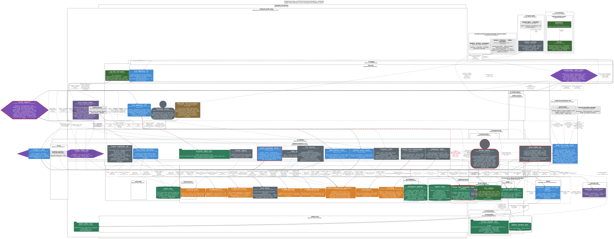
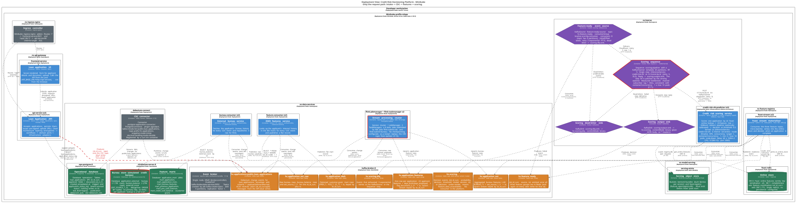
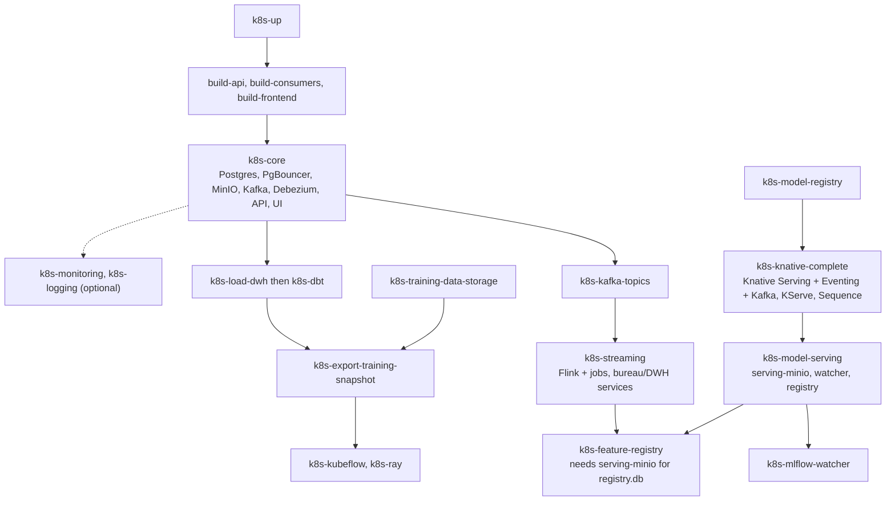

# 6. Deployment

A real-time-only cut (`Deploy-Minikube-RealTime`) leaves out training, observability and tooling:

## 6.1 Environment

| Item | Value |
|---|---|
| Cluster | Minikube profile `mlops`, Docker driver, Kubernetes v1.28.3, a single node |
| Resources | 20 CPU, 24 GB RAM, 80 GB disk (`make k8s-up`) |
| Addons | ingress (ingress-nginx), metallb, metrics-server |
| Image strategy | App images are built into Minikube's Docker daemon (`make build-*`). Scoring images are built in-cluster by the serving watcher and pushed to `docker-registry.model-serving:5000`. Feast uses `ngnquanq/feast-repo:v18` from Docker Hub. |
| Host coupling | The InferenceService template adds `hostAliases` for `192.168.49.1 → host.minikube.internal, broker, kafka`. OTLP exports go to `host.minikube.internal:30317`. |

## 6.2 Namespaces and workloads

| Namespace | Workloads (kind × replicas) | Make target |
|---|---|---|
| `ingress-nginx` | ingress-nginx controller | `k8s-up` (addon) |
| `api-gateway` | `api-service` Deployment ×2, `frontend-service` ×1, Ingresses `api-gateway`, `frontend-ingress` | `k8s-core` |
| `data-services` | `ops-postgres` STS ×1, `ops-pgbouncer`, `data-minio-server`, `kafka-broker` STS ×1, `schema-registry`, `kafka-ui`, `debezium-connect`, `clickhouse-server` STS ×1, `flink-jobmanager` ×1, `flink-taskmanager` ×2, `bureau-consumer` (HPA 2–6), `feature-consumer` (HPA 2–6); Jobs `kafka-create-topics`, `flink-submit-cdc`, `flink-submit-bureau`, `clickhouse-init-schema`, `clickhouse-load-data`, `dbt-transform` | `k8s-core`, `k8s-kafka-topics`, `k8s-streaming`, `k8s-load-dwh`, `k8s-dbt` |
| `feature-registry` | `feast-redis` ×1, `feast-stream` (HPA 2–6), Job `feast-apply` | `k8s-feature-registry` |
| `knative-serving` | activator, autoscaler, controller, webhook | `k8s-knative-serving` |
| `kourier-system` | Kourier gateway | `k8s-knative-serving` |
| `knative-eventing` | eventing-controller, kafka-controller, kafka-source-dispatcher, kafka-channel-dispatcher ×1, kafka-sink-receiver | `k8s-knative-eventing`, `k8s-knative-kafka` |
| `kserve` | kserve-controller-manager, KafkaSource, Sequence, 2 KafkaSinks, InferenceServices `credit-risk-v<N>` (newest 2) | `k8s-kserve`, `k8s-scoring-pipeline` |
| `cert-manager` | cert-manager (KServe webhook certs) | `k8s-kserve` |
| `model-serving` | `serving-minio` + console, `serving-watcher` (2 containers), `docker-registry` | `k8s-model-serving` |
| `model-registry` | `mlflow`, `mlflow-postgresql` STS, MLflow MinIO, `mlflow-watcher`, Jobs `bento-builder-v<N>` | `k8s-model-registry`, `k8s-mlflow-watcher` |
| `training-data` | `training-minio` + console | `k8s-training-data-storage` |
| `kubeflow` | Kubeflow Pipelines 2.14.3 (ml-pipeline, Argo, metadata, MinIO, …) | `k8s-kubeflow` |
| `ray` | kuberay-operator, RayCluster `raycluster-k8s` (1 head + 2 workers) | `k8s-ray` |
| `monitoring` | kube-prometheus-stack (Prometheus, operator, Grafana, kube-state-metrics, node-exporter) | `k8s-monitoring` |
| `logging` | elastic-operator, Elasticsearch, Kibana, Filebeat DaemonSet | `k8s-logging` |
| *(tracing)* | Jaeger chart and NodePort services exist in `platform/ops/k8s/tracing/` | **no target** |

## 6.3 Deployment order and dependencies

`k8s-feature-registry` must run after `k8s-model-serving`, because Feast keeps `registry.db` in `serving-minio`. If the order is reversed, Feast pods CrashLoopBackOff until the bucket exists.

## 6.4 Ports and access

| What | In-cluster address | From the workstation |
|---|---|---|
| UI | `frontend-service.api-gateway:8501` | `http://<minikube ip>/` |
| API | `api-service.api-gateway:80 → 8000` | `http://<minikube ip>/api/...` or `kubectl port-forward svc/api-service 8000:80` |
| PostgreSQL | `ops-postgres.data-services:5432` | `make pf-postgres` → `localhost:6432` (via PgBouncer) |
| Kafka | `kafka-broker.data-services:9092` | `make pf-kafka` → `localhost:9092` |
| Kafka UI | | `make pf-kafka-ui` → `localhost:8080` |
| ClickHouse | `clickhouse-server.data-services:8123` | `make pf-clickhouse` → `localhost:8123` |
| MLflow | `mlflow.model-registry:80` | `make pf-mlflow` → `localhost:5000` |
| Training MinIO | `training-minio.training-data:9000` | `make pf-minio-training` → `localhost:9000` / console `9090` |
| Redis | `feast-redis.feature-registry:6379` | port-forward |
| Predictor | `credit-risk-v<N>-predictor.kserve` → container `:3000` | port-forward |
| Jaeger (if deployed) | | NodePorts `30317` (OTLP gRPC), `30318` (HTTP), `30686` (UI) |

## 6.5 Resource shape (requests → limits, where set)

| Workload | CPU | Memory | Notes |
|---|---|---|---|
| `clickhouse-server` | 2 → 4 | | Raised from 1 → 2 after load-test cycle 0 (85.9% CFS throttling) |
| `bureau-consumer`, `feature-consumer` | 250m → 2 | | HPA at 70% CPU |
| `credit-risk-v<N>-predictor` | 1500m → 2000m | 768Mi → 1152Mi | min 0, max 4 replicas |
| RayCluster | | 6 Gi total | 1 head + 2 workers |

## 6.6 Scaling limits built into the configuration

| Setting | Value | Effective ceiling |
|---|---|---|
| Partitions per platform topic | 4 | At most 4 active consumers per group |
| Bureau / DWH / Feast HPA max | 6 | 2 replicas idle at max scale |
| KafkaSource `consumers` | 8 | 4 active (`hc.feature_ready` has 4 partitions) |
| KafkaChannel partitions | 8 | Single dispatcher replica. Scaling it to 4 caused rebalance storms (RESULTS.md). |
| Kafka replication | 1 | Broker loss stops the platform |
