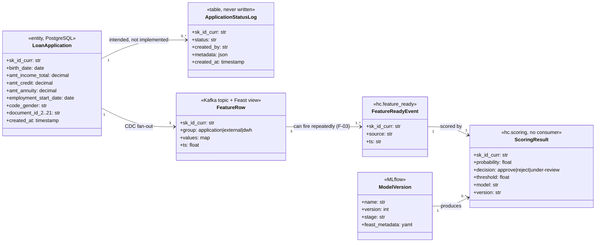
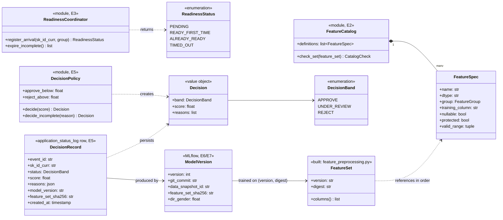
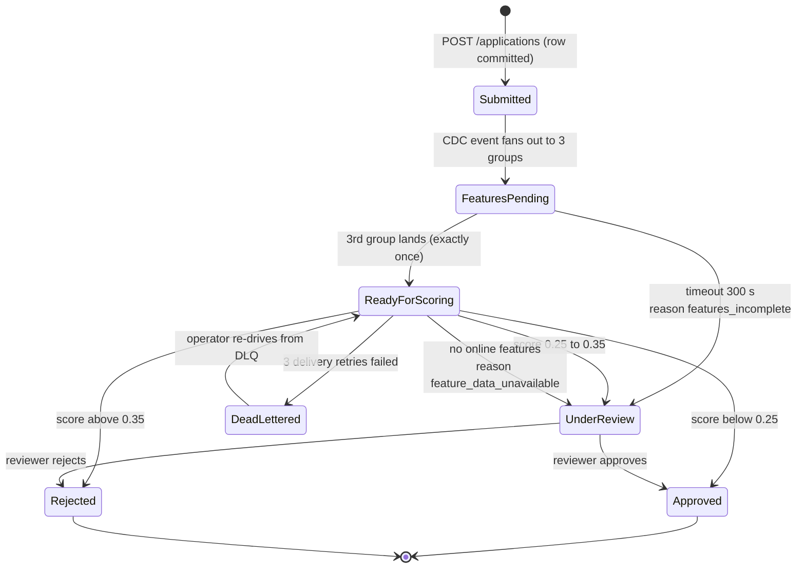
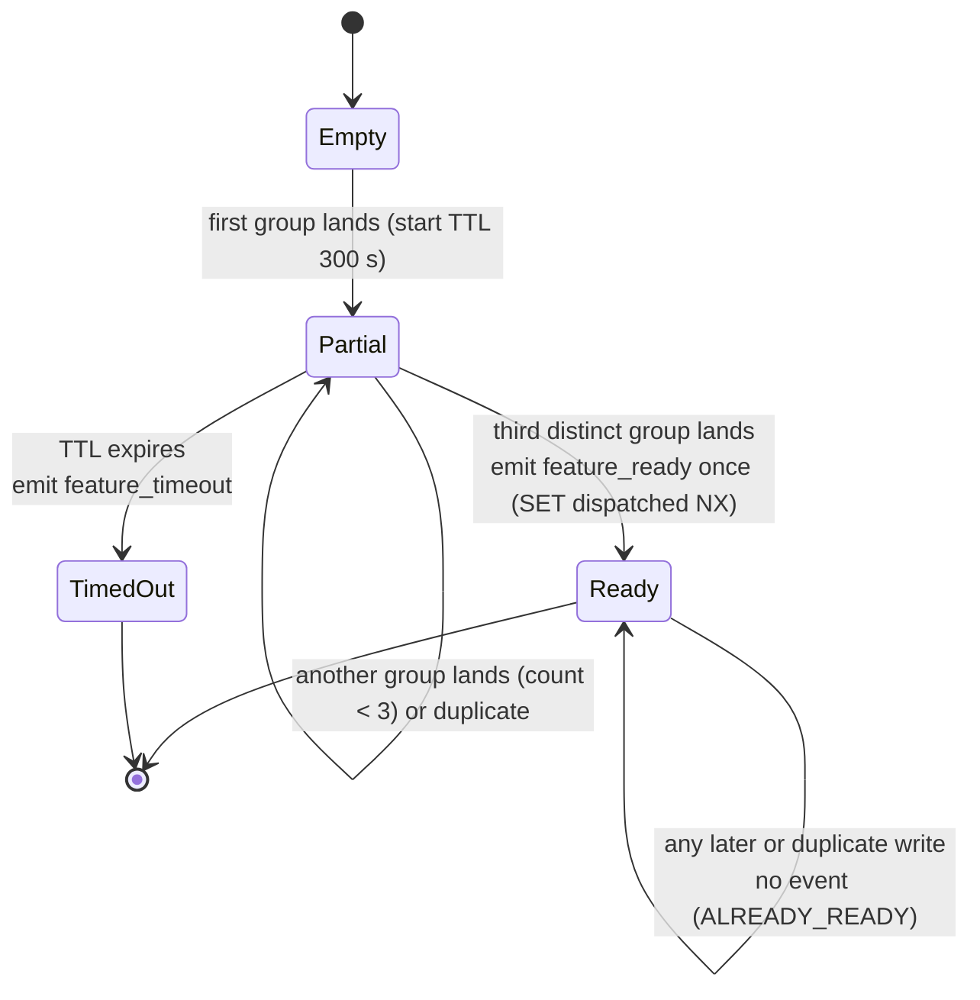
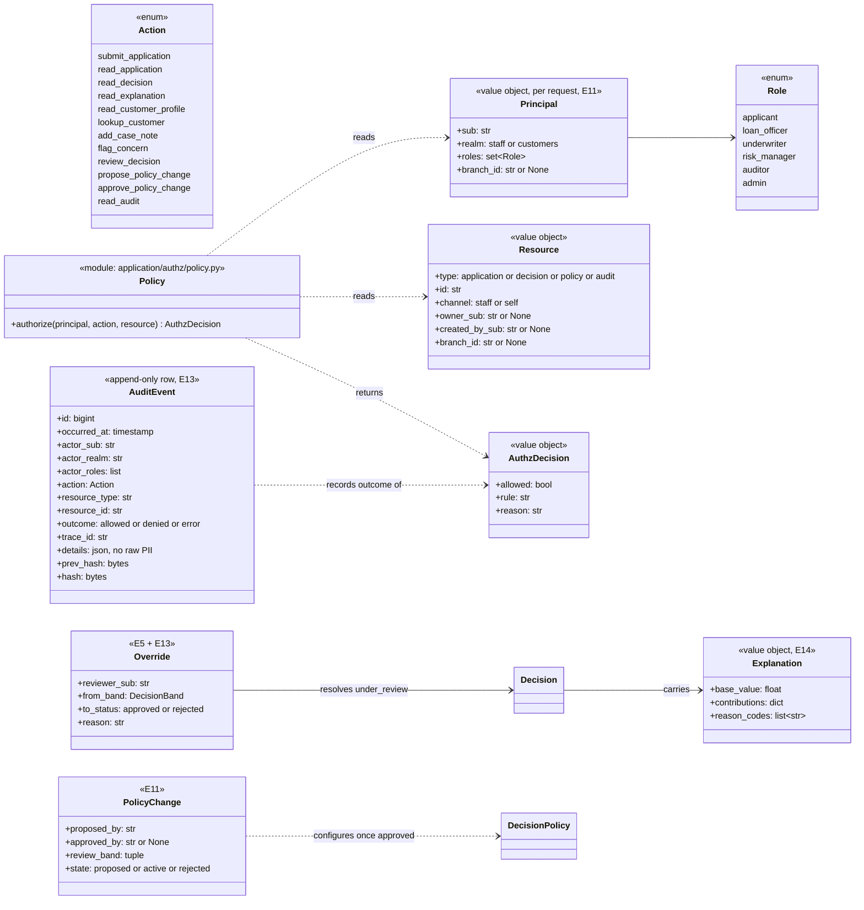
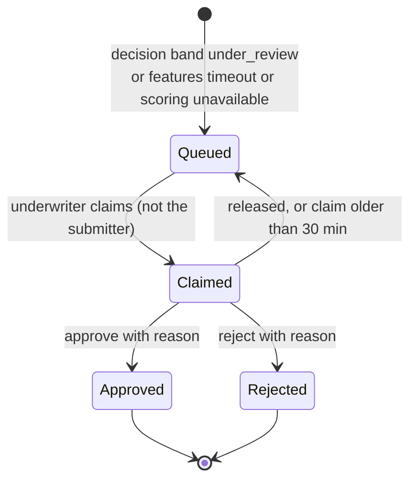
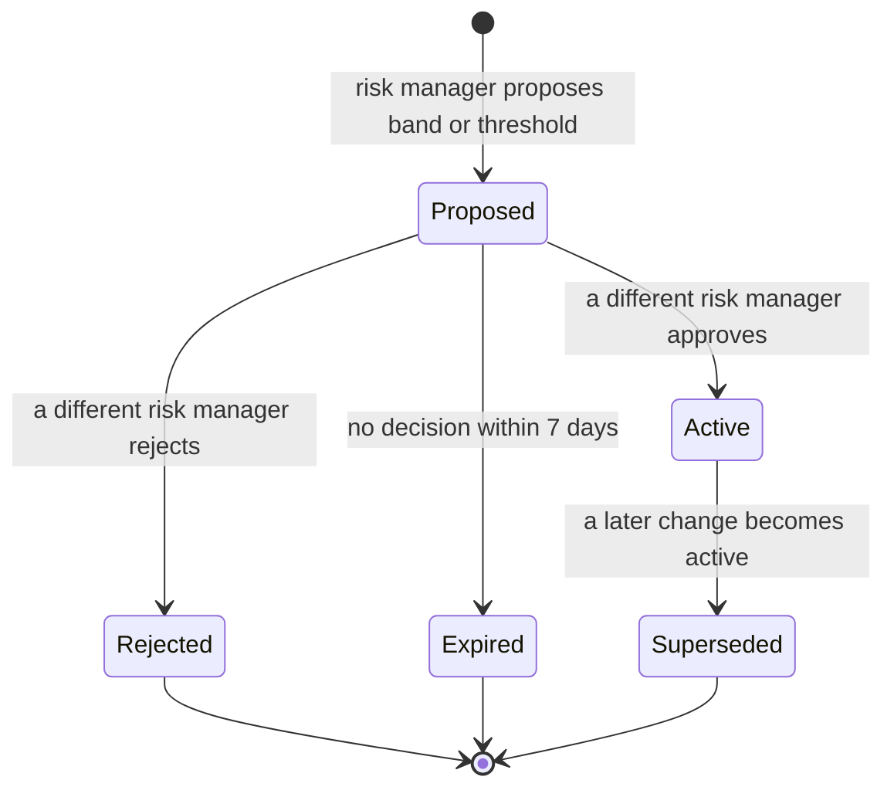

# Domain model (UML)

The vocabulary and the core objects of the credit decisioning domain. Use these names in code, events and docs. "As built" is what the repository does today; "target" is the design the [handoff packages](../03-handoff/README.md) implement.

## 1. Vocabulary

| Term | Meaning | Where it lives |
|---|---|---|
| **Application** | One loan request. Internally keyed by `sk_id_curr` (the customer key that joins all data); outside the API only by its opaque `public_id` (ADR-0014) | PostgreSQL `loan_applications` |
| **Applicant identity** | Name, citizen ID and phone of one customer, encrypted per field; found by the keyed hash of the citizen ID; shown masked, revealed only with an audited reason | PostgreSQL `applicant_identity`, not replicated (ADR-0014) |
| **Document** | An uploaded ID card side or payslip, keyed by the uploader's HMAC tag; expires after 90 days | MinIO `loan-documents`; id in `loan_applications.document_id_N` |
| **Applicant data** | Fields the applicant types in (income, credit, dates, flags) | the application row |
| **Feature** | One model input with a name, type, source group and transform | **Feature catalog** (target); today scattered (F-07) |
| **Feature group** | Features produced together: `application`, `external` (bureau), `dwh` (history) | Kafka topic + Feast view per group |
| **Feature definition** | What one feature means, its type, producer, valid range and sentinel | `contracts/feature_catalog/definitions/*.yaml` (target, E2) |
| **Feature set** | An immutable, ordered list of definitions that one model uses, with a SHA-256 digest | `contracts/feature_catalog/sets/<version>.json` (`legacy-v1` built) |
| **Protected attribute** | A feature that must not be a model input (for example gender) | catalog tag `protected` (target) |
| **Readiness** | All three feature groups for an application are in the online store | Redis DB 1 (E3) |
| **Score** | Model output P(default) in [0, 1]. Higher means riskier | decision event |
| **Decision band** | `approve` (p < 0.25), `under_review` (0.25 ≤ p ≤ 0.35), `reject` (p > 0.35) | decision policy config (E5) |
| **Decision** | Band + score + reasons + model version and feature-set digest, for one application | `application_status_log` (E5) |
| **Decision reason** | Why the system routed an application: `score_band`, `features_incomplete`, `feature_data_unavailable`, `rule:<id>` | decision record |
| **Model reason code** | A feature-level cause of a high score, from SHAP attributions, mapped through the catalog (for example `EXT_SCORE_LOW`) | decision record `reason_codes` (E14) |
| **Explanation** | The ordered model reason codes plus their contributions for one decision | decision record (E14) |
| **Model version** | A registered MLflow version with its `feast_metadata.yaml`, git commit and data snapshot | MLflow |
| **Review queue** | Applications in `under_review` waiting for a human | query on `application_status_log` |
| **Channel** | How an application arrived: `staff` (entered by a loan officer) or `self` (applicant online) | `loan_applications.channel` (E1/E11) |
| **Branch** | The lender branch or point of sale a staff member and a staff-channel application belong to | Keycloak user attribute `branch_id`; `loan_applications.branch_id` |
| **Principal** | The verified caller of one request: subject, realm, roles, branch | built from the JWT by the API (E11) |
| **Realm** | Keycloak identity domain: `staff` or `customers`. A principal belongs to exactly one | Keycloak |
| **Role** | `applicant`, `loan_officer`, `underwriter`, `risk_manager`, `auditor`, `admin` | Keycloak realm roles |
| **Permission** | An action on a resource type, granted to roles under conditions (own, same branch, not own submission) | policy table in `application/authz/policy.py` (E11) |
| **Override** | A reviewer's decision on an `under_review` application, with a mandatory reason | decision record + audit event (E5, E13) |
| **Policy change** | A proposed new threshold or review band; active only after a second risk manager approves | `policy_change` table (E11) |
| **Audit event** | One immutable record of who did what to which resource, when, and the outcome | `audit_event` table, append-only, hash-chained (E13) |

## 2. Class diagram: as built

## 3. Class diagram: target

New elements are E2 (catalog), E3 (readiness), E5 (decision) and E6 (governance).

## 4. State machine: application lifecycle

The target lifecycle. Today only `Submitted` is persisted; everything after it happens only in Kafka and is never written back (F-04).

## 5. State machine: readiness of one application

Owned by the readiness coordinator (E3). Keys live in Redis DB 1.

## 6. Where each concept is stored

| Concept | PostgreSQL | Kafka | Redis | MLflow / MinIO |
|---|---|---|---|---|
| Application | `loan_applications` | `hc.applications.public.loan_applications` | | |
| Feature row | | `hc.application_features`, `hc.application_ext`, `hc.application_dwh` | DB 0 (Feast) | |
| Readiness | | `hc.feature_ready`, `hc.feature_timeout` (E3) | DB 1 `feature_coordination:*`, `dispatched:*` | |
| Decision | `application_status_log` (E5) | `hc.scoring` | | |
| Model version | | | | registry + artifacts (`feast_metadata.yaml`, `model_card.md`) |
| Feature catalog | | | | versioned in git; set version and digest stamped into model metadata |
| Identity, role, branch | Keycloak database (separate instance) | | | |
| Application ownership | `loan_applications.channel`, `created_by_sub`, `applicant_sub`, `branch_id` (E11) | CDC event carries them | | |
| Applicant identity | `applicant_identity` (encrypted, ADR-0014) | **never** (not in the CDC publication) | | |
| Documents | document ids on the application row | ids only | | `loan-documents` bucket, 90-day expiry |
| Estimator draft (amount, term) | | | portal Redis `draft:*`, 30 minutes | |
| Explanation | `application_status_log.metadata.reason_codes` (E14) | `hc.scoring` payload | | |
| Audit event | `audit_event` (append-only, E13) | | | searchable copy in Elasticsearch (ECK) |
| Policy change | `policy_change` (E11) | | | |

## 7. Class diagram: identity, access and audit (target)

`Policy.authorize` is the only place that grants access. Routes call it and audit the result; they never check roles themselves. Its rules are the [permission matrix in E11](../03-handoff/E11-identity-access.md#5-data-contracts).

## 8. State machine: manual review of one application

Every transition writes an audit event. Claiming fails with `separation_of_duties` when the underwriter's `sub` equals the application's `created_by_sub`.

## 9. State machine: decision policy change (four eyes)

