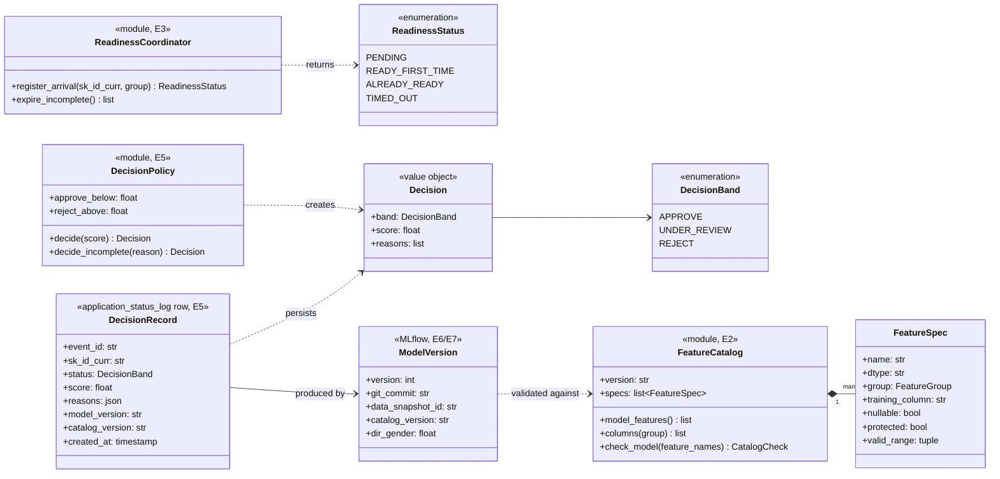
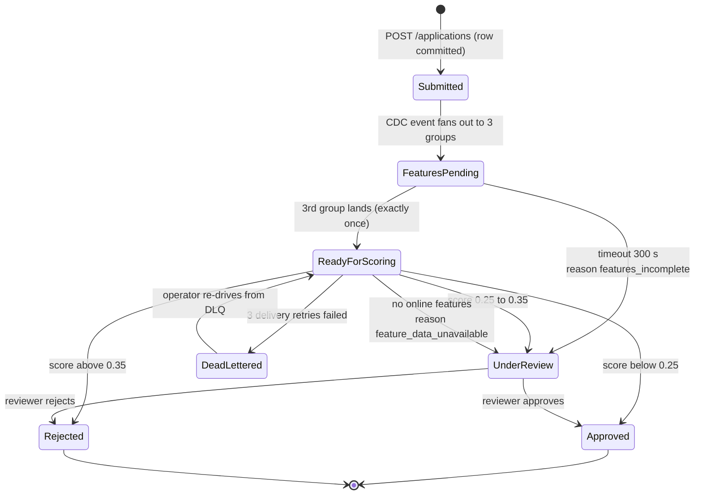
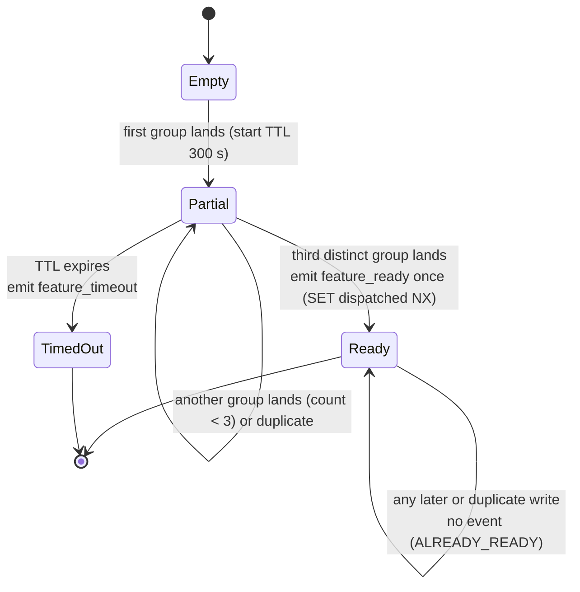

# Domain model (UML)

The vocabulary and the core objects of the credit decisioning domain. Use these names in code, events and docs. "As built" is what the repository does today; "target" is the design the [handoff packages](../03-handoff/README.md) implement.

## 1. Vocabulary

| Term | Meaning | Where it lives |
|---|---|---|
| **Application** | One loan request, identified by `sk_id_curr` | PostgreSQL `loan_applications` |
| **Applicant data** | Fields the applicant types in (income, credit, dates, flags) | the application row |
| **Feature** | One model input with a name, type, source group and transform | **Feature catalog** (target); today scattered (F-07) |
| **Feature group** | Features produced together: `application`, `external` (bureau), `dwh` (history) | Kafka topic + Feast view per group |
| **Feature catalog** | The single declaration of all features and their properties, versioned | `features.yaml` (target, E2) |
| **Protected attribute** | A feature that must not be a model input (for example gender) | catalog tag `protected` (target) |
| **Readiness** | All three feature groups for an application are in the online store | Redis DB 1 (E3) |
| **Score** | Model output P(default) in [0, 1]. Higher means riskier | decision event |
| **Decision band** | `approve` (p < 0.25), `under_review` (0.25 ≤ p ≤ 0.35), `reject` (p > 0.35) | decision policy config (E5) |
| **Decision** | Band + score + reasons + model and catalog versions, for one application | `application_status_log` (E5) |
| **Reason code** | Machine-readable cause: `score_band`, `features_incomplete`, `feature_data_unavailable`, `rule:<id>` | decision record |
| **Model version** | A registered MLflow version with its `feast_metadata.yaml`, git commit and data snapshot | MLflow |
| **Review queue** | Applications in `under_review` waiting for a human | query on `application_status_log` |

## 2. Class diagram: as built

## 3. Class diagram: target

New elements are E2 (catalog), E3 (readiness), E5 (decision) and E6 (governance).

## 4. State machine: application lifecycle

The target lifecycle. Today only `Submitted` is persisted; everything after it happens only in Kafka and is never written back (F-04).

## 5. State machine: readiness of one application

Owned by the readiness coordinator (E3). Keys live in Redis DB 1.

## 6. Where each concept is stored

| Concept | PostgreSQL | Kafka | Redis | MLflow / MinIO |
|---|---|---|---|---|
| Application | `loan_applications` | `hc.applications.public.loan_applications` | | |
| Feature row | | `hc.application_features`, `hc.application_ext`, `hc.application_dwh` | DB 0 (Feast) | |
| Readiness | | `hc.feature_ready`, `hc.feature_timeout` (E3) | DB 1 `feature_coordination:*`, `dispatched:*` | |
| Decision | `application_status_log` (E5) | `hc.scoring` | | |
| Model version | | | | registry + artifacts (`feast_metadata.yaml`, `model_card.md`) |
| Feature catalog | | | | versioned in git; version stamped into model metadata |
