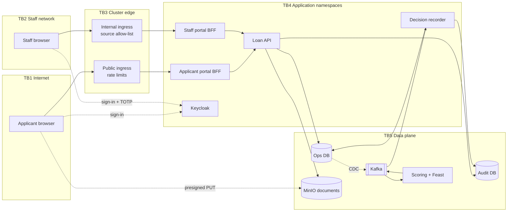

# Threat model

STRIDE per trust boundary for the target design (E11–E15). Reviewed at every release ([checklist 3.1](../release/checklist.md#3-security)). Status: **Designed** = the mitigation is in a handoff package; **Built** = implemented and tested; **Accepted** = a written risk acceptance.

## 1. Data flow and trust boundaries

## 2. Threats and mitigations

| ID | Boundary | STRIDE | Threat | Mitigation | Epic | Status |
|---|---|---|---|---|---|---|
| T01 | TB1→TB3 | Spoofing | Credential stuffing against applicant accounts | Keycloak brute-force detection; rate limits on the public ingress; verified email | E11, E12 | Designed |
| T02 | TB2→TB3 | Spoofing | Stolen staff password | TOTP required in the `staff` realm; API rejects staff tokens without `acr=mfa` | E11 | Designed |
| T03 | TB1→TB4 | Elevation | Applicant reads another applicant's file by changing the id (IDOR) | Ownership check in the policy; denial audited; Playwright and API tests | E11, E12 | Designed |
| T04 | TB2→TB4 | Elevation | Loan officer reads files from another branch | `branch_id` from the token, never from the request; policy condition `same_branch` | E11 | Designed |
| T05 | TB4 | Tampering | Underwriter approves their own submission | Separation-of-duties rule; audit event | E11, E13 | Designed |
| T06 | TB4 | Tampering | One risk manager loosens the bands | Four-eyes state machine; DB check `approved_by <> proposed_by` | E11 | Designed |
| T07 | TB1 | Information disclosure | Token theft through XSS | BFF: tokens never reach the browser; httpOnly `__Host-` cookie; strict CSP with nonces | E12 | Designed |
| T08 | TB1 | Tampering | Cross-site request forgery on portal mutations | CSRF token bound to the session plus an `Origin` check; `SameSite=Lax` | E12 | Designed |
| T09 | TB4 | Spoofing | Forged JWT (`alg=none`, foreign issuer, wrong audience) | Issuer allow-list, audience check, RS256 only, JWKS from the issuer | E11 | Designed |
| T10 | TB4→TB5 | Repudiation | Staff deny having overridden a decision | Append-only, hash-chained audit with actor and mandatory reason | E13 | Designed |
| T11 | TB5 | Tampering | Someone edits audit rows | INSERT-only role; daily chain verification; owner role break-glass only; chain head to WORM storage (follow-up) | E13 | Designed; WORM accepted as follow-up |
| T12 | TB1→TB5 | Tampering | Malicious upload (executable, oversized file) | Presigned URL limited to type, extension and size; content type enforced; no server-side processing of documents | E1 | Partly built (type and extension) |
| T13 | TB5 | Information disclosure | PII in logs or model artifacts | Logs: structured fields without PII, sampled check at release; MLflow `input_example` synthetic | E9, E13 | Designed |
| T14 | TB4/TB5 | Information disclosure | Lateral movement between namespaces | NetworkPolicies, default deny; services reach only their dependencies | E9 | Designed |
| T15 | TB5 | Information disclosure | Kafka traffic in plaintext inside the cluster | Accepted for the portfolio cluster; TLS and SASL listed as a follow-up | E9 | Accepted |
| T16 | TB5 | Denial of service | Scoring outage leads to automatic approvals | Fallback is `manual_review` only, enforced by type and a property test | E15 | Designed |
| T17 | TB1→TB3 | Denial of service | Application flood from the internet | Ingress rate limits per IP; Keycloak registration throttling; review-queue alert | E12, E15 | Designed |
| T18 | Supply chain | Tampering | Compromised dependency or base image | Pinned versions and digests; `pip-audit`, `npm audit`, trivy; gitleaks | E9, E16 | Designed |
| T19 | Model | Tampering | Unreviewed model promoted to Production | Registration gate; promotion audited; feature set pinned by digest | E6, E7, E13 | Designed |
| T20 | Model | Information disclosure | Model or reasons reveal protected attributes | Protected features excluded from sets; proxies excluded from reasons; fairness audit | E6, E14 | Designed |
| T21 | TB2→TB4 | Information disclosure | Staff browse customers they do not serve (curiosity, relatives) | Profile only for the application being handled; lookup by exact ID with a purpose; monthly review of lookups | E11, ADR-0013 | Designed |
| T22 | TB2→TB4 | Tampering | Officer coaches applicants to game inputs using model contributions | Officers see plain-language reasons only; contributions limited to underwriters; inputs verified by documents | E14, ADR-0013 | Designed |
| T23 | TB4 | Elevation | Officer with a sales target decides borderline cases | Maker–checker: officers cannot decide; underwriters cannot review their own submissions | E11, ADR-0013 | Designed |

## 3. Assumptions

- Single-node Minikube; a node compromise is out of scope.
- The `staff` realm stands in for a corporate directory, and the internal ingress allow-list stands in for a VPN or zero-trust proxy.
- Credentials once committed to git history were rotated; history was not rewritten (decision recorded in E9).
