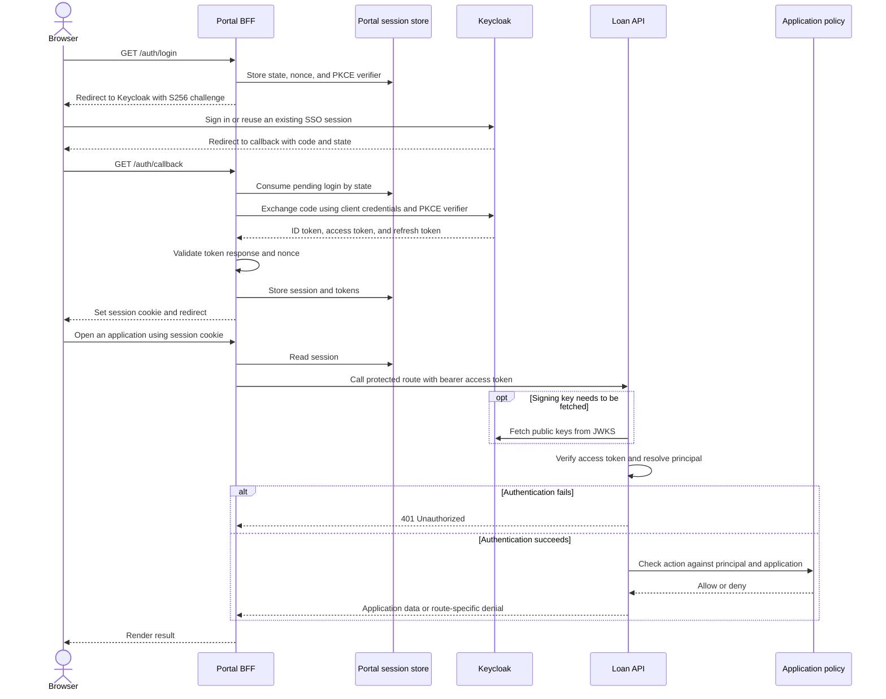

# Identity (E11)

Keycloak with two realms ([ADR-0012](../../../../docs/adr/0012-keycloak-realms-and-bff-portals.md)):

| Realm | Who | Sign-in rules | Roles |
|---|---|---|---|
| `staff` | Lender employees | No self-registration, TOTP enrolled at first sign-in, password policy, brute-force protection | `loan_officer`, `underwriter`, `risk_manager`, `auditor`, `admin`; user attribute `branch_id` |
| `customers` | Applicants | Self-registration with a verified email | `applicant` |

Both realms put audience `credit-api` into access tokens (5 minutes). The API trusts exactly these issuers (`APP_OIDC_ISSUERS`).

## Portal authentication and API authorization

Both portals use OIDC Authorization Code Flow with PKCE. The portal acts as a backend for frontend (BFF) and exchanges the code as a confidential client. It stores tokens in Redis and gives the browser an httpOnly session cookie.



- **Login checks.** `state` links the callback to its pending login. `nonce` binds the ID token to that login. PKCE binds the code exchange to the portal's original verifier. [OIDC flow implementation](../../../../portals/packages/auth/src/oidc.ts)
- **Authentication.** The API checks RS256 signatures, the trusted issuer, the `credit-api` audience, expiration and application roles. Staff tokens must satisfy the configured `acr` requirement when it is enabled. [Token verifier](../../../../application/entrypoints/api/security.py)
- **Authorization.** The API evaluates the requested action against the principal and the resource. A valid role can still be denied for a different applicant or branch. Some routes return 404 to avoid disclosing resource existence. [Application policy](../../../../application/authz/policy.py)
- **Session lifecycle.** The portal refreshes the access token server-side when it approaches expiry and destroys the session if refresh fails. Logout clears the portal session and redirects to Keycloak's end-session endpoint. [Session implementation](../../../../portals/packages/auth/src/session.ts) · [Auth routes](../../../../portals/packages/auth/src/routes.ts)

## Deploy

```bash
make k8s-cnpg-operator      # once per cluster
make k8s-identity           # needs the Identity variables from .env.example
```

Realm files contain no secrets: client secrets are `${...}` placeholders filled from the `keycloak-clients` Secret at import.

## Login theme

The `crs-lending` theme extends Keycloak's `keycloak.v2` login theme. It uses the portal palette and self-hosted Be Vietnam Pro. Keycloak supplies the forms and their authentication behavior.

`make k8s-identity` publishes the theme files as the `keycloak-login-theme` ConfigMap. Both realm definitions select the theme on first import. For an existing realm, set **Realm settings → Themes → Login theme → crs-lending** after deploying the theme. Restart the Keycloak StatefulSet after updating theme assets on a running cluster so every replica loads the new files.

## To verify on the first deployment (not yet run on a cluster)

- Placeholder substitution in the realm import (`${STAFF_PORTAL_CLIENT_SECRET}`, `${SMTP_HOST}`). Set `SMTP_HOST` and `SMTP_PORT` on the StatefulSet, or point them at a local mail catcher for UAT.
- The `mfa` ACR: the staff realm maps `mfa` to level of authentication 2, and the staff client requests it by default. Confirm that staff access tokens carry `"acr": "mfa"` after a TOTP sign-in; the API rejects staff tokens without it (`APP_OIDC_STAFF_REQUIRED_ACR`). If the browser flow does not raise the level, add a "Condition - Level of Authentication" step for level 2 with the OTP form.
- `defaultRoles` in `customers.json`: on Keycloak 26 the default role is the composite `default-roles-customers`. Confirm that new users get `applicant`.
- Test users per role for UAT are created by `scripts/uat/create_test_users.sh` (E16), with generated passwords stored in a Secret.
